# AstroFlow

**Lokale Astro-Plattform im Browser:** Rohbilder werden zu fertigen Astrofotos, Bildfolgen werden auf bewegte Objekte untersucht,
fotografierte Himmelsobjekte bekommen einen Enzyklopädie-Eintrag. Läuft auf deinem Rechner oder NAS, ohne Konto.


*Die Astrofotos und die meisten Oberflächen-Screenshots stammen aus einer echten Instanz (Smart-Teleskop, 80 mm Öffnung) und sind ohne Orts- und Gerätekennung veröffentlicht. Nur „Heute Nacht“, „Himmelsqualität“ und die SkyTrace-Bilder zeigen eine Demo-Instanz mit synthetischen Daten (`python -m astroflow demo`, Test-Fixtures), weil sie Standortangaben enthalten.*

## Was ist AstroFlow?

Eine lokale Anwendung (Python/FastAPI, Oberfläche als Web-App ohne Build-Schritt) für Smart-Teleskope (Seestar, Vespera, Stellina) und
klassische Astrokameras. Sie besteht aus drei Modulen mit gemeinsamer Oberfläche:

| Modul | Was es tut |
|---|---|
| **Bilder** | FITS-Aufnahmen automatisch sortieren, kalibrieren, stacken und entwickeln; neue Nächte werden nachgestackt. Dazu Bild-Tutor, Tiefe und Vergleich, Himmelsqualität, „Heute Nacht“-Empfehlungen, Kometenmodus |
| **SkyTrace** | Bildfolgen sternregistriert auf Lichtspuren und bewegte Objekte untersuchen; Abgleich mit Satelliten-, Meteor-, Asteroiden- und Flugkatalogen zur Aufnahmezeit, 3D-Ansicht, Erfolge |
| **Sage** | Lebende Astronomie-Enzyklopädie: Objekte im Bild bestimmen, aus Fachkatalogen recherchieren (mit Quellen), Zusammenhänge zwischen deinen Aufnahmen finden, Geschichten erzählen und vorlesen lassen, Sammlung mit Erfolgen |

Die Module sind unter Einstellungen → Module & System einzeln abschaltbar. Alles läuft lokal; was optional ins Netz geht, steht unter [Datenschutz](#datenschutz-und-lokaler-betrieb).

## Highlights

### Ergebnisse

Fertige Bilder aus AstroFlow, vollautomatisch aus Rohaufnahmen eines Smart-Teleskops entwickelt (verkleinert):

| | | |
|---|---|---|
|  |  |  |
| NGC 7000, 58 min | NGC 6888, 45 min | M45 Plejaden, 91 min |
|  | 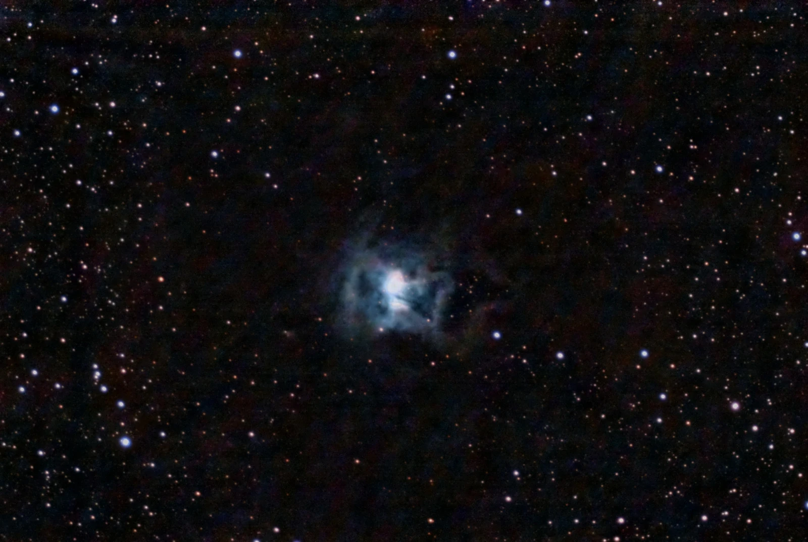 | 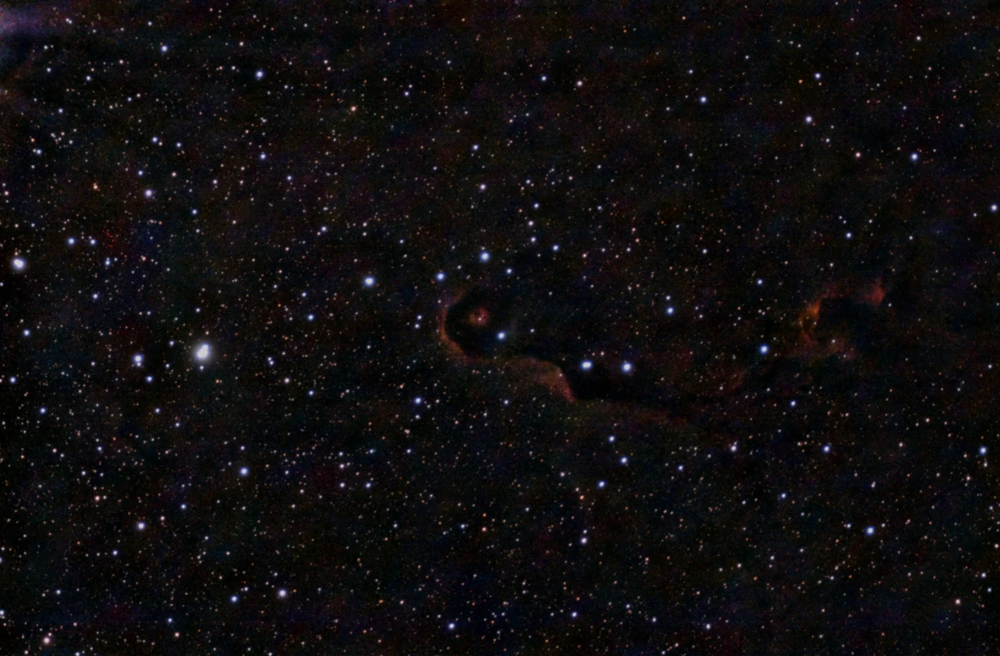 |
| M101, 115 min | NGC 7023, 3 h 58 min | IC 1396, 60 min |

### Vom Rohbild zum fertigen Foto

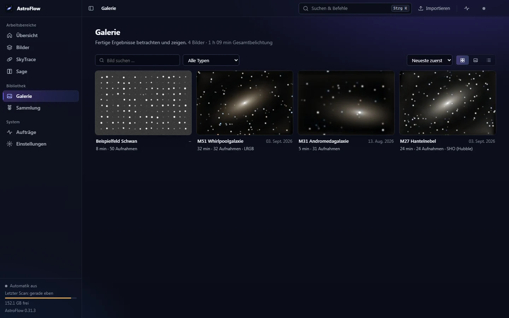

Jedes Objekt erscheint automatisch, sobald seine Rohbilder im Eingangsordner liegen – Objekt, Kamera und Nacht erkennt AstroFlow aus
Header, Ordnername oder Plate-Solving. Neue Nächte werden nachgestackt, jede Verarbeitung bleibt als Version erhalten.

| | |
|---|---|
| 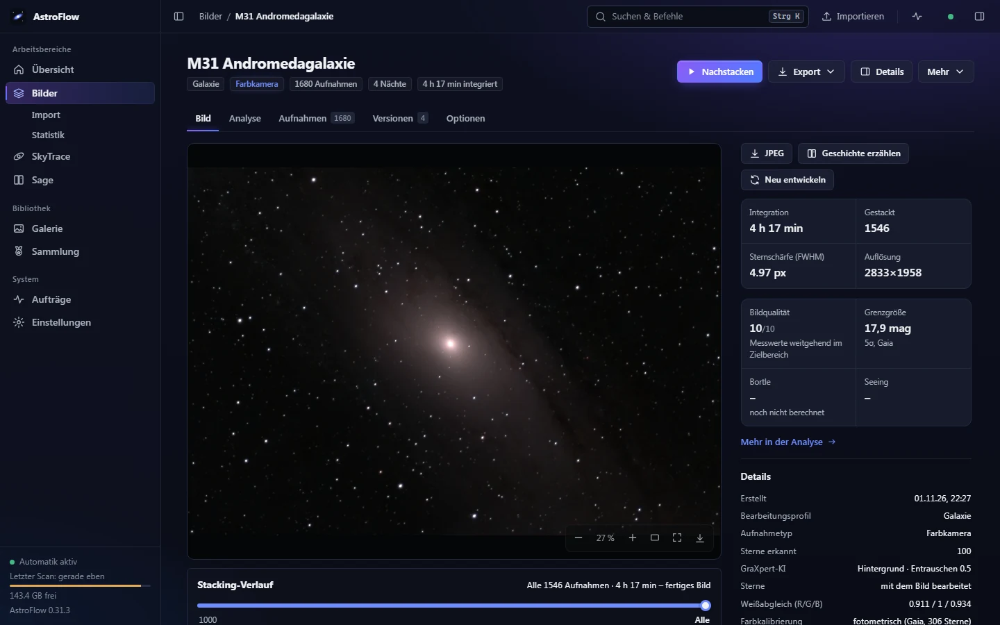 | 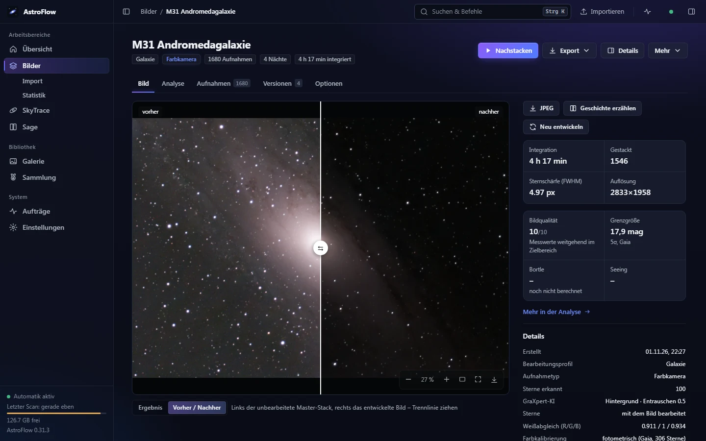 |
| **Objektseite (M31, 4 h 17 min):** Zoom-Betrachter, Kennzahlen, Details. Beim Stacken und Entwickeln zeigt die **Live-Ansicht** echte Zwischenvorschauen mit dem aktiven Schritt; der **Stacking-Verlauf** unter dem Bild zeigt, was 1, 3, 10, 30, 100 … Aufnahmen ausmachen. | **Vorher/Nachher:** links der unbearbeitete lineare Master-Stack, rechts das entwickelte Bild (Gradienten, Farbkalibrierung, optional GraXpert und StarNet). |

### Was dein Bild zeigt

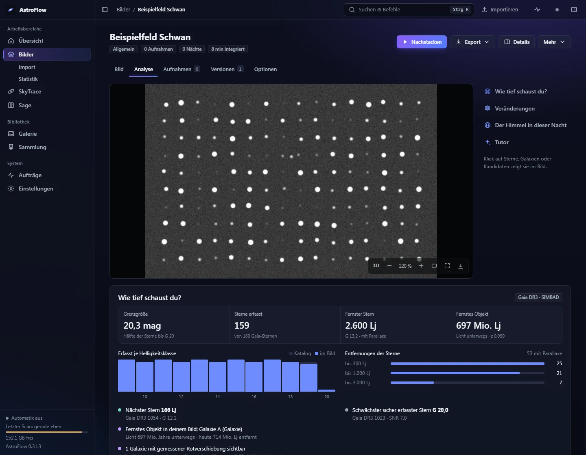

Der Reiter **Analyse** misst aus dem plate-gelösten Bild die Grenzgröße, die erfassten Sterne je Helligkeit, den nächsten und fernsten Stern
(Gaia-Parallaxen) und die fernsten sichtbaren Galaxien und Quasare (SIMBAD-Rotverschiebung, Lichtlaufzeit) – als Kennzahlen, Markierungen im
Bild und als **3D-Ansicht** direkt im Betrachter. Der **Vergleich** blinkt das Bild gegen eine frühere eigene Aufnahme oder die
DSS2-Durchmusterung; auffällige Stellen werden mit SIMBAD und JPL-Kleinkörpern abgeglichen – als Hinweis, nicht als Entdeckung.
Bei **Sternhaufen** zeigt der Reiter zusätzlich das **HR-Diagramm** (Farben-Helligkeits-Diagramm): Farbe und Helligkeit jedes Haufensterns
aus deinem Bild, an Gaia geeicht, Mitglieder über Gaias Parallaxen und Eigenbewegungen, dazu Hauptreihe, Abknickpunkt, Entfernung und eine
vorsichtige Altersschätzung.
**Asteroiden:** welche bekannten Kleinplaneten laut JPL im Feld lagen und welche du wirklich fotografiert hast – nachgewiesen
entlang der Bahn in den Einzelbildern, mit gemessener Helligkeit und Bahnstrich im Bild („Du hast 9 Asteroiden fotografiert, der
schwächste mit 16,2 mag“). An JPL gehen nur Himmelskoordinaten und Zeit, nie der Standort.
Dazu kommen die **Himmelsqualität der Aufnahmenacht** und der **Bild-Tutor** (Befunde mit Tipps passend zum Gerät, Bedingungen der Nacht).

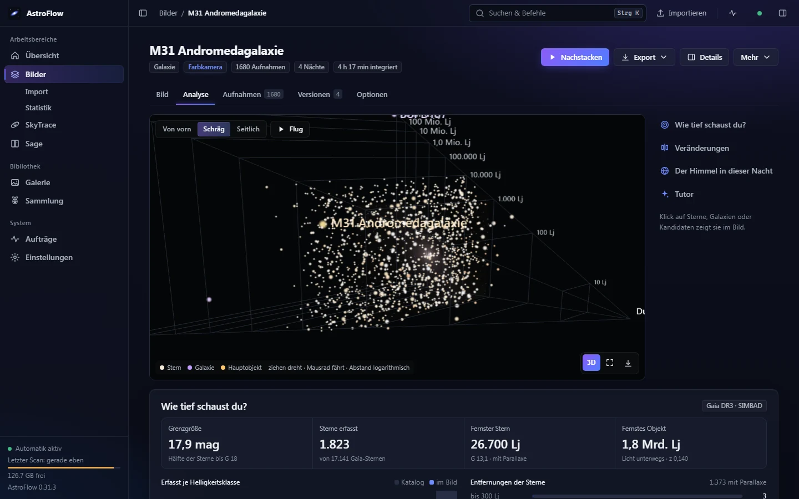

Die 3D-Ansicht (Knopf „3D“ im Betrachter) legt die Sterne und Galaxien des Bildes nach ihrer Entfernung in einen Tunnel – hier M31 mit Sternen aus Gaia.

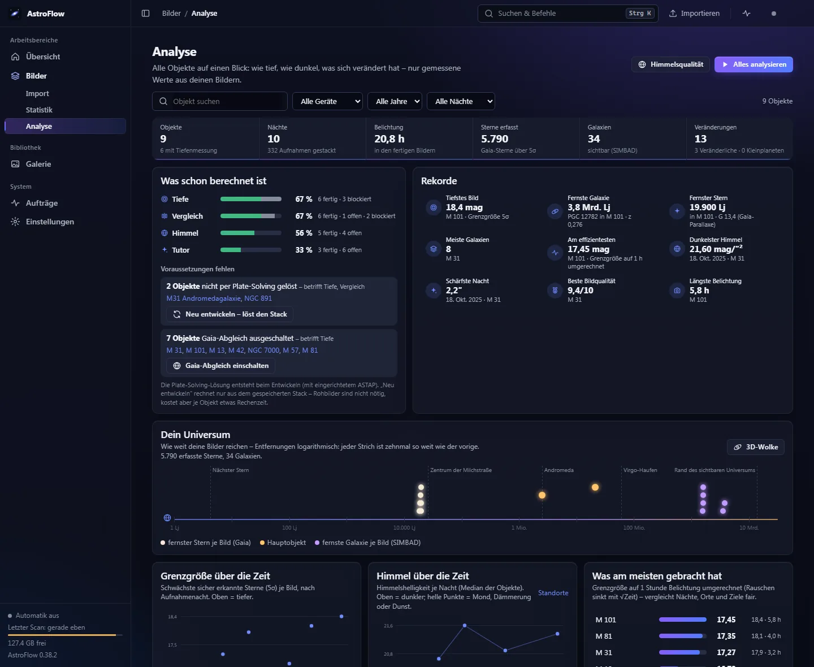

**Bilder → Analyse** (`#/analyse`) zeigt dasselbe über die ganze Bibliothek: Kennzahlen (Nächte, Belichtung, tiefste Grenzgröße, fernstes
Objekt, dunkelster Himmel), Rekorde, „Dein Universum“ als Entfernungsskala bzw. 3D-Wolke aller gemessenen Sterne und Galaxien, Grenzgröße
und Himmel über die Zeit, beste Nächte, Bildqualität, häufigste Tutor-Befunde, Veränderungen, Messier-/Caldwell-Fortschritt und eine
Rangliste „Was am meisten gebracht hat“ (Grenzgröße auf 1 h umgerechnet). Filter nach Objekt, Gerät, Jahr und Nacht. **Alles analysieren**
rechnet fehlende oder veraltete Auswertungen (Tiefe, Vergleich, HR-Diagramm, Asteroiden, Himmel, Tutor) im Hintergrund nach – nacheinander, damit Online-Dienste
geschont werden; anhalten und abbrechen jederzeit. Fehlende Voraussetzungen (nicht gelöst, Gaia aus) stehen mit Knopf zum Beheben dabei.
Jede Zahl führt ins Objekt, Rekorde und Veränderungen direkt zur Stelle im Bild. *(Bild: Demo-Instanz mit synthetischen Werten.)*

### Kometenmodus

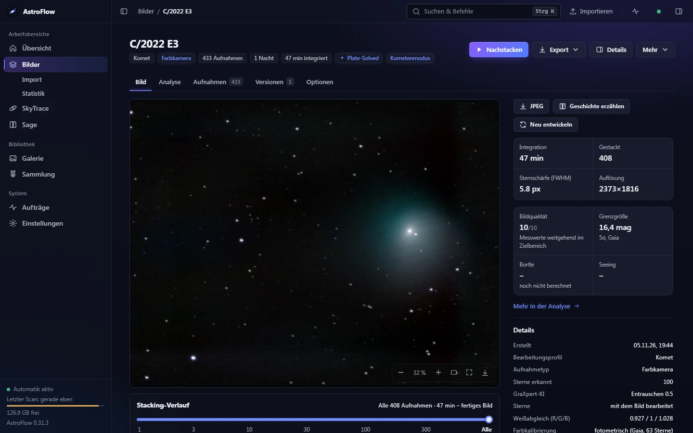

Kometen bekommen zwei Stacks – auf die Sterne und auf den Kometenkern – und werden zu einem Bild zusammengesetzt (hier C/2022 E3, 47 min, Bahn aus der JPL-Ephemeride, im Bild nachgemessen).

### Heute Nacht und Himmelsqualität

*(Demo-Daten mit erfundenem Ort.)*

| | |
|---|---|
| 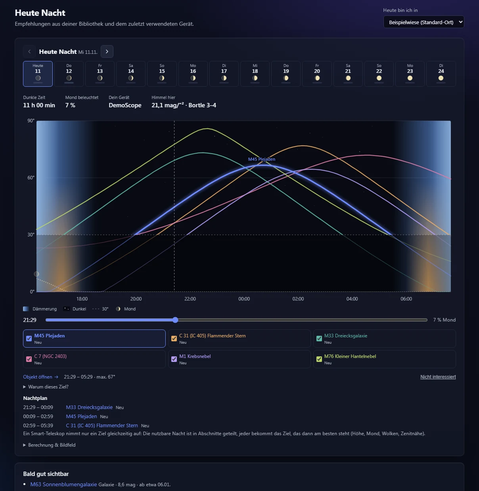 | 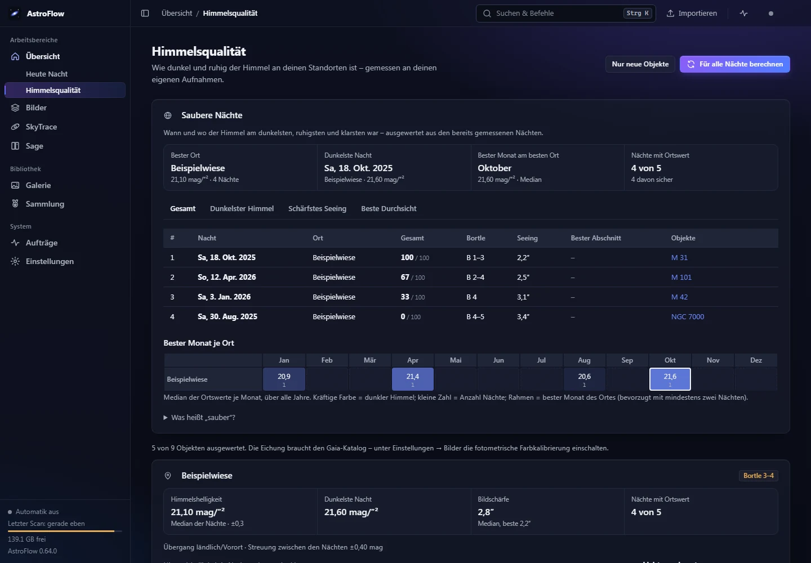 |
| **Heute Nacht:** bis zu sechs heute gut sichtbare Ziele – neue Objekte aus Messier und Caldwell (und weiteren Katalogobjekten, wenn ASTAPs `deep_sky.csv` vorhanden ist) sowie eigene Aufnahmen, denen mehr Belichtung nützt. Höhenverläufe, Dämmerung, Mond, Nachtplan, optional Wettervorhersage. | **Himmelsqualität:** aus deinen eigenen Aufnahmen gemessen (an Gaia-Sternen geeicht): mag/″², Bortle-Schätzung mit Spanne, Bildschärfe (Seeing) und die Richtung der Lichtverschmutzung als Windrose, je Standort. |

### Standorte nach Datum

Das Teleskop steht nicht immer am selben Ort: Unter Einstellungen → Standorte legst du Orte mit Zeiträumen an („vom … bis …“, einzelne Nächte,
Standard-Ort). Der Ort einer Aufnahme ergibt sich aus FITS-Kopf → Zeitraum → Standard; „Heute bin ich in …“ wechselt ihn für die aktuelle Nacht.
Er fließt in Tutor, Heute Nacht, Himmelsqualität und SkyTrace ein. Ein Ort ohne Zeitraum, der nicht Standard ist, wird nie verwendet – die Liste markiert ihn („Zeitraum zuweisen“), und nach dem Anlegen fragt die Seite gleich nach von/bis. SkyTrace zeigt im Analyse-Menü, welcher Ort für die Nacht des Laufs gilt.

### SkyTrace – was sich zwischen den Sternen bewegt

*(Demo-Daten mit erfundenem Ort und erfundener Bahn.)*

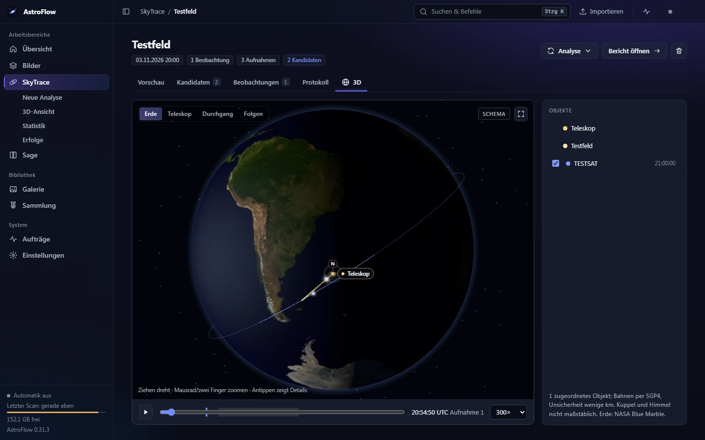

Spuren in Bildfolgen werden als **Kandidaten** mit Ausschnitt, Zeitreihe und Messdetails erfasst und mit Satelliten (gespeicherte historische
Bahndaten), Meteoren und Flugzeugen zur echten Aufnahmezeit abgeglichen. Die **3D-Ansicht** zeigt die Erde zur Aufnahmezeit mit Standort,
Teleskop-Blickfeld und den zugeordneten Bahnen. Ein Kandidat ist ein Hinweis, kein bestätigtes Objekt.

| | |
|---|---|
|  | Weitere Funktionen: **Standort der Nacht prüfen** / **Standorte für alle Nächte suchen** (Rückrechnung aus Satellitenspuren), **Uhrversatz suchen** (Kamera-Uhr bis ± 20 min), **Satelliten neu abgleichen** nach Orts-Änderungen, **Erneut analysieren** aus den bisherigen Aufnahmen, **Erfolge** mit Meilensteinen, Statistik. Vorgeschlagene Orte und Uhrkorrekturen werden nie automatisch übernommen. |

### Sage – die lebende Enzyklopädie

| | |
|---|---|
|  |  |
| **Enzyklopädie:** jedes fotografierte Objekt bekommt einen Eintrag mit deinem Bild, Katalogdaten und Beobachtungen. Recherche aus Fachkatalogen (SIMBAD) und arXiv; jede Aussage hat eine Quelle oder ist als KI-Vorschlag gekennzeichnet. | **Sammlung & Erfolge:** Messier-Fortschritt, Meilensteine und animierte Erfolge für jedes neu bestimmte Objekt. |

Dazu: **Bild bestimmen** (Objekte im Bildfeld markieren), **Geschichte erzählen** und auf Wunsch vorlesen, **Meine Entdeckungen** und **Wissensnetz**.
Im Hintergrund sucht Sage nach neuen Arbeiten und weiteren Objekten in deinen Bildfeldern. Gestackte Aufnahmen landen auf Wunsch automatisch in
Sage und SkyTrace.

### Auch am Handy


Die Oberfläche ist als Web-App für Desktop und Smartphone gebaut. Im Heimnetz erreichst du sie vom Handy (siehe [Heimnetz](#heimnetz)).

## Installation und Start

### Windows: Installer (empfohlen)

1. Unter [Releases](https://github.com/JackONeill199/astroflow/releases) `AstroFlow-Setup-<Version>.exe` herunterladen und starten.
   Python ist enthalten, Administratorrechte sind nicht nötig. Ohne Codesignatur warnt Windows SmartScreen beim ersten Mal
   („Weitere Informationen → Trotzdem ausführen“).
2. Startmenü → **AstroFlow**. Der Server läuft im Hintergrund, der Browser öffnet sich mit dem **Einrichtungsassistenten**:
   Datenordner (Standard `%USERPROFILE%\AstroFlow` – bewusst nicht unter „Dokumente“, das oft per OneDrive synchronisiert wird),
   Teleskop, Standort, ASTAP + Sterndatenbank auf Knopfdruck und eine **Demo**, die in rund einer halben Minute ein erstes Bild liefert.
3. Beenden: Startmenü → **AstroFlow beenden** oder Einstellungen → Module & System. Deinstallieren über Windows → Apps; die Daten bleiben.

Ohne Installation: das **portable ZIP** (`AstroFlow-<Version>-Windows-portabel.zip`) entpacken und `AstroFlow.cmd` doppelklicken –
Daten und Einstellungen liegen dann im Unterordner `Daten`.

Neue Versionen meldet AstroFlow selbst (einmal am Tag eine anonyme Anfrage an GitHub, abschaltbar); Update = neuen Installer drüber installieren.

### macOS, Linux und aus dem Quelltext

Mit [uv](https://docs.astral.sh/uv/) (bringt bei Bedarf auch Python 3.12 mit):

```bash
uv tool install git+https://github.com/JackONeill199/astroflow
astroflow            # startet im Hintergrund und öffnet den Browser (Port 8766, Daten in ~/AstroFlow)
astroflow stop
```

Oder klassisch im Checkout:

```bash
python -m venv .venv && . .venv/bin/activate      # Windows: .venv\Scripts\activate
pip install -r requirements.txt
python -m astroflow demo            # synthetische Testdaten nach ./data/input/demo
python -m astroflow serve           # Web-UI auf :8080, Daten in ./data
python -m astroflow process         # oder: alles direkt per CLI verarbeiten
```

Unter Windows startet `Start.bat` einen solchen Checkout im Hintergrund (Port 8766, Daten in `data/`, Protokoll `data/server.log.err`),
`Stop.bat` beendet ihn. Ordner: `data/input` (Rohdaten, rekursiv gescannt; `ASTROFLOW_INPUT` ändert das), `data/output` (Ergebnisse),
`data/work` (Zwischenstände). Dark-/Flat-/Bias-Frames werden am Header (`IMAGETYP`) oder an Ordner-/Dateinamen (`darks/`, `Flat_…`) erkannt.

Windows-Paket selbst bauen: `python installer/build_windows.py` (portables ZIP; mit Inno Setup 6 zusätzlich den Installer).
`installer/pruefe_paket.py` prüft das ZIP in einer sauberen Umgebung und misst die Zeit bis zum ersten Bild; neben den Paketen liegt
`AstroFlow-Test.wsb` für dieselbe Prüfung in der Windows-Sandbox.

### Docker

1. In `docker-compose.yml` den Pfad zu deinen FITS-Dateien eintragen.
2. `docker compose up -d --build`
3. Browser: <http://localhost:8080>

Das Image enthält ASTAP mit Sterndatenbank D05 (`--build-arg ASTAP_DB=d50` für kleine Bildfelder < 0,6°) und optional die SkyTrace-Engine
(`--build-arg SKYTRACE=1`). GraXpert und StarNet sind nicht im Image.

### Heimnetz

Installierte Version: im Einrichtungsassistenten „Heimnetz“ einschalten (AstroFlow lauscht sonst nur auf diesem PC) und „Windows-Firewall
freigeben“ wählen. Checkout mit `Start.bat`: Der Server lauscht auf allen Netzwerkkarten; `Start.bat` zeigt die Adresse für andere Geräte an. Einmalig `Netzwerk-freigeben.bat` ausführen
(fragt nach Administratorrechten): legt die Firewall-Regel „AstroFlow LAN“ an – nur privates Netzwerkprofil, nur Geräte im eigenen Subnetz, keine
Freigabe ins Internet. **Es gibt kein Passwort; jedes Gerät im Heimnetz kann AstroFlow bedienen.** Rückgängig: `Netzwerk-freigeben.bat entfernen`.

## Optionale Werkzeuge

AstroFlow läuft ohne diese Programme; sie verbessern oder erweitern einzelne Funktionen.

| Werkzeug | Wofür | Einrichtung |
|---|---|---|
| [ASTAP](https://www.hnsky.org/astap.htm) (ab 2023) + Sterndatenbank D05/D20/D50 | Plate-Solving ohne Koordinaten im Header, Objektnamen gelöster Felder (`deep_sky.csv`), Gaia-Farbkalibrierung, Tiefenanalyse | Wird im ASTAP-Programmordner bzw. unter Windows in `%LOCALAPPDATA%\astap` automatisch gesucht; sonst Einstellungen → Bilder → Plate-Solving. Alternativen: lokales astrometry.net, nova.astrometry.net (nur auf ausdrückliche Wahl) |
| [GraXpert](https://github.com/Steffenhir/GraXpert/releases/latest) | KI-Hintergrundextraktion und KI-Entrauschen des linearen Stacks | Installieren; Suche in Programmordnern/PATH, Pfad und Modus unter Einstellungen → Bilder → „GraXpert (KI)“. Ohne GraXpert: Polynom + Wavelets |
| StarNet2 | Sterntrennung bei Nebeln (Nebel ohne Sterne strecken, Sterne kleiner zurück) | Einstellungen → Bilder → StarNet: ZIP installieren oder Pfad setzen. Ohne StarNet keine Sterntrennung bei Nebeln. (Kein automatischer Download, siehe Lizenz von StarNet) |
| `pyopencl` (GPU) | Ausrichten und Sigma-Clipping auf der Grafikkarte (OpenCL), Stacking etwa 3× schneller (gemessen: 219 Stellina-Frames 67 → 22 s) | `pip install pyopencl`; Einstellungen → Bilder → System. Ohne GPU rechnet der Prozessor |
| SkyTrace-Engine (OpenCV, PyTorch/YOLO, PyAV, Skyfield …) | Spurenanalyse in SkyTrace | `pip install -r astroflow/modules/skytrace/requirements.txt` oder unter Einstellungen → SkyTrace den Python-Interpreter einer bestehenden SkyTrace-Installation wählen. Ohne Engine startet AstroFlow trotzdem; vorhandene Ergebnisse bleiben ansehbar |
| Vision-LLM (LM Studio, OpenRouter) | optionaler KI-Bildprüfer und KI-Ergänzung im Tutor | siehe [KI-Bildprüfer](#ki-bildprüfer-optional) |
| KI/Sprache für Sage (OpenAI, OpenRouter, LM Studio, Qwen3-TTS, ElevenLabs) | Geschichten schreiben und vorlesen | Einstellungen → Sage |

## Bedienung in Kürze

1. **Importieren:** Dateien oder ganze Ordner irgendwo auf die Seite ziehen (oder „Importieren“). FITS werden als Rohaufnahmen verarbeitet, JPG/PNG/TIFF
   als fertige Bilder in die Galerie übernommen. Alternativ legst du FITS-Dateien in `data/input`.
2. **Hauptordner durchsuchen:** Import → „Hauptordner durchsuchen“ → Ordner wählen (Ordnerdialog mit Suche, auch in Unterordnern). AstroFlow findet auf einer
   ganzen Teleskop-Festplatte, was noch nicht (fertig) gestackt ist. Quelldateien bleiben unverändert am Ort und werden nicht kopiert (zum Stacken neuer
   Aufnahmen muss die Platte angeschlossen sein).
3. **Orte eintragen:** Einstellungen → Standorte (für Tutor, Heute Nacht, Himmelsqualität, SkyTrace).
4. **Warten:** Die Pipeline läuft automatisch; Aufträge aller Module stehen unter „Aufträge“, die Live-Ansicht im Bild-Tab zeigt den Fortschritt.
5. **Verfeinern:** Pro Objekt unter „Optionen“ Profil, Farbpalette, Bildauswahl, Auflösung, Schmalband, KI-Prüfung; „Mehr → Neu entwickeln“ rechnet nur die
   Entwicklung neu, einzelne Aufnahmen lassen sich ein-/ausschließen.

Befehlspalette **Strg+K** (Objekte und Aktionen aller Module), Tastenkürzel `/` Suche, `1–4` Reiter, `F` Vollbild, `B` Vorher/Nachher.

## Modul Bilder – was automatisch passiert

<details>
<summary>Pipeline im Detail (aufklappen)</summary>

| Schritt | Umsetzung |
|---|---|
| Erkennung & Gruppierung | Objekt aus Header (`OBJECT`, `RA/DEC`) oder Ordnername (Stellina `…_observation_M57`) → eingebauter Katalog (Messier, NGC/IC, …); Gruppierung nach Objekt + Kamera, Sessions nach Nacht; doppelte Dateien werden erkannt und nur einmal gestackt; fertige Integrationen anderer Software werden nicht erneut gestackt |
| Plate-Solving | Fehlen Objektname und Koordinaten, wird die Himmelsposition aus dem Sternmuster bestimmt (eine Aufnahme je Ordner/Nacht, Ergebnis gecacht); auf der Objektseite „Jetzt bestimmen“ |
| Mehrfilter (Mono) | Filter aus `FILTER`-Header (L, R, G, B, Hα, OIII, SII); je Filter eigene Auswahl und eigener Stack auf gemeinsamer Referenz; Kombination zu RGB, LRGB, RGB+Hα, HOO, SHO oder Mono |
| Kalibrierung | Master-Dark/Bias/Flat passend nach Größe/Gain/Belichtung/Filter/Nacht; automatische Hotpixel-Korrektur (auch ohne Darks) und eine Karte ortsfester Sensorfehler aus den eigenen Aufnahmen |
| Sensorglühen | Ohne Darks wird ortsfestes Randglühen aus den Aufnahmen gemessen und vor dem Ausrichten abgezogen (sonst Schlieren durch Feldrotation bei Alt-Az-Geräten) |
| Qualität & Auswahl | Sternzahl, FWHM, Exzentrizität, Hintergrund → Score; Wolken, Unschärfe, Nachführfehler werden verworfen |
| Registrierung & Stacking | Dreiecks-Matching (Verschiebung, Feldrotation, Meridian-Flip, mehrere Nächte); gewichtetes Sigma-Clipping; inkrementell, Stack-Zustand wird gespeichert, neue Aufnahmen werden nachgestackt |
| Farbe | Fotometrische Farbkalibrierung über Gaia-Sternfarben (nur Feldkoordinaten gehen an einen Gaia-Server; abschaltbar) |
| Entwicklung | Gradientenentfernung, Entfaltung, Stretch, Wavelet-Entrauschen, Sternreduktion, Kontrast, Sättigung – profilabhängig (Galaxie, Nebel, Planetarischer Nebel, Haufen …); automatische Qualitätskontrolle mit bis zu 3 Rendering-Runden |
| Kometenmodus | Kometen (z. B. `C/2022 E3`, `12P`) bekommen zwei Stacks (Sterne und Kometenkern); Bahn aus JPL-Horizons oder aus dem Bild gemessen; beide Einzelstacks bleiben ansehbar |
| Speicher | Hochgeladene Einzelbilder werden nach erfolgreichem Stacking gelöscht (abschaltbar, `ASTROFLOW_DELETE_UPLOADS=0`); Nachstacken neuer Nächte geht weiter, komplettes Neu-Stacken nicht mehr. Eingebundene Ordner werden nie angetastet |
| Ausgabe | TIFF 16-bit, PNG, JPEG, linearer FITS-Stack; Verlauf aller Versionen |

</details>

### KI-Bildprüfer (optional)

Ein Vision-Modell (LM Studio lokal oder OpenRouter) bekommt eine Vorschau des fertigen Bildes und die aktuellen Parameter und beurteilt Hintergrund,
Farbstich, Sterne, Rauschen und Artefakte. Bei Beanstandung schlägt es Parameterkorrekturen aus einer festen Whitelist in begrenzten Bereichen vor; AstroFlow
rendert neu und prüft erneut (bis `ASTROFLOW_REVIEW_ROUNDS`, Standard 3). Das Modell führt keinen Code aus. Standardmäßig aus.

```yaml
ASTROFLOW_REVIEW_PROVIDER: lmstudio            # lmstudio | openrouter | off (Standard)
ASTROFLOW_REVIEW_MODEL: qwen2.5-vl-7b-instruct # ein Modell mit Bildeingabe
ASTROFLOW_REVIEW_URL: http://host.docker.internal:1234/v1   # optional, Standard je Anbieter
ASTROFLOW_REVIEW_KEY: sk-or-...                # nur OpenRouter
```

Oder unter Einstellungen → Bilder → KI-Bildprüfer (gespeichert in `data/settings.json`, hat Vorrang vor Umgebungsvariablen; Schlüssel stehen dort im Klartext).
Denkmodelle brauchen mehr Zeit: `ASTROFLOW_REVIEW_MAX_TOKENS=8000`, `ASTROFLOW_REVIEW_TIMEOUT=300`.

### Plate-Solving konfigurieren

```yaml
ASTROFLOW_SOLVER: auto        # auto (lokale Solver) | astap | astrometry | nova | off
ASTROFLOW_ASTAP: /opt/astap/astap_cli      # optional, sonst automatische Suche
ASTROFLOW_ASTAP_DB: /opt/astap             # optional, Ordner der Sterndatenbank
ASTROFLOW_NOVA_KEY: ...                    # nur für nova.astrometry.net
ASTROFLOW_SOLVE_TIMEOUT: 180
```

Bildmaßstab-Hinweise aus dem Header (`FOCALLEN`/`XPIXSZ`, Stellina `FOCAL`/`PIXSZ`) beschleunigen das Lösen; ohne Hinweise wird blind gelöst.

### Weitere Einstellungen

`ASTROFLOW_AUTO=0` (nicht automatisch verarbeiten), `ASTROFLOW_SCAN_INTERVAL`, `ASTROFLOW_THREADS` (Standard: Kerne − 1, max. 12),
`ASTROFLOW_BATCH_MB` (RAM pro Stacking-Stapel, Standard 1/8 des Arbeitsspeichers, 700–4000 MB – auf kleinen NAS ggf. senken).

## SkyTrace und Sage im Detail

<details>
<summary>SkyTrace</summary>

Bildfolgen (z. B. ein Stellina-Beobachtungsordner) werden chronologisch zu einem Ereignisvideo; die Teleskopbewegung wird über das Sternfeld kompensiert,
unscharfe Aufnahmen fallen heraus. Erkannte Spuren erscheinen als Kandidaten mit Vorher-/Nachher-Ausschnitten, Messdetails und Katalogabgleich. Originale werden nur gelesen.

- **Orte und Uhr:** *Standort der Nacht prüfen* rechnet aus mehreren zugeordneten Satellitenspuren zurück, ob die Nacht besser zu einem anderen Ort passt; *Standort suchen* nutzt ± 10 km Spielraum; *Standorte für alle Nächte suchen* prüft je Nacht alle Beobachtungen gegen die Ortsliste. *Uhrversatz suchen* verschiebt den Abgleich um bis zu ± 20 min und schlägt einen Versatz nur vor, wenn mindestens drei verschiedene Spuren bei demselben Versatz treffen und das deutlich über dem Zufall liegt. Übernommen wird nur auf Knopfdruck; Rohbilder und gespeicherte Aufnahmezeiten bleiben unverändert. *Ohne Vorwissen* (für Nächte weit weg von jedem Listenort, Standard ± 1500 km) rechnet aus Spuren und Satellitenbahnen die Bodenpunkte zurück und sucht den Ort samt Uhrversatz; vorgeschlagen wird er nur deutlich über dem Zufall. Rechnet lokal, typisch 10–60 s je Nacht. *Karte* zeigt je Nacht Orte, Vorschlag mit Unsicherheit und – nach einer Suche ohne Vorwissen – eine **Heatmap** der zurückgerechneten Bodenpunkte (hell = viele verschiedene Spuren treffen sich; „Übersicht“/„Nah“), als Umrisskarte ohne Netz; *Heatmap berechnen* holt sie für Nächte nach, in denen ein Listenort passte. Oben steht, wie viele Vorschläge noch nicht übernommen sind (*Alle übernehmen*). Liegt ein zurückgerechneter Punkt knapp neben einem Ort der Liste, der ebenfalls passt, erscheint dieser als **Alternative** – *… für diese Nacht übernehmen* oder *… hierher verschieben* (korrigiert die Koordinaten des Orts; der Dialog nennt, wo er sonst gilt).
- **Analyse-Menü:** *Satelliten neu abgleichen* (gespeicherte Bahndaten, ohne Rohbilder und neue Archivabfragen), *Erneut analysieren* (vollständige Erkennung als neuer Lauf; fehlen Originale, kann ihr Ordner gewählt werden – bei gleichnamigen Dateien entscheidet die Aufnahmezeit), *Zeitreihen aktualisieren*.
- **3D-Erde:** nah heran wird der Globus zur flachen Karte (1:1 verschieben, Maßstab, Koordinaten, Kartenkacheln auf Knopfdruck), weit heraus wieder zur Kugel. Eine Ansicht mit zwei Seiten – *Nächte & Standorte* und *Analysen* (Teleskopweg, Treffer, Zeitleiste, siehe unten). Großer Globus für Standorte und Standortsuche – Orte der Liste, Ort je Nacht, Heatmap der zurückgerechneten Bodenpunkte, Vorschläge mit Unsicherheit, Satellitenbahnen und Teleskop-Blickrichtung der Nacht, Grenzen und Tag/Nacht-Grenze als einzeln schaltbare Ebenen. Nacht wählen → der Globus dreht sich hin und zoomt auf die Region; liegt sie auf der Nachtseite, hellt die *Nachtsicht* sie auf. Übernehmen direkt aus der Karte der Nacht. Ohne Netz; Kartenkacheln nur auf Knopfdruck bei starkem Zoom.
- **3D-Ansicht** (in der 3D-Erde unter *Analysen* und im Lauf-Reiter „3D“): Erde zur Aufnahmezeit mit Standort und Blickfeld, Zeitregler über die Nacht, Himmelskuppel mit der Teleskop-Nachführung (Höhe, Azimut, Bildlage, Feldrotation, Pausen), Strahl zum Zielobjekt, Bahnen (SGP4) zugeordneter Satelliten, Meteore (GMN) und Flugzeuge (ADS-B).
- **Statistik und Erfolge:** Objektarten, häufigste Satelliten, Katalogabgleich je Quelle, Uhrzeiten; Erfolge mit Fortschritt gesperrter Meilensteine.

</details>

<details>
<summary>Sage</summary>

- **Bestimmen:** Galerie-Bilder über die gespeicherte Stack-Lösung; FITS mit WCS direkt; sonst lokal mit ASTAP, wenn der Dateiname das Objekt nennt. Fertig bearbeitete JPGs ohne Hinweis löst zuverlässig nur nova.astrometry.net – dafür „Online-Lösen erlauben“ und Schlüssel eintragen.
- **Erzählen:** OpenAI, OpenRouter oder lokal mit LM Studio (dann verlässt nichts den Rechner). Es gehen nur Objektnamen und Koordinaten an die KI, nie das Bild.
- **Vorlesen:** lokal über einen OpenAI-kompatiblen Sprachserver (Qwen3-TTS) oder ElevenLabs; Vertonungen werden gespeichert.

</details>

## Datenschutz und lokaler Betrieb

- Rohdaten, Ergebnisse und Einstellungen liegen im Datenordner (`data/`); es gibt keine Konten und keine Cloud. Orte sind privat und werden nur lokal gespeichert.
- **Netzabfragen** (jede einzeln abschaltbar; gesendet werden nur Himmelskoordinaten, Feldgröße und Aufnahmezeit – nie Bilder oder dein Standort, ausgenommen die gerundete Wetterabfrage; Ergebnisse werden lokal gespeichert):

| Dienst | Wofür | Schalter |
|---|---|---|
| Gaia DR3 (GAVO bzw. ARI Heidelberg, sonst ESA) | Sternfarben, Helligkeiten, Parallaxen | „Farbkalibrierung über Gaia-Sternfarben“, `ASTROFLOW_GAIA=0` |
| SIMBAD (Harvard-Spiegel, sonst CDS) | Rotverschiebungen, bekannte Veränderliche | „Rotverschiebungen und Veränderliche aus SIMBAD“ |
| DSS2 rot (STScI, sonst CDS hips2fits) | Vergleichsbild ohne eigene frühere Aufnahme | „Himmelsdurchmusterung als Vergleichsbild“ |
| JPL SB-Ident / Horizons (NASA) | Kleinplaneten und Kometen zur Aufnahmezeit | „Kleinplaneten und Kometen prüfen“, `ASTROFLOW_HORIZONS=0` |
| Open-Meteo | Wetter der Aufnahmenacht / Vorhersage (Ort auf 0,1° gerundet) | Bild-Tutor-Einstellung |
| Photon (komoot) / Open-Meteo-Höhe | Ortssuche und Höhe in der Ortsliste (nur Suchtext bzw. auf Knopfdruck) | auf Knopfdruck |
| OpenStreetMap / OpenTopoMap (Kartenkacheln) | Straßen-/Geländekarte unter SkyTrace → Standorte aller Nächte → *Karte* bzw. SkyTrace → 3D-Erde → *Karte laden*; der Kartenausschnitt verrät die Gegend | nur auf Knopfdruck „Straßenkarte“/„Gelände“ (oder „Karten immer laden“) |
| OpenRouter / OpenAI / ElevenLabs | optionaler KI-Prüfer, Geschichten, Vorlesen | standardmäßig aus; LM Studio bleibt komplett lokal |
| nova.astrometry.net | Online-Plate-Solving (verkleinertes Graustufenbild) | nur auf ausdrückliche Wahl |

- Schreibende Anfragen mit fremdem `Origin` werden abgelehnt. Im Heimnetz gibt es kein Passwort (siehe [Heimnetz](#heimnetz)).

## Architektur

```
astroflow/
  server.py            Kompositionswurzel: Module laden, gemeinsame Endpunkte (/api/app, /api/status, /api/activity), Oberfläche
  core/                Einstellungen (data/settings.json), Modul-Basisklasse und Registry, Ortsliste
  modules/
    stacking/          Pipeline (scanner, calibration, registration, stacking, processing, develop, platesolve …), API, Oberfläche
    skytrace/          Engine (aus SkyTrace), API, Oberfläche, Erkennungsmodell
    sage/              Verlauf/Entdeckungen, KI-/Sprach-/nova-Anbindung, API, Oberfläche
  static/              Shell: Navigation, Übersicht, Aktivität, Einstellungen, Befehlspalette, Bildbetrachter, Design-System
```

Jedes Modul bringt API (`/api/<modul>`), Oberfläche (`/m/<modul>/`), Einstellungen, Status und Aktivitäten selbst mit und registriert sich im Frontend mit
`AF.register(...)`. Module sprechen über benannte Dienste miteinander, nicht per Import. **Neues Modul:** Unterpaket `astroflow/modules/<id>/` mit
`class Module(BaseModule)`, in `core/modules.AVAILABLE` eintragen, `static/<id>.js` mit `AF.register`. Details für Entwickler: `AGENTS.md`; Änderungen: `CHANGELOG.md`.

## Entwicklung und Tests

```bash
pip install -r requirements-dev.txt   # pytest, pytest-xdist, Playwright
python -m pytest                       # läuft automatisch parallel (pytest.ini, höchstens 8 Worker)
python -m pytest -m "not ui"            # schneller Teilsatz ohne Browser-Tests
```

Die Tests erzeugen synthetische Aufnahmen (Galaxie, Bayer-Sensor, Mono-Kamera mit LRGB-/SHO-Filtern, Feldrotation über zwei Nächte, Wolken-/Schlieren-/Satellitenframes,
Darks/Flats) und prüfen die ganze Kette inkl. Nachstacken; die Oberflächentests laufen in einem echten Chromium. Die Versionsnummer steht an einer Stelle
(`astroflow/__init__.py`), Regeln dazu in `AGENTS.md`.

## Grenzen

- Der eingebaute Objektkatalog ist klein (mit ASTAPs `deep_sky.csv` deutlich größer); gelöste Felder ohne Katalogobjekt heißen „Feld RA … Dec …“.
- Die Stackfläche entspricht dem Referenzbild; keine Mosaike. Kein echtes Drizzle (2×-Option interpoliert); keine Planeten-/Mond-Modi; Kometenmodus nur für Farbkameras bzw. einen Filter.
- Ohne Flats bleibt multiplikative Vignettierung teilweise sichtbar (additive Gradienten werden entfernt).
- Die Erkennung von Satellitenspuren im Modul Bilder ist unzuverlässig (Satelliten fliegen beim Stacking per Clipping heraus; Spuren untersucht SkyTrace).
- Himmelsqualität ohne Dark-Frames ist nur für bekannte Geräte (bisher Stellina) möglich, die Genauigkeit liegt bei etwa ±0,2–0,4 mag.

## Lizenz

MIT, siehe `LICENSE`. Drittkomponenten: three.js (`astroflow/static/vendor/`) steht unter MIT, die Erdtextur (`astroflow/modules/skytrace/static/vendor/`) ist NASA Blue Marble
(gemeinfrei), siehe die `README.md` in beiden Ordnern. Das SkyTrace-Erkennungsmodell (`astroflow/modules/skytrace/models/night-detector`) stammt aus OpenSkyCam und steht unter AGPL-3.0.
