# AstroFlow

**Deine Astrofotografie, lokal und an einem Ort.** AstroFlow macht aus Rohaufnahmen fertige Astrofotos, sucht in Bildfolgen nach Satelliten und
anderen bewegten Objekten und erklärt dir, was du fotografiert hast – im Browser, auf deinem Rechner, ohne Konto.


## Installation

### Windows: Installer oder portables ZIP (empfohlen)

Von der Releases-Seite des Repositories laden:

- **`AstroFlow-Setup-<Version>.exe`** – Installer pro Benutzer (keine Administratorrechte), Startmenü, optional Desktop-Verknüpfung und Start beim Anmelden.
- **Portables ZIP** – entpacken und `AstroFlow.cmd` starten; die Daten liegen im Ordner `Daten` daneben.

Python und alle Pakete sind enthalten, es muss nichts weiter installiert werden. Beim ersten Start führt ein **Einrichtungsassistent** durch Datenordner
(Standard `%USERPROFILE%\AstroFlow`), Teleskop, Standort, **ASTAP mit Sterndatenbank auf Knopfdruck**, eine **Demo für das erste Bild** (nach rund einer halben
Minute fertig), GPU-Beschleunigung und Heimnetz-Freigabe. „AstroFlow beenden“ steht im Startmenü und unter Einstellungen → Module & System. Beim Deinstallieren
bleiben die Daten erhalten.

### Mit Python (Windows, Linux, macOS)

```bash
python -m venv .venv && . .venv/bin/activate      # Windows: .venv\Scripts\activate
pip install .                                      # legt den Befehl `astroflow` an
astroflow                                          # startet den Server und öffnet den Browser (astroflow stop beendet ihn)
```

Ohne Installation des Pakets (nur `pip install -r requirements.txt`) startest du mit `python -m astroflow serve` (Web-UI auf Port 8080, Daten in `./data`) und `python -m astroflow demo` für synthetische
Testdaten. `Start.bat` / `Stop.bat` starten und beenden den Server unter Windows im Hintergrund (Port 8766).

### Docker

In `docker-compose.yml` den Pfad zu deinen FITS-Dateien eintragen, dann `docker compose up -d --build` und <http://localhost:8080> öffnen. Das Image enthält ASTAP
mit Sterndatenbank D05 (`--build-arg ASTAP_DB=d50` für kleine Bildfelder) und optional die SkyTrace-Engine (`--build-arg SKYTRACE=1`).

### Heimnetz und Handy

Die Oberfläche ist eine Web-App für Desktop und Smartphone. Im Assistenten (oder mit `Netzwerk-freigeben.bat`) lässt sich AstroFlow im Heimnetz freigeben – nur
privates Netzwerkprofil, nur eigenes Subnetz, nicht ins Internet. **Es gibt kein Passwort; jedes Gerät im Heimnetz kann AstroFlow bedienen.**


## Was ist AstroFlow?

Eine lokale Anwendung (Python/FastAPI, Oberfläche ohne Build-Schritt) für Smart-Teleskope (Seestar, Vespera, Stellina) und klassische Astrokameras mit drei Modulen
unter einer Oberfläche (einzeln abschaltbar unter Einstellungen → Module & System):

| Modul | Was es tut |
|---|---|
| **Bilder** | FITS-Aufnahmen automatisch sortieren, kalibrieren, stacken und entwickeln; neue Nächte werden nachgestackt. Dazu Analysen (Tiefe, Vergleich, Himmelsqualität, Gerätediagnose, Asteroiden, HR-Diagramm), Bild-Tutor, „Heute Nacht“, Kometenmodus |
| **SkyTrace** | Bildfolgen auf Lichtspuren und bewegte Objekte untersuchen; Abgleich mit Satelliten (historische Bahndaten), Meteoren und Flugzeugen zur Aufnahmezeit, 3D-Erde, Standort- und Uhrsuche, Statistik, Erfolge |
| **Sage** | Lebende Astronomie-Enzyklopädie: Objekte im Bild bestimmen, aus Fachkatalogen recherchieren (mit Quellen), Geschichten erzählen und vorlesen, Entdeckungen, Wissensnetz, Sammlung mit Erfolgen |

## Highlights

### Vom Rohbild zum fertigen Foto

Jedes Objekt erscheint automatisch, sobald seine Rohbilder im Eingangsordner liegen – Objekt, Kamera und Nacht erkennt AstroFlow aus Header, Ordnername oder
Plate-Solving. Beim Stacken zeigt die **Live-Ansicht** echte Zwischenvorschauen mit dem aktuellen Schritt.

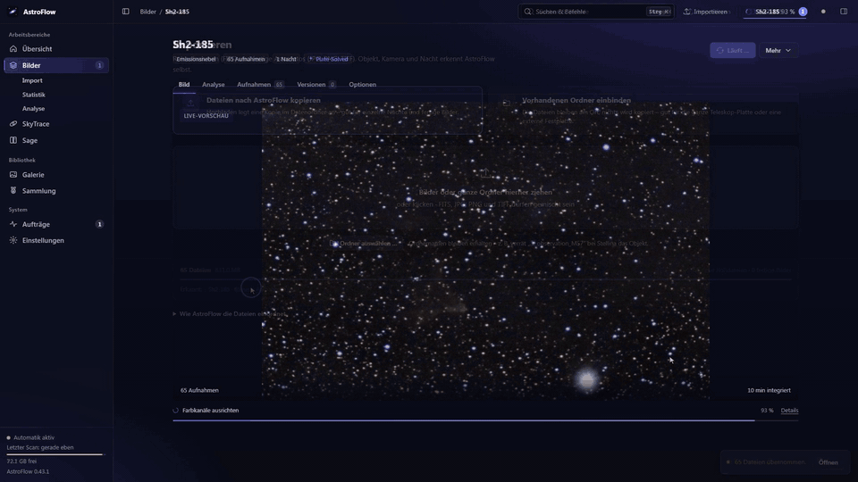

Der **Stacking-Verlauf** zeigt, was 1, 3, 10, 30, 100 … Aufnahmen ausmachen, und **Vorher/Nachher** vergleicht den linearen Stack mit dem entwickelten Bild
(Gradienten, Gaia-Farbkalibrierung, optional GraXpert und StarNet).

| | |
|---|---|
| 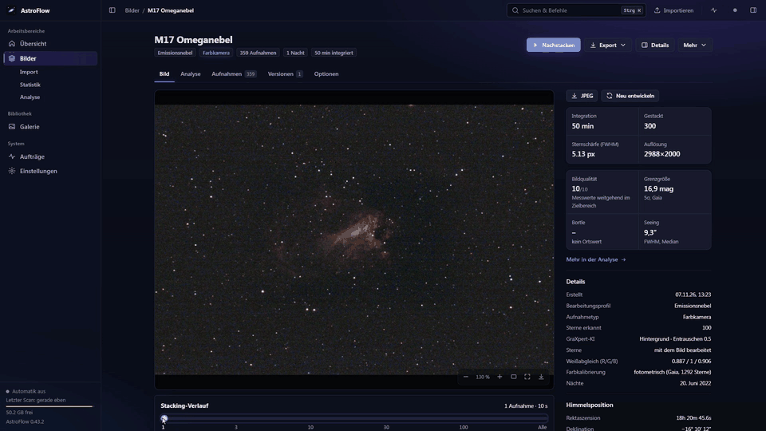 | 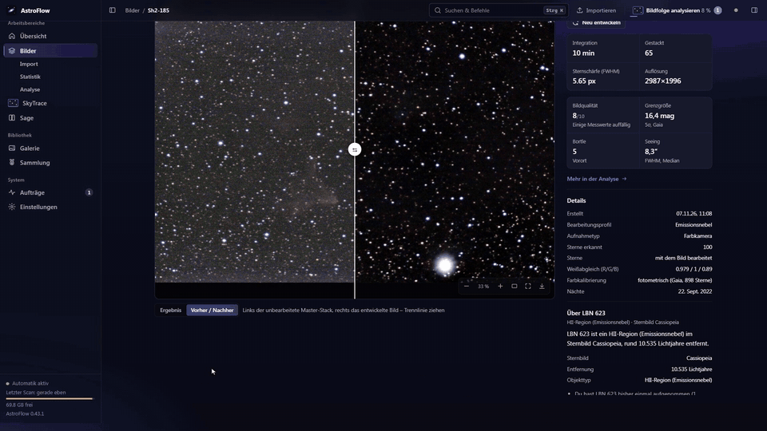 |

*(Live-Ansicht: synthetische Demodaten. Stacking-Verlauf: M16 Adlernebel, Vorher/Nachher: M17 Omeganebel – echte Aufnahmen eines Smart-Teleskops.)*

### Ergebnisse

Fertige Bilder aus AstroFlow, vollautomatisch aus Rohaufnahmen eines Smart-Teleskops (80 mm Öffnung) entwickelt, verkleinert:

| | | |
|---|---|---|
|  |  | 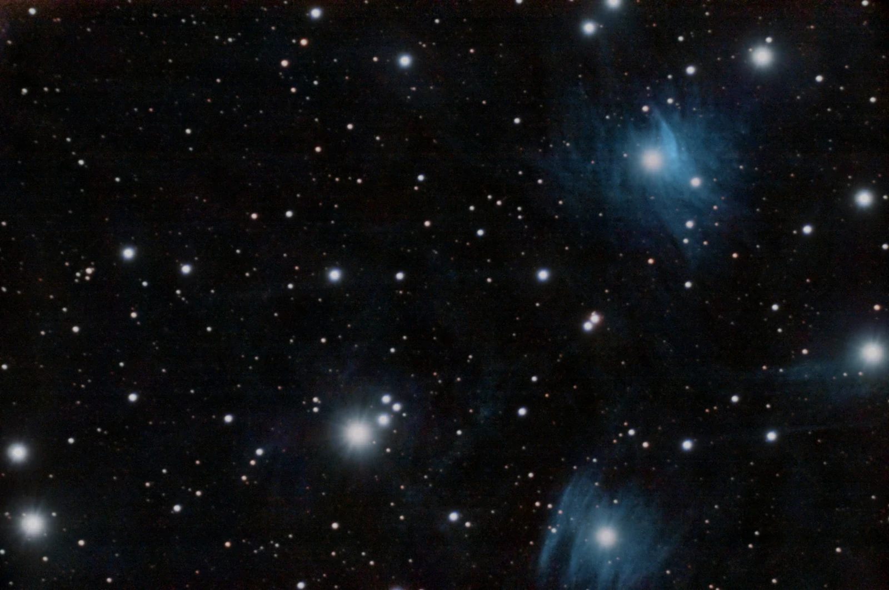 |
| NGC 7000, 58 min | NGC 6888, 45 min | M45 Plejaden, 91 min |
| 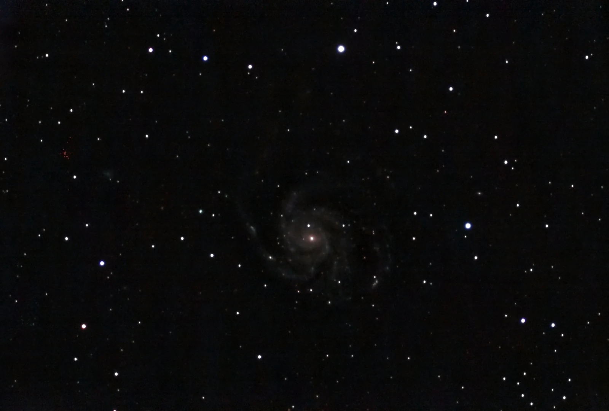 |  |  |
| M101, 115 min | NGC 7023, 3 h 58 min | IC 1396, 60 min |


### Analyse: Was dein Bild zeigt

Im Reiter **Analyse** jedes Objekts misst AstroFlow aus dem plate-gelösten Bild die **Grenzgröße**, die erfassten Sterne, den nächsten und fernsten Stern
(Gaia-Parallaxen) und die fernsten sichtbaren Galaxien und Quasare (Rotverschiebung, Lichtlaufzeit) – als Kennzahlen, Markierungen und **in 3D**.

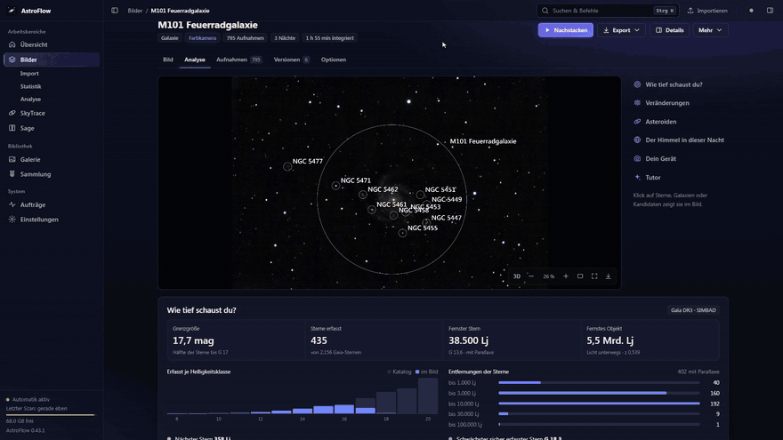

Der **Blinkvergleich** stellt das Bild gegen eine frühere eigene Aufnahme oder die DSS2-Durchmusterung. Neue oder verschwundene Lichtquellen werden nur gemeldet,
wenn sie über der Grenzgröße beider Bilder liegen, und mit SIMBAD und JPL-Kleinkörpern abgeglichen – als Hinweis, nicht als Entdeckung.

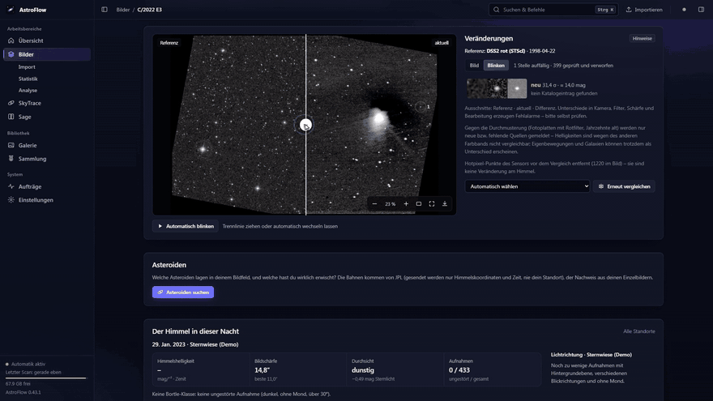

Weitere Auswertungen je Objekt, alle aus gespeicherten Daten:

- **Himmel der Aufnahmenacht** (Bortle-Schätzung, Seeing, Lichtrichtung) und **Dein Gerät** (Nachführung, Fokus, Bildfeld-Schärfe)
- **Asteroiden:** welche bekannten Kleinplaneten im Feld lagen und welche du wirklich erwischt hast
- **HR-Diagramm** bei Sternhaufen: Farben-Helligkeits-Diagramm aus deinem Bild mit Entfernung, Rötung und grobem Alter
- **Bild-Tutor:** Befunde mit Tipps passend zum Gerät, Bedingungen der Nacht (Mond, Dämmerung, Wolken)

Das **Analyse-Dashboard** (Bilder → Analyse) fasst die ganze Bibliothek zusammen: Kennzahlen, Rekorde, „Dein Universum“ als 3D-Wolke, Verläufe und die Frage,
was am meisten gebracht hat; „Alles analysieren“ rechnet fehlende Auswertungen im Hintergrund nach.


### Himmelsqualität und „Heute Nacht“

| | |
|---|---|
|  |  |
| **Heute Nacht:** gut sichtbare Ziele (neue Objekte aus Messier und Caldwell, eigene Aufnahmen mit Bedarf an mehr Belichtung), Höhenverläufe, Mond, Nachtplan, optional Wetter. | **Himmelsqualität:** aus deinen Aufnahmen gemessen, an Gaia-Sternen geeicht – mag/″², Bortle mit Spanne, Seeing, Lichtrichtung, dazu die **sauberen Nächte** mit Ranglisten. |

*(Demodaten mit erfundenem Ort.)*

Orte legst du unter Einstellungen → Standorte **nach Datum** an (Zeiträume, einzelne Nächte, Standard-Ort); „Heute bin ich in …“ wechselt den Ort für die
aktuelle Nacht. Der Ort einer Aufnahme ergibt sich aus FITS-Kopf → Zeitraum → Standard.

### Kometenmodus

Kometen bekommen zwei Stacks – auf die Sterne und auf den Kometenkern – und werden zu einem Bild zusammengesetzt (Bahn aus der JPL-Ephemeride oder im Bild
gemessen). Beide Einzelstacks bleiben ansehbar.

### SkyTrace – was sich zwischen den Sternen bewegt

Spuren in Bildfolgen werden als **Kandidaten** mit Ausschnitt, Zeitreihe und Messdetails erfasst und zur echten Aufnahmezeit mit Satelliten, Meteoren und Flugzeugen
abgeglichen. Ein Kandidat ist ein Hinweis, kein bestätigtes Objekt.

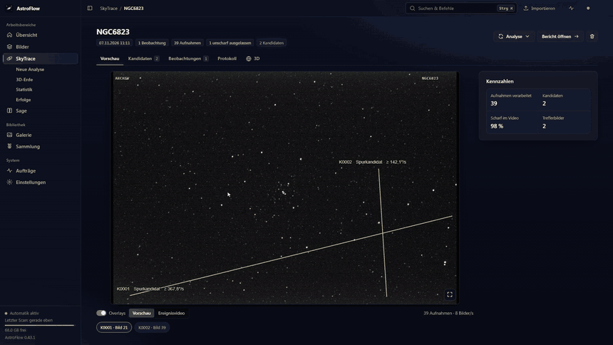

Die **3D-Erde** zeigt den Standort, das Blickfeld des Teleskops, Satellitenbahnen und – beim Hineinzoomen – eine flache Karte; auch Orte, Heatmaps der
Standortsuche und die Tag/Nacht-Grenze liegen auf demselben Globus.

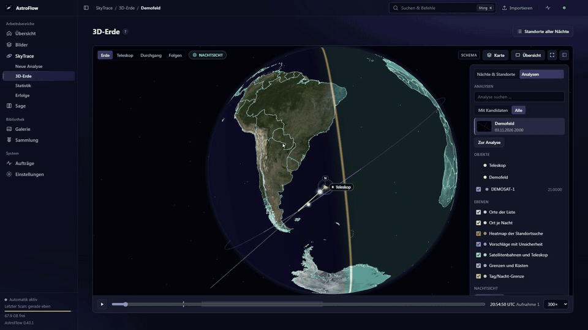

*(Die Animationen zeigen Demodaten mit erfundenem Ort.)*

Weitere Funktionen: **Standort suchen** (aus Satellitenspuren zurückgerechnet, auch ohne Vorwissen), **Uhrversatz suchen**, **Satelliten neu abgleichen**,
**Erneut analysieren**, Statistik mit **Satellitenhelligkeit** und „Satelliten am Himmel“ sowie **Erfolge**. Vorschläge für Orte und Uhrkorrekturen werden nie
automatisch übernommen.

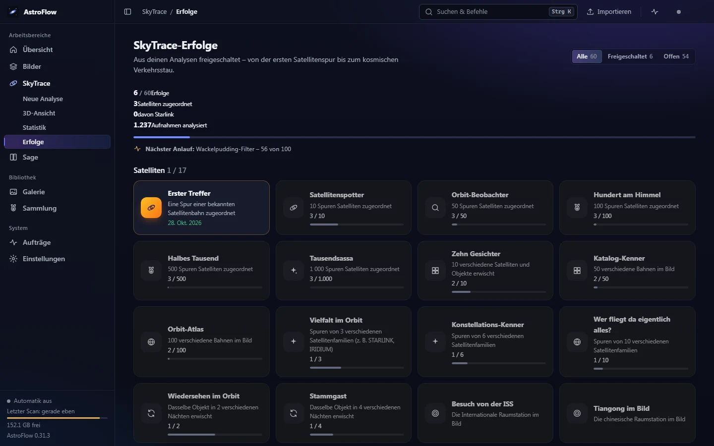

### Sage – die lebende Enzyklopädie

| | |
|---|---|
|  | 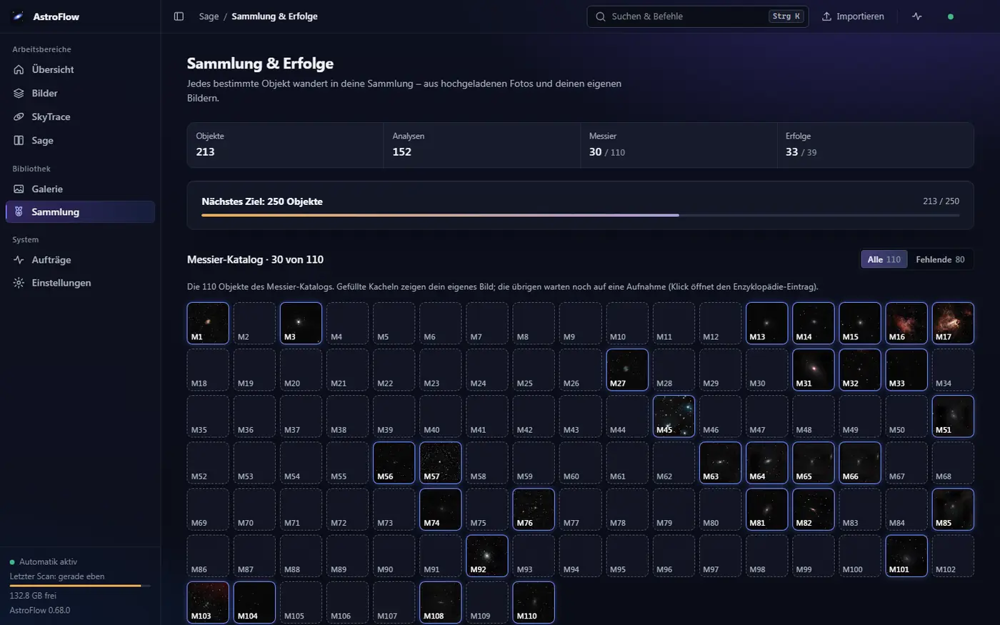 |
| **Enzyklopädie:** jedes fotografierte Objekt bekommt einen Eintrag mit deinem Bild, Katalogdaten und Beobachtungen; jede Aussage hat eine Quelle oder ist als KI-Vorschlag gekennzeichnet. | **Sammlung & Erfolge:** Messier-Fortschritt, Meilensteine und Erfolge für jedes neu bestimmte Objekt. |

Dazu: **Bild bestimmen**, **Geschichte erzählen** und vorlesen lassen, **Meine Entdeckungen**, **Wissensnetz**. Gestackte Aufnahmen landen auf Wunsch automatisch in
Sage und SkyTrace.

## Optionale Werkzeuge

AstroFlow läuft ohne diese Programme; sie verbessern oder erweitern einzelne Funktionen.

| Werkzeug | Wofür | Einrichtung |
|---|---|---|
| [ASTAP](https://www.hnsky.org/astap.htm) (ab 2023) + Sterndatenbank D05/D20/D50 | Plate-Solving, Objektnamen, Gaia-Farbkalibrierung, Tiefenanalyse | Im Assistenten auf Knopfdruck (D05 ~100 MB, D50 ~900 MB) oder selbst installieren; wird automatisch gesucht, sonst Einstellungen → Bilder → Plate-Solving. Alternativen: lokales astrometry.net, nova.astrometry.net (nur auf ausdrückliche Wahl) |
| [GraXpert](https://github.com/Steffenhir/GraXpert/releases/latest) | KI-Hintergrundextraktion und -Entrauschen des linearen Stacks | Von der Herstellerseite installieren; Einstellungen → Bilder → „GraXpert (KI)“. Ohne GraXpert: Polynom + Wavelets |
| StarNet2 | Sterntrennung bei Nebeln | Einstellungen → Bilder → StarNet: ZIP installieren oder Pfad setzen. Ohne StarNet keine Sterntrennung bei Nebeln |
| `pyopencl` (GPU) | Ausrichten und Sigma-Clipping auf der Grafikkarte (OpenCL), Stacking etwa 3× schneller | Im Assistenten oder `pip install pyopencl`; ohne GPU rechnet der Prozessor |
| SkyTrace-Engine (OpenCV, PyTorch/YOLO, PyAV, Skyfield …) | Spurenanalyse in SkyTrace | `pip install -r astroflow/modules/skytrace/requirements.txt` oder unter Einstellungen → SkyTrace einen vorhandenen Interpreter wählen. Ohne Engine startet AstroFlow trotzdem; vorhandene Ergebnisse bleiben ansehbar |
| Vision-LLM (LM Studio, OpenRouter) | optionaler KI-Bildprüfer und KI-Ergänzung im Tutor | siehe unten |
| KI/Sprache für Sage (OpenAI, OpenRouter, LM Studio, Qwen3-TTS, ElevenLabs) | Geschichten schreiben und vorlesen | Einstellungen → Sage |

## Bedienung in Kürze

1. **Importieren:** Dateien oder ganze Ordner irgendwo auf die Seite ziehen (oder „Importieren“). FITS werden als Rohaufnahmen verarbeitet, JPG/PNG/TIFF als fertige
   Bilder in die Galerie übernommen.
2. **Hauptordner durchsuchen:** Import → „Hauptordner durchsuchen“ → Ordner wählen (Ordnerdialog mit Suche, auch in Unterordnern). AstroFlow findet auf einer ganzen
   Teleskop-Festplatte, was noch nicht (fertig) gestackt ist; die Quelldateien bleiben unverändert am Ort und werden nicht kopiert.
3. **Orte eintragen:** Einstellungen → Standorte (für Tutor, Heute Nacht, Himmelsqualität, SkyTrace).
4. **Warten:** Die Pipeline läuft automatisch; Aufträge aller Module stehen unter „Aufträge“.
5. **Verfeinern:** Pro Objekt unter „Optionen“ Profil, Farbpalette, Bildauswahl, Auflösung, Schmalband; „Mehr → Neu entwickeln“ rechnet nur die Entwicklung neu.

Befehlspalette **Strg+K** (Objekte und Aktionen aller Module); Tasten `/` Suche, `1–4` Reiter, `F` Vollbild, `B` Vorher/Nachher.

<details>
<summary>Was die Pipeline im Modul Bilder automatisch tut</summary>

| Schritt | Umsetzung |
|---|---|
| Erkennung & Gruppierung | Objekt aus Header (`OBJECT`, `RA/DEC`) oder Ordnername → Katalog; Gruppierung nach Objekt + Kamera, Sessions nach Nacht; doppelte Dateien und fertige Integrationen anderer Software werden nicht erneut gestackt |
| Plate-Solving | Fehlen Objektname und Koordinaten, wird die Position aus dem Sternmuster bestimmt (eine Aufnahme je Ordner/Nacht, gecacht) |
| Mehrfilter (Mono) | je Filter eigene Auswahl und eigener Stack; Kombination zu RGB, LRGB, RGB+Hα, HOO, SHO oder Mono |
| Kalibrierung | Master-Dark/Bias/Flat; automatische Hotpixel-Korrektur (auch ohne Darks), Karte ortsfester Sensorfehler, Messung und Abzug des Sensorglühens aus den Aufnahmen |
| Qualität & Auswahl | Sternzahl, FWHM, Exzentrizität, Hintergrund → Score; Wolken, Unschärfe, Nachführfehler werden verworfen |
| Registrierung & Stacking | Dreiecks-Matching (Feldrotation, Meridian-Flip, mehrere Nächte); gewichtetes Sigma-Clipping; inkrementell – neue Aufnahmen werden nachgestackt |
| Farbe | Fotometrische Farbkalibrierung über Gaia-Sternfarben (nur Feldkoordinaten gehen an einen Gaia-Server; abschaltbar) |
| Entwicklung | Gradientenentfernung, Entfaltung, Stretch, Entrauschen, Sternreduktion, Kontrast, Sättigung – profilabhängig; automatische Qualitätskontrolle mit bis zu 3 Rendering-Runden |
| Speicher | Hochgeladene Einzelbilder werden nach erfolgreichem Stacking gelöscht (abschaltbar, `ASTROFLOW_DELETE_UPLOADS=0`); Nachstacken neuer Nächte geht weiter, komplettes Neu-Stacken nicht mehr. Eingebundene Ordner werden nie angetastet |
| Ausgabe | TIFF 16-bit, PNG, JPEG, linearer FITS-Stack; Verlauf aller Versionen |

</details>

<details>
<summary>KI-Bildprüfer, Plate-Solving und weitere Einstellungen</summary>

**KI-Bildprüfer (optional, standardmäßig aus):** Ein Vision-Modell (LM Studio lokal oder OpenRouter) bekommt eine Vorschau des fertigen Bildes und beurteilt
Hintergrund, Farbstich, Sterne, Rauschen und Artefakte. Bei Beanstandung schlägt es Parameterkorrekturen aus einer festen Whitelist vor; AstroFlow rendert neu und
prüft erneut (bis `ASTROFLOW_REVIEW_ROUNDS`, Standard 3). Das Modell führt keinen Code aus.

```yaml
ASTROFLOW_REVIEW_PROVIDER: lmstudio            # lmstudio | openrouter | off (Standard)
ASTROFLOW_REVIEW_MODEL: qwen2.5-vl-7b-instruct # ein Modell mit Bildeingabe
ASTROFLOW_REVIEW_URL: http://host.docker.internal:1234/v1   # optional, Standard je Anbieter
ASTROFLOW_REVIEW_KEY: sk-or-...                # nur OpenRouter
```

Oder unter Einstellungen → Bilder → KI-Bildprüfer (gespeichert in `settings.json` im Datenordner, hat Vorrang vor Umgebungsvariablen; Schlüssel stehen dort im Klartext).

**Plate-Solving:**

```yaml
ASTROFLOW_SOLVER: auto        # auto (lokale Solver) | astap | astrometry | nova | off
ASTROFLOW_ASTAP: /opt/astap/astap_cli      # optional, sonst automatische Suche
ASTROFLOW_ASTAP_DB: /opt/astap             # optional, Ordner der Sterndatenbank
ASTROFLOW_NOVA_KEY: ...                    # nur für nova.astrometry.net
ASTROFLOW_SOLVE_TIMEOUT: 180
```

**Weitere Umgebungsvariablen:** `ASTROFLOW_DATA` (Datenordner), `ASTROFLOW_AUTO=0` (nicht automatisch verarbeiten), `ASTROFLOW_SCAN_INTERVAL`,
`ASTROFLOW_THREADS` (Standard: Kerne − 1, max. 12), `ASTROFLOW_BATCH_MB` (RAM pro Stacking-Stapel, auf kleinen NAS ggf. senken).

</details>

## Datenschutz und lokaler Betrieb

- Rohdaten, Ergebnisse und Einstellungen liegen im Datenordner; es gibt keine Konten und keine Cloud. Orte sind privat und werden nur lokal gespeichert.
- **Netzabfragen** (jede einzeln abschaltbar; gesendet werden nur Himmelskoordinaten, Feldgröße und Aufnahmezeit – nie Bilder oder dein Standort, ausgenommen die gerundete Wetterabfrage; Ergebnisse werden lokal gespeichert):

| Dienst | Wofür | Schalter |
|---|---|---|
| Gaia DR3 (GAVO bzw. ARI Heidelberg, sonst ESA) | Sternfarben, Helligkeiten, Parallaxen, Eigenbewegungen | „Farbkalibrierung über Gaia-Sternfarben“, `ASTROFLOW_GAIA=0` |
| SIMBAD (Harvard-Spiegel, sonst CDS) | Rotverschiebungen, bekannte Veränderliche | „Rotverschiebungen und Veränderliche aus SIMBAD“ |
| DSS2 rot (STScI, sonst CDS hips2fits) | Vergleichsbild ohne eigene frühere Aufnahme | „Himmelsdurchmusterung als Vergleichsbild“ |
| JPL SB-Ident / Horizons (NASA) | Kleinplaneten, Asteroiden und Kometen zur Aufnahmezeit (geozentrisch) | „Kleinplaneten und Kometen prüfen“, `ASTROFLOW_HORIZONS=0` |
| Open-Meteo | Wetter der Aufnahmenacht / Vorhersage (Ort auf 0,1° gerundet) | Bild-Tutor-Einstellung |
| Photon (komoot) / Open-Meteo-Höhe | Ortssuche und Höhe in der Ortsliste (nur Suchtext) | nur auf Knopfdruck |
| OpenStreetMap / OpenTopoMap (Kartenkacheln) | Karte bei der Standortsuche in SkyTrace und beim Zoomen auf der 3D-Erde; der Ausschnitt verrät die Gegend | nur auf Knopfdruck „Karte laden“ (oder „immer laden“) |
| GitHub | Hinweis auf neue Versionen (anonym, höchstens einmal am Tag) | Einstellungen → Module & System |
| ASTAP-Download (SourceForge) | Plate-Solver und Sterndatenbank | nur auf Knopfdruck im Assistenten |
| OpenRouter / OpenAI / ElevenLabs | optionaler KI-Prüfer, Geschichten, Vorlesen | standardmäßig aus; LM Studio bleibt komplett lokal |
| nova.astrometry.net | Online-Plate-Solving (verkleinertes Graustufenbild) | nur auf ausdrückliche Wahl |

- Schreibende Anfragen mit fremdem `Origin` werden abgelehnt.

## Architektur, Entwicklung und Tests

```
astroflow/
  server.py            Kompositionswurzel: Module laden, gemeinsame Endpunkte (/api/app, /api/status, /api/activity), Oberfläche
  core/                Einstellungen, Modul-Basisklasse und Registry, Ortsliste, Starter und Einrichtungsassistent
  modules/
    stacking/          Pipeline (scanner, calibration, registration, stacking, processing, develop, platesolve …), Analysen, API, Oberfläche
    skytrace/          Engine (aus SkyTrace), API, Oberfläche, Erkennungsmodell
    sage/              Verlauf/Entdeckungen, KI-/Sprach-/nova-Anbindung, API, Oberfläche
  static/              Shell: Navigation, Übersicht, Aktivität, Einstellungen, Befehlspalette, Bildbetrachter, Design-System
installer/             Windows-Paket (portables ZIP, Inno-Setup-Installer)
```

Jedes Modul bringt API (`/api/<modul>`), Oberfläche (`/m/<modul>/`), Einstellungen, Status und Aktivitäten selbst mit. Module sprechen über benannte Dienste
miteinander, nicht per Import. Einstieg für Entwickler: `AGENTS.md`; Änderungen: `CHANGELOG.md`.

```bash
pip install -r requirements-dev.txt   # pytest, pytest-xdist, Playwright
python -m pytest                       # läuft parallel (pytest.ini, höchstens 8 Worker)
python -m pytest -m "not ui"            # schneller Teilsatz ohne Browser-Tests
python installer/build_windows.py      # Windows: portables ZIP (+ Installer mit Inno Setup) nach dist/
```

Die Tests erzeugen synthetische Aufnahmen (Galaxie, Bayer-Sensor, Mono-Kamera mit Filtern, Feldrotation, Wolken, Satelliten, Darks/Flats) und prüfen die ganze Kette;
die Oberflächentests laufen in einem echten Chromium.

## Grenzen

- Der eingebaute Objektkatalog ist klein (mit ASTAPs `deep_sky.csv` deutlich größer).
- Die Stackfläche entspricht dem Referenzbild; keine Mosaike. Kein echtes Drizzle; keine Planeten-/Mond-Modi; Kometenmodus nur für Farbkameras bzw. einen Filter.
- Ohne Flats bleibt multiplikative Vignettierung teilweise sichtbar.
- Die Himmelsqualität ohne Dark-Frames ist nur für bekannte Geräte (bisher Stellina) möglich, die Genauigkeit liegt bei etwa ±0,2–0,4 mag.
- Installer und portables ZIP gibt es bisher nur für Windows; unter Linux und macOS startest du AstroFlow mit Python oder Docker.

## Lizenz

MIT, siehe `LICENSE`. Drittkomponenten: three.js (`astroflow/static/vendor/`) steht unter MIT, die Erdtextur (`astroflow/modules/skytrace/static/vendor/`) ist NASA Blue Marble
(gemeinfrei), siehe die `README.md` in beiden Ordnern. Das SkyTrace-Erkennungsmodell (`astroflow/modules/skytrace/models/night-detector`) stammt aus OpenSkyCam und steht unter AGPL-3.0.
