# AstroFlow

**Deine Astrofotografie, lokal und an einem Ort.** Rohbilder werden zu fertigen Astrofotos, Bildfolgen zu Entdeckungen,
Himmelsobjekte zu Geschichten – im Browser, auf deinem Rechner oder NAS, ohne Konto und ohne Cloud-Zwang.


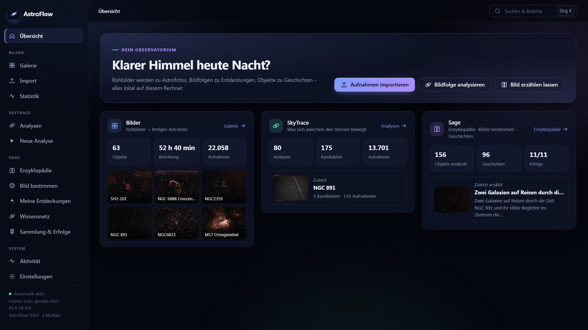

| Modul | Was es tut |
|---|---|
| **Bilder** | FITS-Aufnahmen (Seestar, Stellina, Vespera, Astrokameras) automatisch sortieren, kalibrieren, stacken und entwickeln – inklusive Nachstacken neuer Nächte |
| **SkyTrace** | Bildfolgen sternregistriert auf Lichtspuren und bewegte Objekte untersuchen; Kandidaten mit Zeitreihen, Messdetails und Abgleich gegen Satelliten-, Meteor-, Asteroiden- und Flugkataloge zur echten Aufnahmezeit |
| **Sage** | Lebende Astronomie-Enzyklopädie: Objekte im Bild bestimmen, aus Fachkatalogen recherchieren (mit Quellen), Zusammenhänge zwischen deinen Aufnahmen entdecken, Geschichten erzählen und vorlesen lassen; Sammlung mit Erfolgen |

Alle Module teilen sich eine Oberfläche: Übersicht, gemeinsame Aktivität aller Aufträge, eine Einstellungsseite, Befehlspalette (Strg+K)
und Drag & Drop überall (FITS → Rohdaten-Pipeline, JPG/PNG/TIFF → fertige Bilder in der Galerie). Aus einem fertigen Bild der Galerie erzählt Sage mit einem Klick die Geschichte
(„Mehr → Geschichte erzählen“) – die Objekte kommen dabei aus der Plate-Solving-Lösung des Stacks.

**Inhalt:** [Rundgang](#rundgang) · [Was automatisch passiert](#modul-bilder--was-automatisch-passiert) · [Schnellstart](#schnellstart) ·
[KI-Bildprüfer](#ki-bildprüfer-lm-studio--openrouter) · [Plate-Solving](#plate-solving) · [Web-App](#web-app) · [SkyTrace](#skytrace) · [Sage](#sage) ·
[Architektur](#architektur) · [Grenzen](#grenzen)

## Rundgang

### Heute Nacht – passende Aufnahmeziele

Die Übersicht empfiehlt bis zu sechs heute noch gut sichtbare Ziele: **neue Objekte** aus Messier (110), Caldwell (109)
und – falls ASTAPs `deep_sky.csv` vorhanden ist – weiteren auffälligen Katalogobjekten (passend zu Helligkeitsgrenze deines
Geräts und Bildfeld) und **eigene Aufnahmen, denen mehr Belichtungszeit** hilft („bisher 37 min, heute bis zu 5 h → Rauschen
etwa −67 %“). Die Rangfolge zählt nur dunkle, mondarme (und bei Vorhersage klare) Stunden und wertet Zenitnähe bei Alt-Az-Geräten ab.
Hinweise „Letzte Gelegenheit bis zum Frühjahr“ und „Bald gut sichtbar“ zeigen die Saison; ein Nachtplan teilt die Nacht
in Abschnitte, weil ein Smart-Teleskop nur ein Ziel gleichzeitig aufnimmt. „Nicht interessiert“ blendet ein Ziel aus
(lokal im Browser). Die Grafik zeigt
Höhenverläufe, Dämmerung, dunkle Zeit, Mond und die Mindesthöhe von 30°. Links führen zum eigenen Bild bzw. zum
Sage-Eintrag; ohne Sage erscheint eine lokale Katalogkarte.

Mit Maus, Touch oder Zeitregler lassen sich die Höhen zu einer Uhrzeit ablesen. Die Zielnamen wählen eine Kurve aus,
die Kontrollkästchen blenden einzelne Kurven aus. „Objekt öffnen“ führt zur Aufnahme bzw. zum Sage-Eintrag;
die Begründung ist beim ausgewählten Ziel aufklappbar. Auf Desktopbreite stehen Bilder, SkyTrace und Sage kompakt
neben der größeren Grafik. Unter **Ansicht** wählst du „Ausgewogen“, „Nachtplanung“ oder „Bilder & Module“;
AstroFlow merkt sich die Aufteilung auf diesem Gerät. Auf großen Bildschirmen stehen SkyTrace und Sage nebeneinander
unter den Bildvorschauen. Bildfeld und technische Angaben findest du unter „Berechnung & Bildfeld“.

Zuerst unter **Einstellungen → Bilder → Bild-Tutor** den Beobachtungsort eintragen. AstroFlow nutzt das zuletzt
verwendete Gerät: bekanntes Bildfeld aus Plate-Solving, bei Stellina ersatzweise einen Näherungswert. Bei unbekanntem
Bildfeld wird die Objektgröße nicht gefiltert. „Heute Nacht“ öffnet Details und, bei aktivierter Wetterfreigabe im
Bild-Tutor, eine Open-Meteo-Vorhersage mit auf 0,1° gerundetem Standort. Die Himmelsberechnung läuft offline.

Alle Bilder stammen aus einer echten Instanz: rund 22 000 Stellina-Aufnahmen aus 31 Nächten, 63 Objekte – ohne Nachbearbeitung in anderer Software.

### Bilder – vom Rohbild zum fertigen Foto

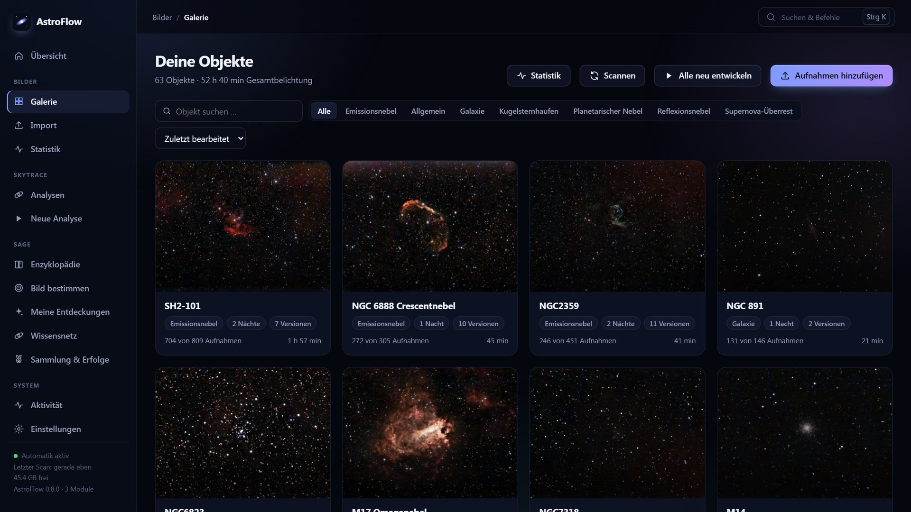
**Galerie:** Jedes Objekt erscheint automatisch, sobald seine Rohbilder im Eingangsordner liegen – Objekt, Kamera und Nacht erkennt AstroFlow selbst
(Header, Ordnername oder Plate-Solving). Neue Nächte werden nachgestackt; jede Verarbeitung bleibt als Version erhalten.

| | |
|---|---|
| 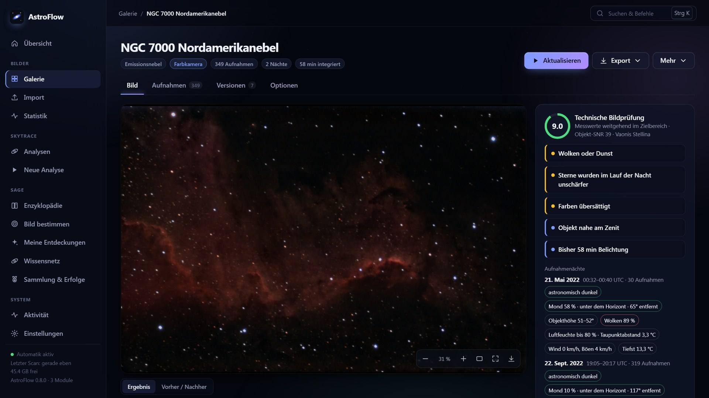 | 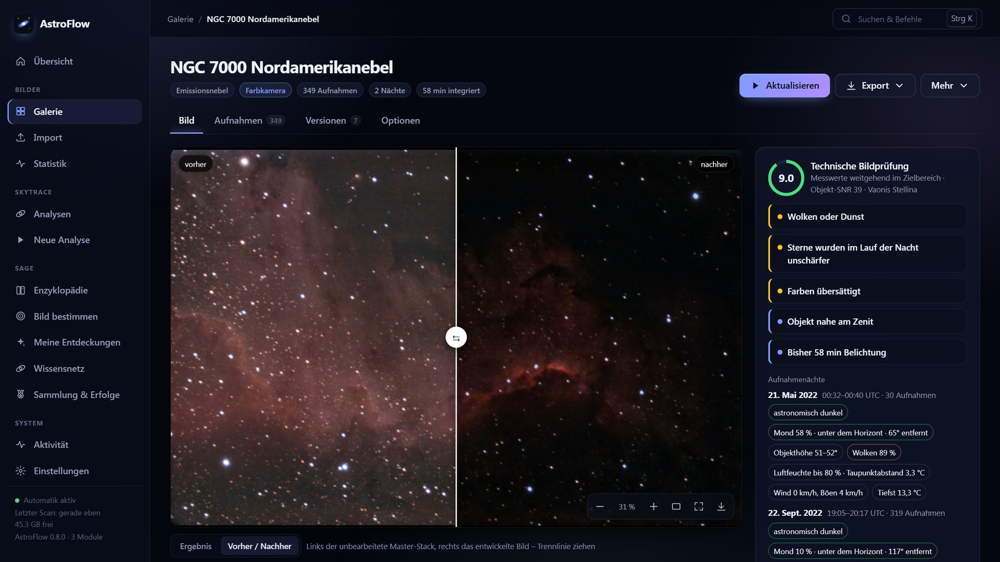 |
| **Objektseite & Bild-Tutor:** Zoom-Betrachter, technische Bildprüfung mit Punktzahl und verständlichen Befunden – dazu die Bedingungen jeder Aufnahmenacht (Dämmerung, Mond, Objekthöhe, Wolken, Taupunkt, Wind). | **Vorher/Nachher:** links der unbearbeitete lineare Master-Stack, rechts das automatisch entwickelte Bild (Gradienten, Gaia-Farbkalibrierung, optional GraXpert und StarNet). |
| 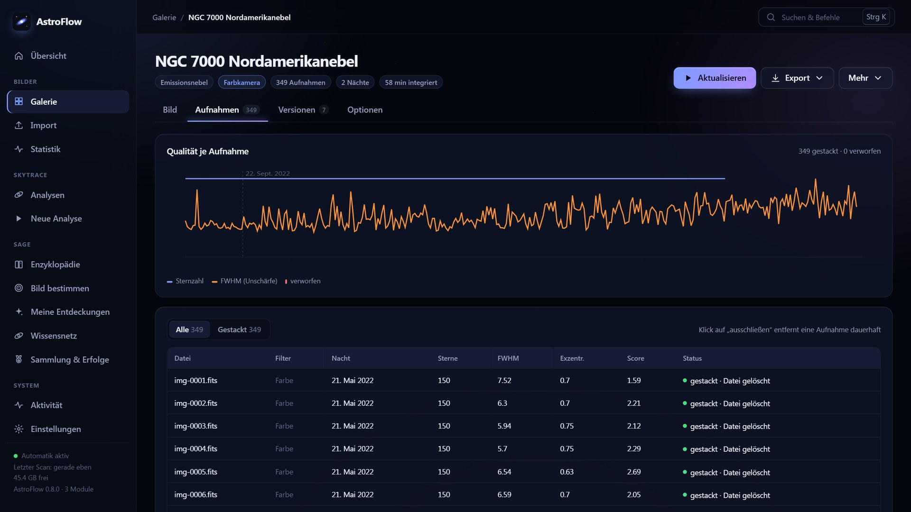 | 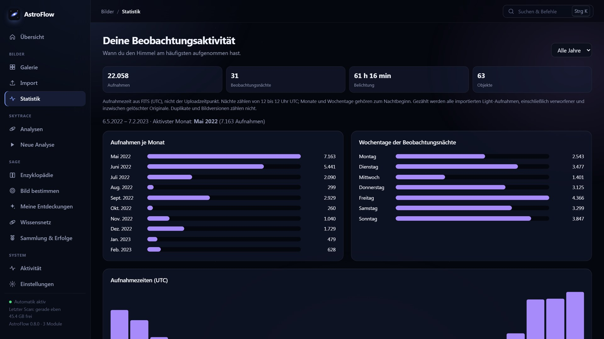 |
| **Aufnahmen:** Sternzahl und Schärfe jeder Einzelaufnahme über alle Nächte; Ausreißer (Wolken, Unschärfe, Nachführfehler) werden verworfen, einzelne Aufnahmen lassen sich ein- und ausschließen. | **Statistik:** wann du den Himmel aufgenommen hast – Monate, Wochentage, Uhrzeiten, Gesamtbelichtung. |

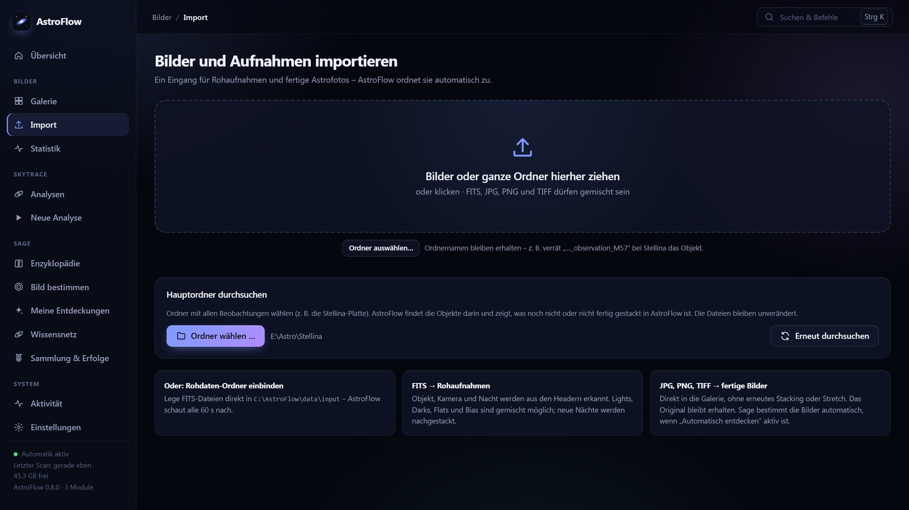
**Import:** Dateien oder ganze Ordner per Drag & Drop, FITS und fertige JPG/PNG/TIFF gemischt. „Hauptordner durchsuchen“ findet auf einer ganzen
Teleskop-Festplatte, was noch nicht (fertig) gestackt ist – die Quelldateien bleiben unverändert am Ort und werden nicht kopiert
(auch nicht von einer anderen Platte; zum Stacken neuer Aufnahmen muss sie angeschlossen sein).

### SkyTrace – was sich zwischen den Sternen bewegt

| | |
|---|---|
| 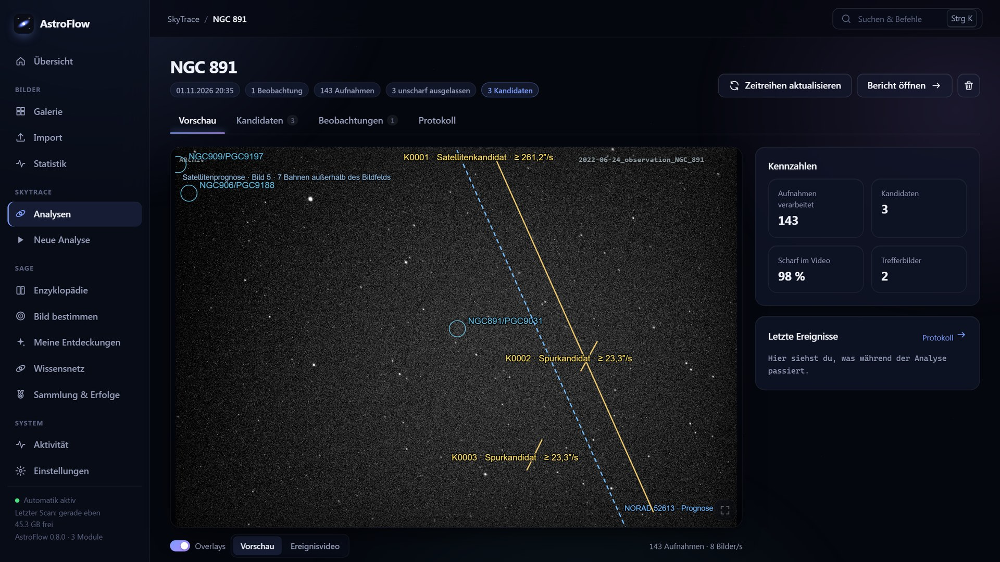 | 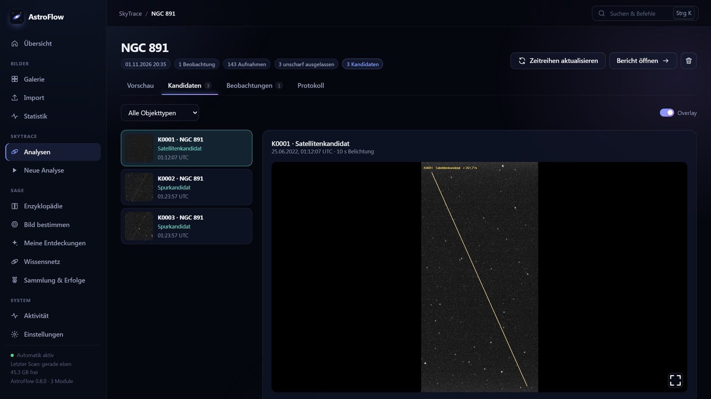 |
| **Analyse einer Bildfolge:** Spuren mit gemessener Winkelgeschwindigkeit, Satellitenprognose zur Aufnahmezeit und Galaxien aus dem Katalog als Overlay; dazu ein Ereignisvideo. | **Kandidaten:** jede Spur mit Ausschnitt, Zeitpunkt und Einordnung (Satellit, Meteor, Flugzeug …) – ein Kandidat bleibt ein Hinweis, kein bestätigtes Objekt. |

### Sage – die lebende Enzyklopädie deines Himmels

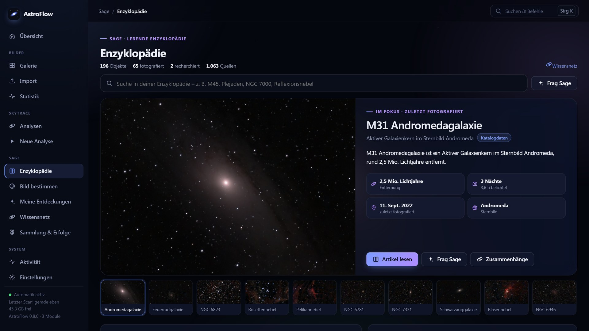
**Enzyklopädie:** Jedes fotografierte Objekt bekommt einen Eintrag – mit deinem eigenen Bild, Katalogdaten und deinen Beobachtungen.

| | |
|---|---|
| 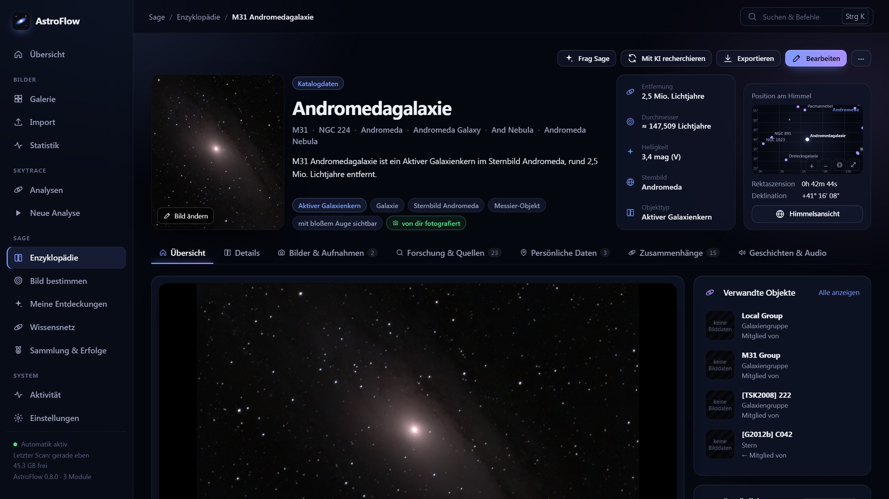 | 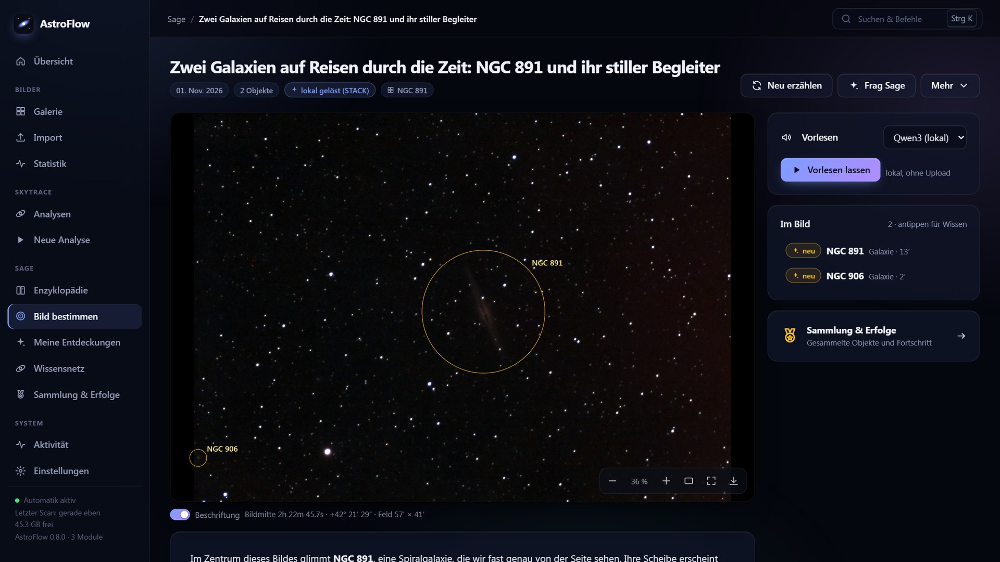 |
| **Artikel:** Entfernung, Größe, Helligkeit, Position am Himmel, Forschung & Quellen, persönliche Daten und Zusammenhänge zu anderen Objekten. | **Bild bestimmen & erzählen:** Sage markiert alle Objekte im Bildfeld und erzählt ihre Geschichte – auf Wunsch vorgelesen, auch komplett lokal. |
| 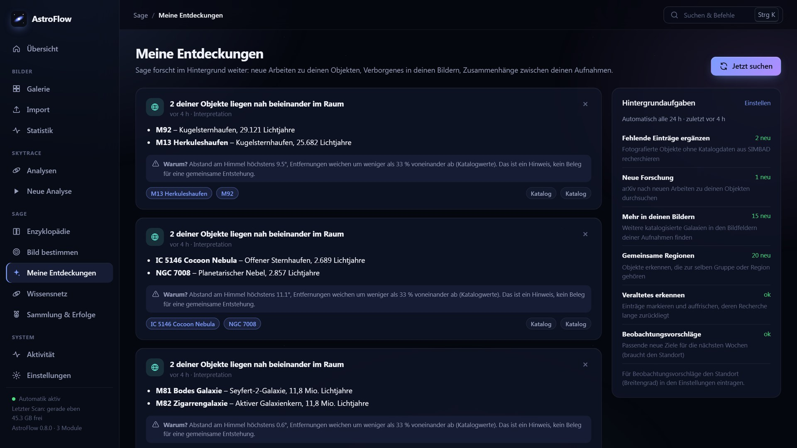 | 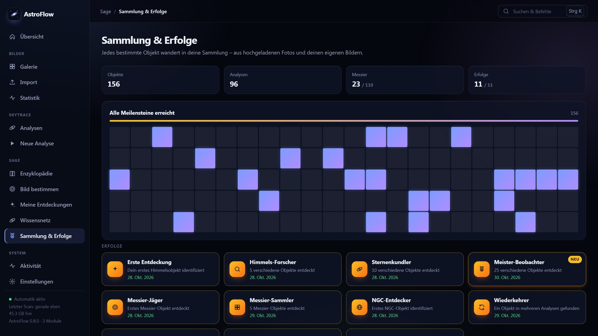 |
| **Entdeckungen:** Sage forscht im Hintergrund weiter – neue Fachartikel zu deinen Objekten, weitere Galaxien in deinen Bildfeldern, räumliche Nachbarn. Jede Aussage mit Begründung. | **Sammlung & Erfolge:** Messier-Fortschritt, Meilensteine und Erfolge für jedes neu bestimmte Objekt. |

### Bedienung

| | |
|---|---|
| 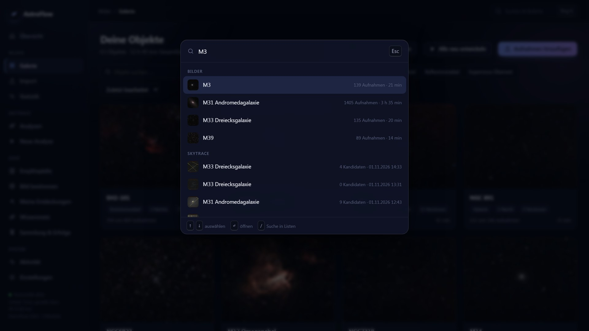 | 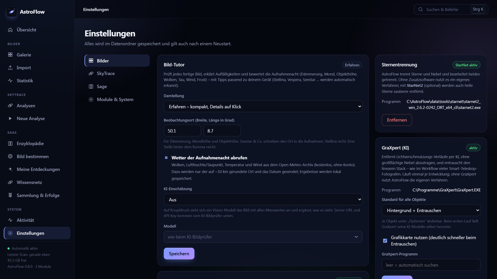 |
| **Befehlspalette (Strg+K):** Objekte, Analysen und Aktionen aller Module mit einer Suche. | **Einstellungen:** je Modul an einem Ort – Bild-Tutor, StarNet, GraXpert, Plate-Solving, KI-Anbieter, Speicher, Module ein/aus. |

## Modul Bilder – was automatisch passiert

| Schritt | Umsetzung |
|---|---|
| Erkennung & Gruppierung | Objekt aus Header (`OBJECT`, `RA/DEC`) oder Ordnername (Stellina `…_observation_M57`) → eingebauter Katalog (Messier, NGC/IC, …); Gruppierung nach Objekt + Kamera, Sessions nach Nacht; doppelt vorhandene Dateien (z. B. erneut hochgeladen) werden erkannt und nur einmal gestackt |
| Plate-Solving | Fehlen Objektname und Koordinaten, wird die Himmelsposition aus dem Sternmuster bestimmt (ASTAP, lokales astrometry.net oder optional nova.astrometry.net) – eine Aufnahme je Ordner/Nacht, Ergebnis gecacht |
| Mehrfilter (Mono-Kamera) | Filter aus `FILTER`-Header (L, R, G, B, Hα, OIII, SII); je Filter eigene Auswahl und eigener Stack auf gemeinsamer Referenz; automatische Kombination zu **RGB, LRGB, RGB+Hα, HOO, SHO** oder Mono |
| Kalibrierung | Master-Dark/Bias/Flat aus Kalibrierframes (auch Dark-Skalierung), passend nach Größe/Gain/Belichtung/Filter/Nacht; automatische Hotpixel-Korrektur (auch ohne Darks) |
| Sensorglühen | Ohne Darks misst AstroFlow das ortsfeste Randglühen des Sensors aus den Aufnahmen selbst und zieht es vor dem Ausrichten ab – sonst verschmiert es bei Alt-Az-Geräten (Stellina, Seestar) durch die Feldrotation zu Schlieren. Je Teleskop entsteht ein Glüh-Datensatz, der mit jeder Nacht genauer wird und auch nach dem Löschen der Einzelbilder erhalten bleibt |
| Qualitätsbewertung | Sternzahl, FWHM, Exzentrizität, Hintergrund → Score; Wolken, Unschärfe, Schlieren werden verworfen |
| Registrierung | Dreiecks-Matching: Verschiebung, Feldrotation (Alt/Az), Meridian-Flip; über mehrere Nächte |
| Stacking | Gewichtetes Sigma-Clipping (Satelliten/Flugzeuge/Hot-Pixel fliegen raus), Tausende Frames in RAM-sparenden Batches |
| Grafikkarte (optional) | Mit `pip install pyopencl` laufen Ausrichten und Sigma-Clipping auf der GPU (OpenCL: AMD, NVIDIA, Intel) – Stacking etwa 3× schneller (219 Stellina-Frames: 67 → 22 s). Einstellungen → Bilder → System; ohne GPU rechnet der Prozessor |
| Kontinuierliche Verbesserung | Stack-Zustand wird gespeichert; neue Aufnahmen werden **nachgestackt**, ohne alles neu zu rechnen |
| Speicher | Hochgeladene Einzelbilder werden nach erfolgreichem Stacking gelöscht (abschaltbar, `ASTROFLOW_DELETE_UPLOADS=0`); Nachstacken neuer Nächte geht weiter, nur komplettes Neu-Stacken nicht mehr. Eingebundene Ordner werden nie angetastet |
| Farbe | Fotometrische Farbkalibrierung wie PCC/SPCC: der Stack wird plate-gesolvt, der Weißabgleich richtet sich nach den Gaia-Farben der Sterne im Feld (sonnenähnliche Sterne = weiß). Nur die Feldkoordinaten gehen an einen Gaia-Server (GAVO/ARI Heidelberg, sonst ESA); abschaltbar (`ASTROFLOW_GAIA=0`) |
| KI-Hintergrund & -Entrauschen | Mit [GraXpert](https://github.com/Steffenhir/GraXpert/releases/latest) (optional, kostenlos): Lichtverschmutzungsverläufe werden per KI entfernt, ohne Nebel abzutragen, und der lineare Stack wird entrauscht. Einstellungen → Bilder → „GraXpert (KI)“; ohne GraXpert Polynom + Wavelets |
| Sterne | Bei Nebeln mit StarNet2 (optional, Einstellungen → Bilder): Sterne werden vom Nebel getrennt, der Nebel ohne Sterne gestreckt, die Sterne kommen kleiner zurück. Ohne StarNet und bei Galaxien/Haufen ohne Trennung; je Objekt unter Optionen änderbar |
| Bildbearbeitung | Gradientenentfernung, Farbkalibrierung über Sternfarben, Entfaltung, farberhaltender asinh/MTF-Stretch, Wavelet-Entrauschen, Sternreduktion, lokaler Kontrast, Sättigung, bei Nebeln Endbearbeitung (Strukturen anheben, Vibrance) – **profilabhängig** (Galaxie, Emissions-/Reflexionsnebel, Planetarischer Nebel, Haufen, …) |
| Bild-Tutor | Erklärt Auffälligkeiten (auch Farbverläufe im Himmel) mit Tipps passend zum Gerät (Stellina, Vespera, Seestar …) und bewertet die Aufnahmenacht: Dämmerung, Mond, Objekthöhe, Wolken, Tau, Wind, Frost (Wetter optional über Open-Meteo). Auf Knopfdruck ergänzt ein Vision-LLM, was es im Bild sieht. Einstellungen → Bilder → „Bild-Tutor“ (Einsteiger/Erfahren, Standort) |
| KI-Bildprüfung (optional) | Vision-LLM prüft das Ergebnis und korrigiert Parameter, bis es passt |
| Ausgabe | TIFF 16-bit, PNG, JPEG, linearer FITS-Stack; Verlauf aller Versionen |

## Schnellstart

### Docker

1. In `docker-compose.yml` den Pfad zu deinen FITS-Dateien eintragen.
2. `docker compose up -d --build`
3. Browser: <http://localhost:8080>

### Windows: Doppelklick

`Start.bat` startet AstroFlow im Hintergrund (Port 8766, Daten in `data/`, Protokoll `data/server.log.err`) und öffnet den Browser;
läuft es schon, wird nur der Browser geöffnet. `Stop.bat` beendet den Server. Anpassbar über `ASTROFLOW_PORT` und `ASTROFLOW_DATA`.
**Im Heimnetz nutzen:** Der Server lauscht auf allen Netzwerkkarten; `Start.bat` zeigt die Adresse für andere Geräte an (z. B. `http://192.168.…:8766`).
Einmalig `Netzwerk-freigeben.bat` ausführen (fragt nach Administratorrechten): legt die Firewall-Regel „AstroFlow LAN“ an – nur privates Netzwerkprofil,
nur Geräte im eigenen Subnetz, keine Freigabe ins Internet. Es gibt kein Passwort; jedes Gerät im Heimnetz kann AstroFlow bedienen.
Rückgängig: `Netzwerk-freigeben.bat entfernen`.

### Ohne Docker

```bash
python -m venv .venv && . .venv/bin/activate      # Windows: .venv\Scripts\activate
pip install -r requirements.txt
python -m astroflow demo            # synthetische Testdaten nach ./data/input/demo
python -m astroflow serve           # Web-UI auf :8080
python -m astroflow process         # oder: alles direkt per CLI verarbeiten
```

Ordner: `data/input` (Rohdaten, rekursiv gescannt; `ASTROFLOW_INPUT` ändert das), `data/output` (Ergebnisse), `data/work` (Zwischenstände).
Dark-/Flat-/Bias-Frames werden am Header (`IMAGETYP`) oder an Ordner-/Dateinamen (`darks/`, `Flat_…`) erkannt.

## KI-Bildprüfer (LM Studio / OpenRouter)

Ein Vision-Modell bekommt eine Vorschau des fertigen Bildes und die aktuellen Parameter und beantwortet:
*„Sieht das so aus, wie es aussehen sollte?“* (Hintergrund, Farbstich, Sterne, Rauschen/Plastik-Look, Artefakte).
Bei Beanstandung liefert es konkrete Parameterkorrekturen (z. B. `target_bg`, `denoise`, `saturation`); AstroFlow
rendert neu und prüft erneut (bis `ASTROFLOW_REVIEW_ROUNDS`, Standard 3). Fällt der Prüfer aus, bleibt das letzte Bild gültig.
Das Modell darf nur eine feste Liste von Parametern in begrenzten Bereichen ändern – es führt keinen Code aus.

```yaml
ASTROFLOW_REVIEW_PROVIDER: lmstudio            # lmstudio | openrouter | off (Standard)
ASTROFLOW_REVIEW_MODEL: qwen2.5-vl-7b-instruct # ein Modell mit Bildeingabe
ASTROFLOW_REVIEW_URL: http://host.docker.internal:1234/v1   # optional, Standard je Anbieter
ASTROFLOW_REVIEW_KEY: sk-or-...                # nur OpenRouter
```

Oder in der Web-UI unter **Einstellungen → Bilder → KI-Bildprüfer** – dort gesetzte Werte (wie auch Plate-Solving und Speicher) werden in
`data/settings.json` gespeichert und überleben Neustarts; sie haben Vorrang vor den Umgebungsvariablen.
Denkmodelle (z. B. Qwen3, Bonsai) überlegen oft 2 000–3 000 Tokens vor der Antwort: Standardlimit daher
`ASTROFLOW_REVIEW_MAX_TOKENS=8000`, Zeitlimit `ASTROFLOW_REVIEW_TIMEOUT=300` s. **Datenschutz:** LM Studio bleibt komplett lokal. Bei OpenRouter wird die
verkleinerte Vorschau (max. 1280 px) an einen externen Dienst gesendet – deshalb ist der Prüfer standardmäßig aus.

## Plate-Solving

Viele Aufnahmen (Stellina, Astrokameras ohne Montierungsanbindung) enthalten weder Objektnamen noch Koordinaten.
AstroFlow löst dann je Ordner, Kamera und Nacht **eine** Aufnahme und ordnet alle Bilder der Gruppe dem erkannten Objekt zu.
Bildmaßstab-Hinweise aus dem Header (`FOCALLEN`/`XPIXSZ`, Stellina `FOCAL`/`PIXSZ`) beschleunigen das; ohne Hinweise wird blind gelöst.

- **Docker:** ASTAP + Sterndatenbank D05 sind im Image enthalten (für kleine Bildfelder < 0,6°: `docker compose build --build-arg ASTAP_DB=d50`).
- **Ohne Docker:** [ASTAP](https://www.hnsky.org/astap.htm) (ab 2023 – ältere Versionen kennen die D-Datenbanken nicht) und eine Sterndatenbank (D05, D20 oder D50) installieren.
  AstroFlow sucht ASTAP und Datenbank automatisch im ASTAP-Programmordner und – unter Windows ohne Admin-Rechte – in `%LOCALAPPDATA%\astap`
  (dort einfach `astap_cli.exe` aus dem Kommandozeilen-ZIP und die entpackte Datenbank ablegen).
- **Objektnamen:** Liegt ASTAPs `deep_sky.csv` (~30 000 Objekte, beim Windows-Installer dabei) vor, bekommen gelöste Felder echte Namen
  (z. B. „NGC 1579“) statt „Feld RA … Dec …“.
- Bereits als „Unbekanntes Objekt“ eingeordnete Aufnahmen: auf der Objektseite **„Jetzt bestimmen“** – sie werden danach ins richtige Projekt verschoben und nachgestackt.

```yaml
ASTROFLOW_SOLVER: auto        # auto (lokale Solver) | astap | astrometry | nova | off
ASTROFLOW_ASTAP: /opt/astap/astap_cli      # optional, sonst automatische Suche
ASTROFLOW_ASTAP_DB: /opt/astap             # optional, Ordner der Sterndatenbank
ASTROFLOW_NOVA_KEY: ...                    # nur für nova.astrometry.net
ASTROFLOW_SOLVE_TIMEOUT: 180
```

**Datenschutz:** ASTAP und astrometry.net laufen lokal. nova.astrometry.net wird nur genutzt, wenn er ausdrücklich gewählt ist;
dabei wird ein verkleinertes Graustufenbild (nicht öffentlich markiert) hochgeladen.

## Web-App

Die Oberfläche (<http://localhost:8080>) ist eine installierbare Web-App (PWA) für Desktop und Smartphone:

- **Übersicht** mit dem Stand aller Module, **Aktivität** mit allen Aufträgen (Verarbeitung, Spurenanalysen, Geschichten), **Einstellungen** je Modul
- **Galerie** aller Objekte mit Suche, Filter nach Objekttyp und Sortierung; Live-Fortschritt laufender Verarbeitungen
- **Objektseite** mit Zoom-/Pan-Betrachter (Mausrad, Ziehen, Pinch, Doppelklick = 100 %, Vollbild), Kanalübersicht (Belichtung je Filter), Details und KI-Prüfprotokoll
- **Aufnahmen**: Qualitätsdiagramm über alle Nächte, filter- und sortierbare Tabelle, Einzelbilder ein-/ausschließen
- **Versionen**: jede Verarbeitung bleibt erhalten; zwei Versionen per Schieberegler vergleichen
- **Live-Bildaufbau**: Echte Vorschauen erscheinen während des Stackens und Entwickelns im Bild-Tab. Eine kompakte
  Statuszeile zeigt den aktiven Schritt, etwa GraXpert, Gaia, StarNet oder Stretch; „Details“ öffnet den bisherigen Ablauf.
- **Stacking-Verlauf**: Der Regler unter dem fertigen Bild nutzt die gespeicherten Live-Vorschauen nach 1, 3, 10, 30, 100 …
  Aufnahmen. Eine zusätzliche Entwicklung dieser Zwischenstände entfällt. Die Vorschauen können in Farbe, Helligkeit und
  Ausschnitt vom vollständig entwickelten Endergebnis abweichen (Standard: fertiges Bild; ältere Ergebnisse bleiben erhalten).
- **Optionen** je Objekt (Profil, Farbpalette, Bildauswahl, Auflösung, Schmalband, KI-Prüfung) mit „Speichern & verarbeiten“
- **Import** von Dateien oder ganzen Ordnern per Drag & Drop (überall auf der Seite), auch gemischt: FITS werden als Rohaufnahmen verarbeitet, JPG/PNG/TIFF als fertige Bilder direkt in die Galerie übernommen. Originaldateien bleiben unverändert, identische fertige Bilder werden nicht doppelt angelegt. 16-Bit-TIFFs bleiben als Original erhalten; Anzeigevorschauen sind 8 Bit. **Aktivität** (Auftragsliste), **Einstellungen**
- **Stellina-Verlaufsbilder** (`img-…-output.jpeg`) werden mit eindeutigen Vaonis-/Geräte-/Objekt-/Zeitmetadaten als Versionen einer Aufnahme zusammengefasst. Gibt es passende Rohdaten desselben Geräts, Objekts und derselben Nacht, stehen sie dort unter **Teleskopbilder** statt als separate Galeriekarten. Die Originale bleiben erhalten; der Dateiname allein reicht für eine Zuordnung nicht aus.
  Beim Hochladen kompletter Beobachtungsordner werden automatisch erzeugte `img-…-output`-Zwischenstände neben FITS bereits vor dem Upload ausgelassen; ohne FITS wird nur der letzte dieser Zwischenstände je Beobachtungsordner übernommen. Die Quelldateien werden dabei nicht verändert.

## Weitere Einstellungen

`ASTROFLOW_AUTO=0` (nicht automatisch verarbeiten), `ASTROFLOW_SCAN_INTERVAL`, `ASTROFLOW_THREADS` (Standard: Kerne − 1, max. 12), `ASTROFLOW_BATCH_MB` (RAM pro Stacking-Stapel, Standard 1/8 des Arbeitsspeichers bzw. des Docker-Limits, 700–4000 MB – auf kleinen NAS ggf. senken).
Pro Objekt in der UI: Profil, Farbpalette (`auto | RGB | LRGB | SHO | HOO | mono`), „beste X %“, 2×-Auflösung; einzelne Aufnahmen lassen sich ein-/ausschließen.

## SkyTrace

Bildfolgen (z. B. ein Stellina-Beobachtungsordner) werden chronologisch zu einem Ereignisvideo; Teleskopbewegung wird über das Sternfeld
kompensiert, unscharfe Aufnahmen fallen heraus. Auch schwache lange Schweife werden über das gemeinsame Profil vieler
Sterne auf Verwacklung geprüft. Erkannte Spuren erscheinen als **Kandidaten** mit Vorher-/Nachher-Ausschnitten, Messdetails
(„Warum wurde diese Spur erkannt?“) und Katalogabgleich. Ein Kandidat ist kein bestätigtes Objekt, ein Katalogtreffer bleibt ein Hinweis.
Originale werden nur gelesen. Standort und Kataloge: Einstellungen → SkyTrace.
Im Dropdown **Analyse → Erneut analysieren** startet die vollständige Erkennung mit aktuellem Code als neuer Lauf
aus den bisherigen Aufnahmen. Fehlen Originaldateien, kann ihr Ordner ausgewählt werden. Bei Ersatz-FITS muss auch das
Aufnahmedatum übereinstimmen: gleiche Dateinamen aus einer anderen Nacht werden nicht zugeordnet. Der alte Lauf bleibt erhalten.
**Analyse → Zeitreihen aktualisieren** erneuert nur die Berichte und den Katalogabgleich, ohne neue Objekterkennung.
Bei Kandidaten lässt sich zwischen **Ganzes Bild** (Analyseauflösung) und **Ausschnitt** umschalten. Die Zeitreihe
zeigt Treffer und benachbarte Aufnahmen; **Zum Treffer** und **Im Video öffnen** springen direkt zur passenden Stelle.
Ältere Läufe nutzen vorhandene Vergleichsbilder oder das unbeschriftete Video. „Zeitreihen aktualisieren“ ergänzt
gespeicherte Vollbilder, sofern die Rohaufnahmen noch erreichbar sind.
**3D-Ansicht** (Knopf im Lauf) zeigt die Erde zur Aufnahmezeit mit Standort und Teleskop-Blickfeld – auch ohne erkanntes Objekt.
Der Zeitregler läuft von der ersten bis zur letzten Aufnahme; eine Himmelskuppel über dem Standort zeigt, wie das Teleskop
über die Nacht nachgeführt hat (Höhe, Azimut, Bildlage, Feldrotation, Pausen). Ein Strahl verlängert das Blickfeld bis zum
Zielobjekt (Name, Typ, Entfernung – nicht maßstäblich). Sind Satelliten, Meteore (GMN) oder Flugzeuge (ADS-B) zugeordnet,
erscheinen alle mit ihrer Bahn (SGP4) und dem markierten Durchgang durchs Blickfeld; ein Eintrag der Legende springt zum
Durchgang oder zum Kandidaten. Der Knopf im Kandidaten öffnet dieselbe Ansicht mit diesem Objekt im Fokus.
Die **Statistik** (SkyTrace → Statistik) fasst alle Analysen zusammen: Objektarten, häufigste Satelliten, Katalogabgleich je Quelle,
Uhrzeiten und Monate der Kandidaten sowie die ergiebigsten Beobachtungen.

Die **Erfolge** (SkyTrace → Erfolge) sammeln Meilensteine aus deinen Analysen – ernst (erster Satellit, 100 Zuordnungen, die ISS im Bild)
und mit einem Augenzwinkern („Die Konstellation grüßt“ bei 100 Starlinks, „Kosmischer Verkehrsstau“, „Saubere Nacht“). Gesperrte Erfolge
zeigen den Fortschritt; bestehende Analysen werden beim ersten Öffnen rückwirkend datiert, neue Erfolge melden sich nach einer Analyse als Hinweis.

Die Analyse braucht zusätzliche Pakete (OpenCV, PyTorch/YOLO, PyAV, Skyfield …): `pip install -r astroflow/modules/skytrace/requirements.txt`
oder unter Einstellungen → SkyTrace den Python-Interpreter einer bestehenden SkyTrace-Installation wählen. Docker: `docker compose build --build-arg SKYTRACE=1`.
Ohne diese Pakete startet AstroFlow trotzdem; vorhandene Ergebnisse lassen sich ansehen. Ein bestehender SkyTrace-Datenordner (mit `Ergebnisse/`)
kann als Datenordner eingetragen werden.

## Sage

Sage ist eine **lebende Enzyklopädie**: Jedes Objekt, das du fotografierst oder bestimmst, bekommt einen Eintrag mit Katalogdaten,
deinen Bildern und Beobachtungen. Recherchen stützen sich auf Fachkataloge (z. B. SIMBAD) und arXiv; jede Aussage hat eine Quelle oder ist als
KI-Vorschlag gekennzeichnet. Im Hintergrund sucht Sage nach neuen Arbeiten, weiteren Objekten in deinen Bildfeldern und Zusammenhängen
zwischen deinen Aufnahmen (**Meine Entdeckungen**, **Wissensnetz**). Gestackte Aufnahmen aus dem Modul Bilder landen auf Wunsch automatisch in Sage.

Fotos zentral unter **Import** hochladen oder ein Bild aus der Galerie wählen → Sage bestimmt die Objekte, schreibt die Geschichte und liest sie vor.
Bei fertigen Bildern startet Sage nach dem Import automatisch, sofern „Automatisch entdecken“ aktiv ist. In Sage führt **Zum Import** zum gemeinsamen Eingang;
nur bei abgeschaltetem Bilder-Modul bleibt dort ein eigener Upload verfügbar. FITS-Master-Stacks werden vom zentralen Import noch nicht als fertige Bilder unterstützt.
- **Bestimmen:** Galerie-Bilder über die gespeicherte Stack-Lösung; FITS mit WCS direkt; sonst lokal mit ASTAP, wenn der Dateiname das Objekt nennt
  (z. B. `M42.jpg`). Fertig bearbeitete JPGs ohne Hinweis löst zuverlässig nur nova.astrometry.net – dafür „Online-Lösen erlauben“ und Schlüssel eintragen.
- **Erzählen:** OpenAI, OpenRouter oder lokal mit LM Studio (dann verlässt nichts den Rechner). Es gehen nur Objektnamen und Koordinaten an die KI, nie das Bild.
- **Vorlesen:** lokal über einen OpenAI-kompatiblen Sprachserver (Qwen3-TTS) oder ElevenLabs. Vertonungen werden gespeichert.

## Architektur

```
astroflow/
  server.py            Kompositionswurzel: Module laden, gemeinsame Endpunkte (/api/app, /api/status, /api/activity), Oberfläche
  core/                Einstellungen (data/settings.json), Modul-Basisklasse und Registry
  modules/
    stacking/          Pipeline (scanner, calibration, registration, stacking, processing, develop, platesolve …), API, Oberfläche
    skytrace/          Engine (aus SkyTrace), API, Oberfläche, Erkennungsmodell
    sage/              Verlauf/Entdeckungen, KI-/Sprach-/nova-Anbindung, API, Oberfläche
  static/              Shell: Navigation, Übersicht, Aktivität, Einstellungen, Befehlspalette, Bildbetrachter, Design-System
```

Jedes Modul bringt API (`/api/<modul>`), Oberfläche (`/m/<modul>/`), Einstellungen, Status und Aktivitäten selbst mit und registriert sich
im Frontend mit `AF.register(...)`. Module sprechen über benannte Dienste miteinander (z. B. stellt „Bilder“ den Plate-Solver bereit), nicht per Import.
Module lassen sich unter Einstellungen → Module & System abschalten. **Neues Modul:** Unterpaket `astroflow/modules/<id>/` mit `class Module(BaseModule)`,
in `core/modules.AVAILABLE` eintragen, `static/<id>.js` mit `AF.register` – fertig.

## Tests

```bash
pip install -r requirements-dev.txt   # pytest, pytest-xdist, Playwright
python -m pytest                       # läuft automatisch parallel auf allen Kernen (pytest.ini)
python -m pytest -m "not ui"            # schneller Teilsatz ohne Browser-Tests
```
Die Tests erzeugen synthetische Aufnahmen (Galaxie, Bayer-Sensor, Mono-Kamera mit LRGB- und SHO-Filtern, Feldrotation über zwei Nächte, Wolken-/Schlieren-/Satellitenframes, Darks/Flats) und prüfen die ganze Kette inkl. inkrementellem Nachstacken.

## Grenzen

- Objektkatalog ist klein (erweiterbar in `objects.py`); gelöste Felder ohne Katalogobjekt heißen „Feld RA … Dec …“.
- Die Stack-Fläche entspricht dem Referenzbild; Mosaike und stark versetzte Sessions werden nicht erweitert.
- Kein echtes Drizzle (2×-Option interpoliert); keine Komet-/Planeten-/Mond-Modi.
- Ohne Flats bleibt multiplikative Vignettierung teilweise sichtbar (additive Gradienten werden entfernt).

Lizenz: MIT. three.js (`astroflow/modules/skytrace/static/vendor/`) steht unter MIT, die Erdtextur ist NASA Blue Marble
(gemeinfrei), siehe `vendor/README.md`. Das SkyTrace-Erkennungsmodell (`astroflow/modules/skytrace/models/night-detector`) stammt aus OpenSkyCam und steht unter AGPL-3.0.
