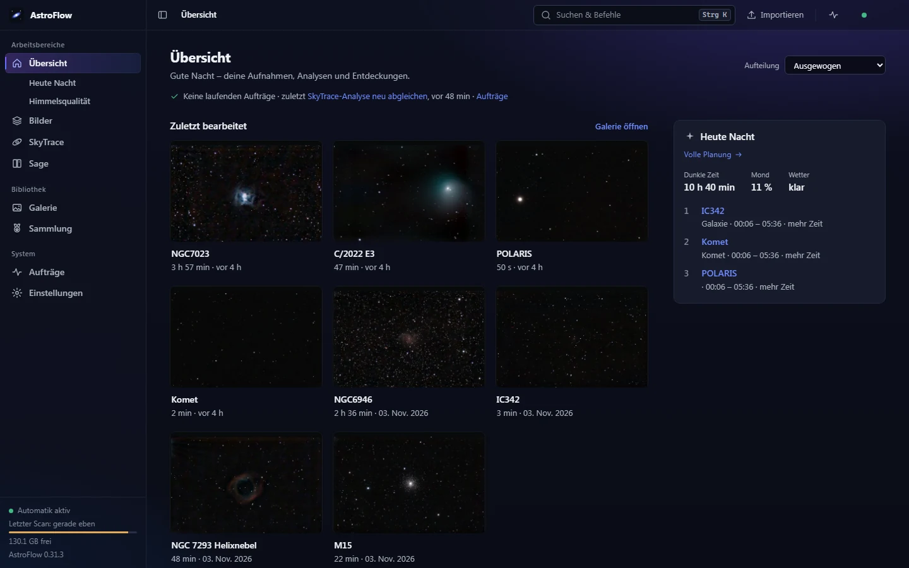
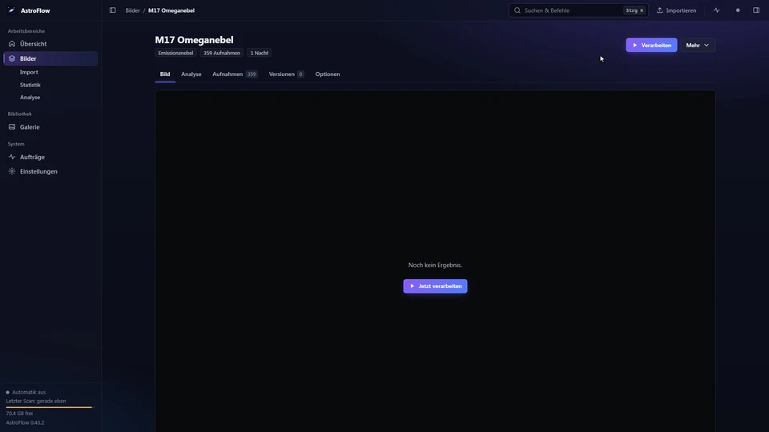
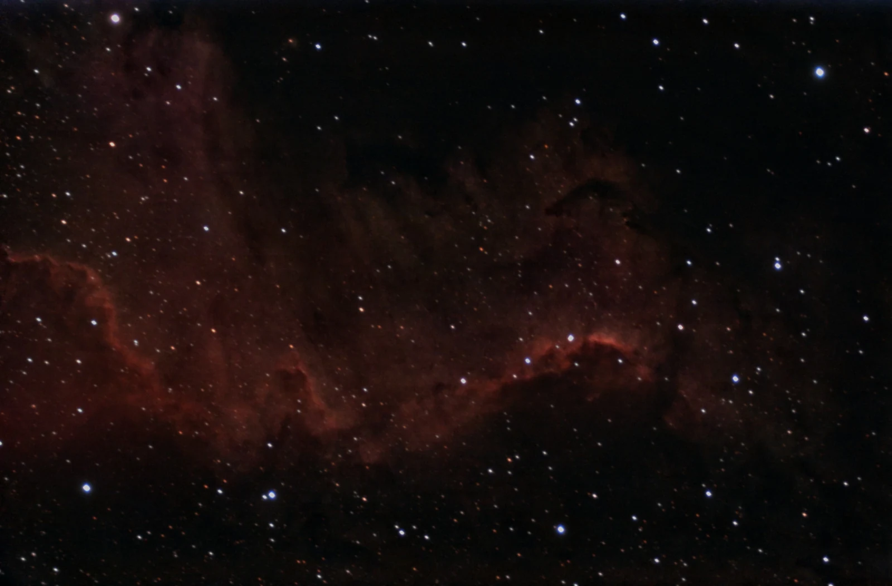
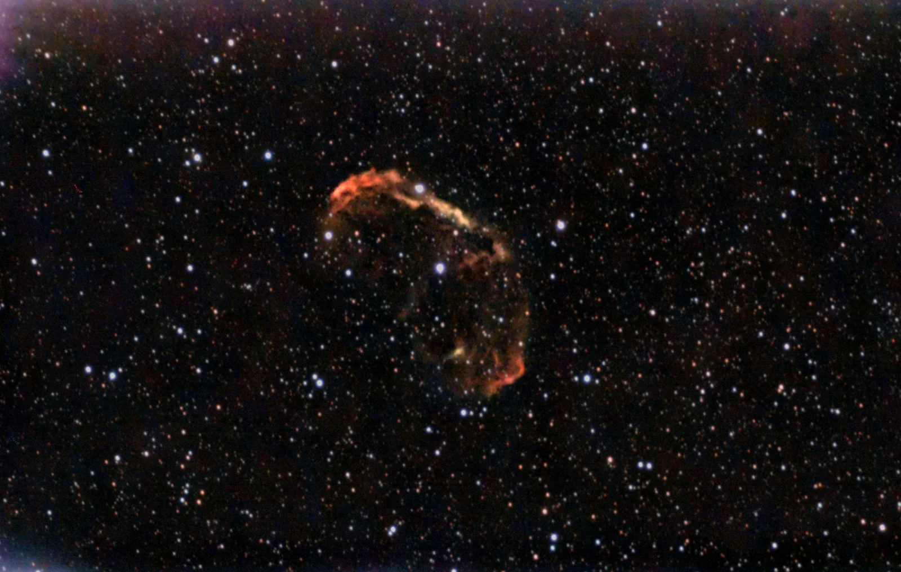
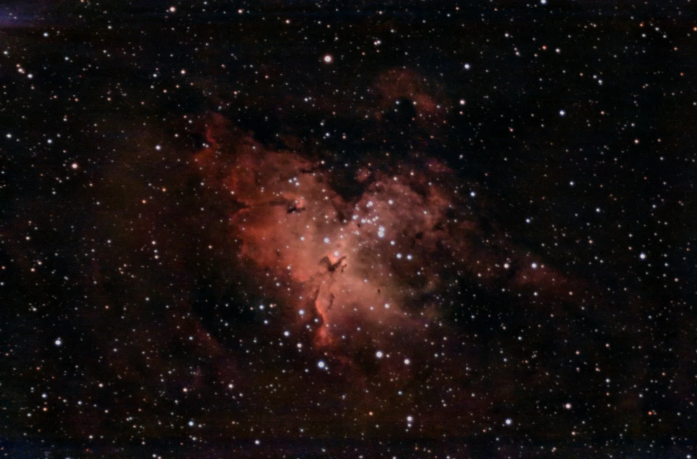
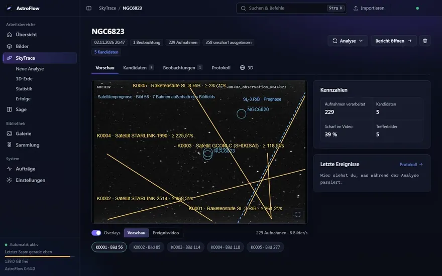
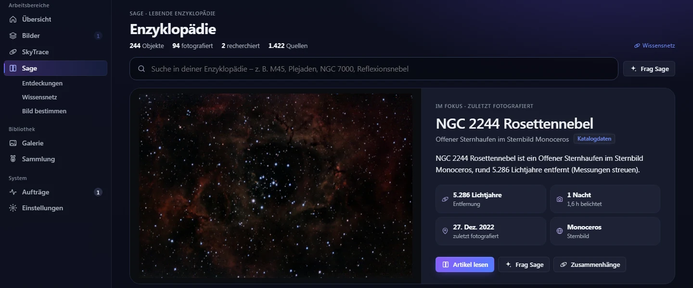
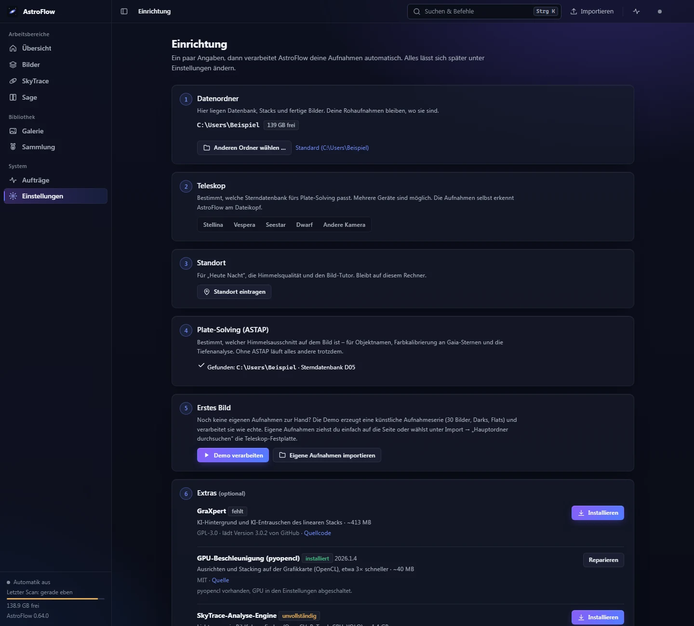
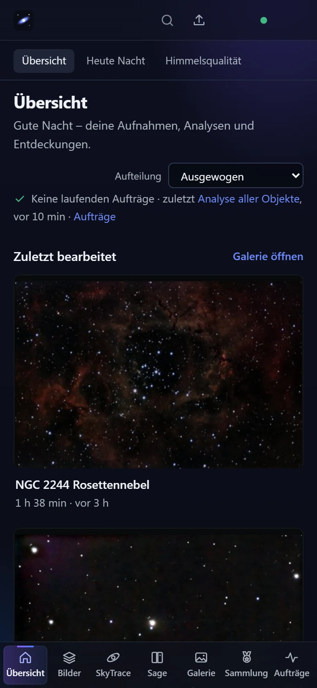

# AstroFlow

**Deine Astrofotografie, lokal und an einem Ort.** AstroFlow macht aus Rohaufnahmen fertige Astrofotos, sucht in Bildfolgen nach Satelliten und
anderen bewegten Objekten und erklärt dir, was du fotografiert hast – im Browser, auf deinem Rechner, ohne Konto.


> **Lizenz:** Quellcode offen, private und nicht-kommerzielle Nutzung frei ([PolyForm Noncommercial 1.0.0](LICENSE)). Stände bis einschließlich v0.51.3 wurden unter MIT veröffentlicht und bleiben für diese Stände MIT. Details unter [Lizenz](#lizenz).



**Schnellzugriff:** [Installation](#installation) · [Die drei Module](#die-drei-module) · [Optionale Werkzeuge](#optionale-werkzeuge) · [Datenschutz](#datenschutz-und-lokaler-betrieb)

## Was ist AstroFlow?

Eine lokale Anwendung (Python/FastAPI, Oberfläche ohne Build-Schritt) für Smart-Teleskope (Seestar, Vespera, Stellina) und klassische Astrokameras mit drei Modulen
unter einer Oberfläche (einzeln abschaltbar unter Einstellungen → Module & System):

| Modul | Was es tut |
|---|---|
| **Bilder** | FITS-Aufnahmen automatisch sortieren, kalibrieren, stacken und entwickeln; neue Nächte werden nachgestackt. Dazu Analysen (Tiefe, Vergleich, Himmelsqualität, Gerätediagnose, Asteroiden, HR-Diagramm), Bild-Tutor, „Heute Nacht“, **Observatorium** (Himmelsatlas mit deinen Fotos), Kometenmodus |
| **SkyTrace** | Bildfolgen auf Lichtspuren und bewegte Objekte untersuchen; Abgleich mit Satelliten (historische Bahndaten), Meteoren und Flugzeugen zur Aufnahmezeit, 3D-Erde, Standort- und Uhrsuche, Statistik, Erfolge |
| **Sage** | Lebende Astronomie-Enzyklopädie: Objekte im Bild bestimmen, aus Fachkatalogen recherchieren (mit Quellen), Geschichten erzählen und vorlesen, Entdeckungen, Wissensnetz, Sammlung mit Erfolgen |

## Die drei Module

Jedes Modul hat eine eigene Seite mit allen Funktionen, Bildern und Videos.

<!-- modul:bilder – Block pflegt die Bilder-Sitzung -->
### Bilder – vom Rohbild zum fertigen Foto

FITS-Aufnahmen werden automatisch sortiert, kalibriert, gestackt und entwickelt; neue Nächte werden nachgestackt. Dazu Analysen
(Tiefe, Vergleich, HR-Diagramm, Asteroiden, Gerätediagnose), „Heute Nacht“, das **Observatorium** mit deinen Fotos am Himmel und Beobachtungsplaner.



| | | |
|---|---|---|
|  |  |  |

**[Alles zu Bilder →](docs/module/bilder.md)**
<!-- /modul:bilder -->

<!-- modul:skytrace – Block pflegt die SkyTrace-Sitzung -->
### SkyTrace – was sich zwischen den Sternen bewegt

Lichtspuren in Bildfolgen werden erkannt und zur echten Aufnahmezeit mit Satelliten, Meteoren und Flugzeugen abgeglichen – mit 3D-Erde,
Standort- und Uhrsuche, Statistik und Erfolgen.



**[Alles zu SkyTrace →](docs/module/skytrace.md)**
<!-- /modul:skytrace -->

<!-- modul:sage – Block pflegt die Sage-Sitzung -->
### Sage – die lebende Enzyklopädie

Jedes fotografierte Objekt bekommt einen Eintrag mit deinem Bild, Katalogdaten und Quellen; dazu Bild bestimmen, Geschichten zum Vorlesen,
Entdeckungen, Wissensnetz und Sammlung mit Erfolgen.



**[Alles zu Sage →](docs/module/sage.md)**
<!-- /modul:sage -->

## Installation

### Windows: Installer oder portables ZIP (empfohlen)

Von der [Releases-Seite](https://github.com/JackONeill199/astroflow/releases/latest) laden:

- **`AstroFlow-Setup-<Version>.exe`** – Installer pro Benutzer (keine Administratorrechte), Startmenü, optional Desktop-Verknüpfung und Start beim Anmelden.
  Bei „Vollständig“ richtet AstroFlow danach selbst ein:
  - ASTAP + Sterndatenbank (D05 für Smart-Teleskope, D50 für kleine Bildfelder)
  - **GraXpert**
  - GPU-Beschleunigung
  - SkyTrace-Analyse-Engine
  - Demo-Aufnahmen

  Alles kommt aus dem Internet von der jeweiligen Originalquelle, der Fortschritt steht unter „Aufträge“. StarNet lädt AstroFlow
  aus Lizenzgründen nicht.
- **Portables ZIP** – entpacken und `AstroFlow.cmd` starten; die Daten liegen im Ordner `Daten` daneben.

Python und alle Pakete sind enthalten, es muss nichts weiter installiert werden. Beim ersten Start führt ein **Einrichtungsassistent** durch Datenordner
(Standard `%USERPROFILE%\AstroFlow`), Teleskop, Standort, **ASTAP mit Sterndatenbank auf Knopfdruck**, eine **Demo für das erste Bild** (nach rund einer halben
Minute fertig), GPU-Beschleunigung und Heimnetz-Freigabe. „AstroFlow beenden“ steht im Startmenü und unter Einstellungen → Module & System. Beim Deinstallieren
bleiben die Daten erhalten.

### Linux: Paket mit Installationsskript (empfohlen)

Von der [Releases-Seite](https://github.com/JackONeill199/astroflow/releases/latest) **`AstroFlow-<Version>-Linux-x86_64.tar.gz`** laden, dann:

```bash
tar xzf AstroFlow-*-Linux-x86_64.tar.gz
cd AstroFlow
./install.sh                # nur für deinen Benutzer, ohne root/sudo; --autostart = beim Anmelden starten
```

Danach steht **AstroFlow** im Anwendungsmenü (Rechtsklick → „AstroFlow beenden“), im Terminal gibt es `astroflow` und `astroflow stop`.
Python und alle Pakete sind enthalten (Linux x86_64 mit glibc 2.28 oder neuer: Ubuntu 20.04+, Debian 11+, Fedora, Linux Mint, openSUSE …).
Der Einrichtungsassistent lädt auf Wunsch ASTAP mit Sterndatenbank, **GraXpert**, GPU-Beschleunigung und die SkyTrace-Engine; die
Heimnetz-Freigabe in ufw bzw. firewalld geht auf Knopfdruck (das System fragt nach dem Passwort).

- **Portabel:** statt `install.sh` einfach `./AstroFlow` starten (Daten im Ordner `Daten` daneben), `./AstroFlow-beenden` beendet.
- **Update:** neues Paket entpacken und dort `./install.sh` erneut ausführen – Daten, Einstellungen und Zusatzpakete bleiben.
- **Entfernen:** `astroflow-deinstallieren` (Daten unter `~/AstroFlow` bleiben; `--werkzeuge` entfernt auch ASTAP, GraXpert und Zusatzpakete).
- Das Symbol im Infobereich erscheint, wo die Arbeitsfläche es anzeigt (KDE, Xfce, Cinnamon; GNOME nur mit der Erweiterung „AppIndicator“).
- Für ARM-Rechner (z. B. Raspberry Pi 5) gibt es noch kein Paket – dort mit Python (unten) oder Docker.

### Mit Python (Windows, Linux, macOS)

Wer schon Python 3.12 hat, kann AstroFlow auch mit [pipx](https://pipx.pypa.io) oder [uv](https://docs.astral.sh/uv/) installieren:
`pipx install git+https://github.com/JackONeill199/astroflow` bzw. `uv tool install git+https://github.com/JackONeill199/astroflow`, danach `astroflow`.
Oder klassisch in einer eigenen Umgebung:

```bash
python -m venv .venv && . .venv/bin/activate      # Windows: .venv\Scripts\activate
pip install .                                      # legt den Befehl `astroflow` an
astroflow                                          # startet den Server und öffnet den Browser (astroflow stop beendet ihn)
```

Ohne Installation des Pakets (nur `pip install -r requirements.txt`) startest du mit `python -m astroflow serve` (Web-UI auf Port 8080, Daten in `./data`) und `python -m astroflow demo` für synthetische
Testdaten. `scripts/windows/Start.bat` / `Stop.bat` starten und beenden den Server unter Windows im Hintergrund (Port 8766). Beide sind standardmäßig
nur auf diesem Rechner erreichbar (`127.0.0.1`); fürs Heimnetz siehe unten (`serve --lan` bzw. Einstellungen → Heimnetz).

### Docker

In `docker-compose.yml` den Pfad zu deinen FITS-Dateien eintragen, dann `docker compose up -d --build` und <http://localhost:8080> öffnen
(nur von diesem Rechner aus; fürs Heimnetz unter Linux `network_mode: host` statt `ports`, siehe Hinweise in `docker-compose.yml`). Das Image enthält ASTAP
mit Sterndatenbank D05 (`--build-arg ASTAP_DB=d50` für kleine Bildfelder) und optional die SkyTrace-Engine (`--build-arg SKYTRACE=1`).

Der **Einrichtungsassistent** erscheint beim ersten Start (und später unter Einstellungen → Module & System):



### Heimnetz und Handy

Die Oberfläche ist eine Web-App für Desktop und Smartphone. Standardmäßig ist AstroFlow nur auf dem eigenen Rechner erreichbar.
Unter **Einstellungen → Heimnetz** (bzw. im Assistenten, mit `serve --lan` oder `ASTROFLOW_LAN=1` für `Start.bat`) wird es im
Heimnetz erreichbar – nicht ins Internet weiterleiten. Unter Windows gibt die Firewall-Regel (Knopf dort oder `scripts/windows/Netzwerk-freigeben.bat`)
nur das private Netzwerkprofil und das eigene Subnetz frei.

Jedes Gerät wird **einmal gekoppelt**: am Rechner unter Einstellungen → Heimnetz den QR-Code mit dem Handy scannen. Das Handy bleibt
danach gekoppelt; gekoppelte Geräte lassen sich dort wieder entfernen. Ungekoppelte Geräte sehen nur einen Hinweis. Einstellungen, die
Programme starten oder den Rechner betreffen (Komponenten, Programmpfade, Heimnetz, Datenordner, Beenden), gehen nur am Rechner selbst.



## Optionale Werkzeuge

AstroFlow läuft ohne diese Programme; sie verbessern oder erweitern einzelne Funktionen.

| Werkzeug | Wofür | Einrichtung |
|---|---|---|
| [ASTAP](https://www.hnsky.org/astap.htm) (ab 2023) + Sterndatenbank D05/D20/D50 | Plate-Solving, Objektnamen, Gaia-Farbkalibrierung, Tiefenanalyse | Im Assistenten auf Knopfdruck (D05 ~100 MB, D50 ~900 MB) oder selbst installieren; wird automatisch gesucht, sonst Einstellungen → Bilder → Plate-Solving. Alternativen: lokales astrometry.net, nova.astrometry.net (nur auf ausdrückliche Wahl) |
| [GraXpert](https://github.com/Steffenhir/GraXpert/releases/latest) | KI-Hintergrundextraktion und -Entrauschen des linearen Stacks | Windows und Linux (x86_64): im Installer bzw. Assistenten oder unter Einstellungen → Module & System → Komponenten (lädt das offizielle Release, GPL-3); sonst von der Herstellerseite installieren. Ohne GraXpert (auch ohne GPU): eigenes Hintergrundmodell mit Objektschutz + Mehrskalen-Entrauschen auf der CPU |
| StarNet2 | Sterntrennung bei Nebeln | Einstellungen → Bilder → StarNet: ZIP installieren oder Pfad setzen. Ohne StarNet keine Sterntrennung bei Nebeln |
| `pyopencl` (GPU) | Ausrichten und Sigma-Clipping auf der Grafikkarte (OpenCL), Stacking etwa 3× schneller | Im Installer, unter Einstellungen → Module & System → Komponenten oder `pip install pyopencl`; ohne GPU rechnet der Prozessor |
| SkyTrace-Engine (OpenCV, PyTorch/YOLO, PyAV, Skyfield …) | Spurenanalyse in SkyTrace | Im Installer bzw. unter Einstellungen → Module & System → Komponenten (PyTorch für den Prozessor, ~1,4 GB), sonst `pip install -r astroflow/modules/skytrace/requirements-engine.txt` oder unter Einstellungen → SkyTrace einen vorhandenen Interpreter wählen. Ohne Engine startet AstroFlow trotzdem; vorhandene Ergebnisse bleiben ansehbar |
| Vision-LLM (LM Studio, OpenRouter) | optionaler KI-Bildprüfer und KI-Ergänzung im Tutor | siehe unten |
| KI/Sprache für Sage (OpenAI, OpenRouter, LM Studio, Qwen3-TTS, ElevenLabs) | Geschichten schreiben und vorlesen | Einstellungen → Sage |

## Bedienung in Kürze

1. **Importieren:** Dateien oder ganze Ordner irgendwo auf die Seite ziehen (oder „Importieren“). FITS werden als Rohaufnahmen verarbeitet, JPG/PNG/TIFF als fertige
   Bilder in die Galerie übernommen. Nennt der Dateiname kein Objekt, bestimmt AstroFlow es mit ASTAP aus dem Sternmuster (im Hintergrund, nur lokal);
   klappt das nicht, lässt sich der Name in der Bildansicht über „Namen setzen“ eintragen (z. B. „IC 1805“).
2. **Hauptordner durchsuchen:** Import → „Hauptordner durchsuchen“ → Ordner wählen (Ordnerdialog mit Suche, auch in Unterordnern). AstroFlow findet auf einer ganzen
   Teleskop-Festplatte, was noch nicht (fertig) gestackt ist; die Quelldateien bleiben unverändert am Ort und werden nicht kopiert.
3. **Orte eintragen:** Einstellungen → Standorte (für Tutor, Heute Nacht, Himmelsqualität, SkyTrace).
4. **Warten:** Die Pipeline läuft automatisch; Aufträge aller Module stehen unter „Aufträge“.
5. **Verfeinern:** Pro Objekt unter „Optionen“ Profil, Farbpalette, Bildauswahl, Auflösung, Schmalband; „Mehr → Neu entwickeln“ rechnet nur die Entwicklung neu.

Befehlspalette **Strg+K** (Objekte und Aktionen aller Module); Tasten `/` Suche, `1–4` Reiter, `F` Vollbild, `B` Vorher/Nachher.

<details>
<summary>Was die Pipeline im Modul Bilder automatisch tut</summary>

| Schritt | Umsetzung |
|---|---|
| Erkennung & Gruppierung | Objekt aus Header (`OBJECT`, `RA/DEC`) oder Ordnername → Katalog; Gruppierung nach Objekt + Kamera, Sessions nach Nacht; doppelte Dateien und fertige Integrationen anderer Software werden nicht erneut gestackt |
| Plate-Solving | Fehlen Objektname und Koordinaten, wird die Position aus dem Sternmuster bestimmt (eine Aufnahme je Ordner/Nacht, gecacht) |
| Mehrfilter (Mono) | je Filter eigene Auswahl und eigener Stack; Kombination zu RGB, LRGB, RGB+Hα, HOO, SHO oder Mono |
| Kalibrierung | Master-Dark/Bias/Flat; automatische Hotpixel-Korrektur (auch ohne Darks), Karte ortsfester Sensorfehler, Messung und Abzug des Sensorglühens aus den Aufnahmen |
| Qualität & Auswahl | Sternzahl, FWHM, Exzentrizität, Hintergrund → Score; Wolken, Unschärfe, Nachführfehler werden verworfen |
| Registrierung & Stacking | Dreiecks-Matching (Feldrotation, Meridian-Flip, mehrere Nächte); gewichtetes Sigma-Clipping; inkrementell – neue Aufnahmen werden nachgestackt |
| Mosaik | Verschiebt sich das Bildfeld deutlich (Mosaikmodus, Nachführsprünge), werden alle Felder auf einer größeren Fläche zusammengesetzt statt auf den gemeinsamen Kern zugeschnitten; Hintergründe angeglichen, Übergänge geblendet (Option automatisch/ein/aus, Zuschnitt groß/kompakt) |
| Farbe | Fotometrische Farbkalibrierung über Gaia-Sternfarben (nur Feldkoordinaten gehen an einen Gaia-Server; abschaltbar) |
| Entwicklung | Gradientenentfernung, Entfaltung, Stretch, Entrauschen, Sternreduktion, Kontrast, Sättigung – profilabhängig; automatische Qualitätskontrolle mit bis zu 3 Rendering-Runden |
| Speicher | Hochgeladene Einzelbilder werden nach erfolgreichem Stacking gelöscht (abschaltbar, `ASTROFLOW_DELETE_UPLOADS=0`); Nachstacken neuer Nächte geht weiter, komplettes Neu-Stacken nicht mehr. Eingebundene Ordner werden nie angetastet |
| Ausgabe | TIFF 16-bit, PNG, JPEG, linearer FITS-Stack (unbearbeitet, für Siril/PixInsight; mit GraXpert zusätzlich die bearbeitete Fassung); Verlauf aller Versionen |

</details>

<details>
<summary>KI-Bildprüfer, Plate-Solving und weitere Einstellungen</summary>

**KI-Bildprüfer (optional, standardmäßig aus):** Ein Vision-Modell (LM Studio lokal oder OpenRouter) bekommt eine Vorschau des fertigen Bildes und beurteilt
Hintergrund, Farbstich, Sterne, Rauschen und Artefakte. Bei Beanstandung schlägt es Parameterkorrekturen aus einer festen Whitelist vor; AstroFlow rendert neu und
prüft erneut (bis `ASTROFLOW_REVIEW_ROUNDS`, Standard 3). Das Modell führt keinen Code aus.

```yaml
ASTROFLOW_REVIEW_PROVIDER: lmstudio            # lmstudio | openrouter | off (Standard)
ASTROFLOW_REVIEW_MODEL: qwen2.5-vl-7b-instruct # ein Modell mit Bildeingabe
ASTROFLOW_REVIEW_URL: http://host.docker.internal:1234/v1   # optional, Standard je Anbieter
ASTROFLOW_REVIEW_KEY: sk-or-...                # nur OpenRouter
```

Oder unter Einstellungen → Bilder → KI-Bildprüfer (gespeichert in `settings.json` im Datenordner, hat Vorrang vor Umgebungsvariablen; Schlüssel stehen dort im Klartext).

**Plate-Solving:**

```yaml
ASTROFLOW_SOLVER: auto        # auto (lokale Solver) | astap | astrometry | nova | off
ASTROFLOW_ASTAP: /opt/astap/astap_cli      # optional, sonst automatische Suche
ASTROFLOW_ASTAP_DB: /opt/astap             # optional, Ordner der Sterndatenbank
ASTROFLOW_NOVA_KEY: ...                    # nur für nova.astrometry.net
ASTROFLOW_SOLVE_TIMEOUT: 180
```

**Weitere Umgebungsvariablen:** `ASTROFLOW_DATA` (Datenordner), `ASTROFLOW_AUTO=0` (nicht automatisch verarbeiten), `ASTROFLOW_SCAN_INTERVAL`,
`ASTROFLOW_THREADS` (Standard: Kerne − 1, max. 12), `ASTROFLOW_BATCH_MB` (RAM pro Stacking-Stapel, auf kleinen NAS ggf. senken).

</details>

## Datenschutz und lokaler Betrieb

- Rohdaten, Ergebnisse und Einstellungen liegen im Datenordner; es gibt keine Konten und keine Cloud. Orte sind privat und werden nur lokal gespeichert.
- **Netzabfragen** (jede einzeln abschaltbar; gesendet werden nur Himmelskoordinaten, Feldgröße und Aufnahmezeit – nie Bilder oder dein Standort, ausgenommen die gerundete Wetterabfrage; Ergebnisse werden lokal gespeichert):

| Dienst | Wofür | Schalter |
|---|---|---|
| Gaia DR3 (GAVO bzw. ARI Heidelberg, sonst ESA) | Sternfarben, Helligkeiten, Parallaxen, Eigenbewegungen | „Farbkalibrierung über Gaia-Sternfarben“, `ASTROFLOW_GAIA=0` |
| SIMBAD (Harvard-Spiegel, sonst CDS) | Rotverschiebungen, bekannte Veränderliche | „Rotverschiebungen und Veränderliche aus SIMBAD“ |
| DSS2 rot (STScI, sonst CDS hips2fits) | Vergleichsbild ohne eigene frühere Aufnahme | „Himmelsdurchmusterung als Vergleichsbild“ |
| JPL SB-Ident / Horizons (NASA) | Kleinplaneten, Asteroiden und Kometen zur Aufnahmezeit (geozentrisch) | „Kleinplaneten und Kometen prüfen“, `ASTROFLOW_HORIZONS=0` |
| Open-Meteo | Wetter der Aufnahmenacht / Vorhersage (Ort auf 0,1° gerundet) | Bild-Tutor-Einstellung |
| Photon (komoot) / Open-Meteo-Höhe | Ortssuche und Höhe in der Ortsliste (nur Suchtext) | nur auf Knopfdruck |
| OpenStreetMap / OpenTopoMap (Kartenkacheln) | Karte bei der Standortsuche in SkyTrace und beim Zoomen auf der 3D-Erde; der Ausschnitt verrät die Gegend | nur auf Knopfdruck „Karte laden“ (oder „immer laden“) |
| GitHub | Hinweis auf neue Versionen (anonym, höchstens einmal am Tag) | Einstellungen → Module & System |
| ASTAP-Download (SourceForge) | Plate-Solver und Sterndatenbank | nur auf Knopfdruck im Assistenten |
| OpenRouter / OpenAI / ElevenLabs | optionaler KI-Prüfer, Geschichten, Vorlesen | standardmäßig aus; LM Studio bleibt komplett lokal |
| nova.astrometry.net | Online-Plate-Solving (verkleinertes Graustufenbild) | nur auf ausdrückliche Wahl |

- Schreibende Anfragen mit fremdem `Origin` werden abgelehnt.

## Architektur, Entwicklung und Tests

```
astroflow/
  server.py            Kompositionswurzel: Module laden, gemeinsame Endpunkte (/api/app, /api/status, /api/activity), Oberfläche
  core/                Einstellungen, Modul-Basisklasse und Registry, Ortsliste, Starter und Einrichtungsassistent
  modules/
    stacking/          Pipeline (scanner, calibration, registration, stacking, processing, develop, platesolve …), Analysen, API, Oberfläche
    skytrace/          Engine (aus SkyTrace), API, Oberfläche, Erkennungsmodell
    sage/              Verlauf/Entdeckungen, KI-/Sprach-/nova-Anbindung, API, Oberfläche
  static/              Shell: Navigation, Übersicht, Aktivität, Einstellungen, Befehlspalette, Bildbetrachter, Design-System
installer/             Windows-Paket (portables ZIP, Inno-Setup-Installer)
```

Jedes Modul bringt API (`/api/<modul>`), Oberfläche (`/m/<modul>/`), Einstellungen, Status und Aktivitäten selbst mit. Module sprechen über benannte Dienste
miteinander, nicht per Import. Einstieg für Entwickler: `AGENTS.md` (Details in `docs/entwicklung/`); Änderungen: `CHANGELOG.md`.

```bash
pip install -r requirements-dev.txt   # pytest, pytest-xdist, Playwright
python -m pytest                       # läuft parallel (pytest.ini, höchstens 8 Worker)
python -m pytest -m "not ui"            # schneller Teilsatz ohne Browser-Tests
python installer/build_windows.py      # Windows: portables ZIP (+ Installer mit Inno Setup) nach dist/
```

Die Tests erzeugen synthetische Aufnahmen (Galaxie, Bayer-Sensor, Mono-Kamera mit Filtern, Feldrotation, Wolken, Satelliten, Darks/Flats) und prüfen die ganze Kette;
die Oberflächentests laufen in einem echten Chromium.

## Grenzen

- Der eingebaute Objektkatalog ist klein (mit ASTAPs `deep_sky.csv` deutlich größer).
- Rohaufnahmen nur als FITS; Kamera-RAW (CR2, NEF, ARW …) und XISF werden nicht gestackt.
- Mosaike nur aus Aufnahmen, die gemeinsame Sterne mit dem Referenzbild haben (Raster bis etwa eine Bildbreite um die Mitte); die Fläche steht nach dem
  ersten Stack fest – weiter außen liegende neue Aufnahmen brauchen „Komplett neu stacken“. Kein echtes Drizzle; keine Planeten-/Mond-Modi; Kometenmodus nur
  für Farbkameras bzw. einen Filter und nicht mit Mosaiken.
- Ohne Flats bleibt multiplikative Vignettierung teilweise sichtbar.
- Die Himmelsqualität ohne Dark-Frames ist nur für bekannte Geräte (bisher Stellina) möglich, die Genauigkeit liegt bei etwa ±0,2–0,4 mag.
- Fertige Pakete gibt es für Windows und Linux (x86_64); unter macOS und auf ARM-Linux startest du AstroFlow mit Python oder Docker.
- Oberfläche und Dokumentation gibt es bisher nur auf Deutsch.
- Entwickelt und geeicht vor allem mit Daten von Stellina und Vespera; Seestar, Dwarf und andere Geräte sind wenig erprobt – Rückmeldungen und
  Beispieldaten helfen sehr.

## AstroFlow unterstützen

AstroFlow ist für private Nutzung kostenlos, der Quellcode ist offen. Wenn du die Entwicklung unterstützen möchtest, kannst du über [GitHub Sponsors](https://github.com/sponsors/JackONeill199) oder [Ko-fi](https://ko-fi.com/jackoneill199) spenden. Genauso helfen Fehlermeldungen, Ideen und ein Stern auf GitHub.

## Lizenz

Der eigene Code von AstroFlow steht unter der **PolyForm Noncommercial License 1.0.0** (siehe `LICENSE`): Quellcode offen, private und nicht-kommerzielle Nutzung frei (auch Ändern und Weitergeben, mit Lizenztext und `Required Notice`); kommerzielle Nutzung, etwa der Weiterverkauf, ist ohne gesonderte Erlaubnis nicht gestattet. Alle Stände bis einschließlich **v0.51.3** wurden unter der MIT-Lizenz veröffentlicht und bleiben für diese Stände MIT.

Drittkomponenten (Überblick in `NOTICE`): three.js (`astroflow/static/vendor/`) steht unter MIT, die Erdtextur (`astroflow/modules/skytrace/static/vendor/`) ist NASA Blue Marble
(gemeinfrei), siehe die `README.md` in beiden Ordnern. Das SkyTrace-Erkennungsmodell (`astroflow/modules/skytrace/models/night-detector`) stammt aus OpenSkyCam und steht unter AGPL-3.0.
Die Messier-/Caldwell-Daten für „Heute Nacht“ (`astroflow/modules/stacking/katalogdaten/`) stammen aus [OpenNGC](https://github.com/mattiaverga/OpenNGC) und den englischen Wikipedia-Listen „Messier object“ und „Caldwell catalogue“ (beide CC-BY-SA 4.0, Namensnennung und Weitergabe unter gleichen Bedingungen; Lizenztext dort im Ordner).
Der Himmelsatlas des Observatoriums nutzt den Yale Bright Star Catalogue (5. Ausgabe, gemeinfrei) und Sternbildlinien aus [d3-celestial](https://github.com/ofrohn/d3-celestial) (BSD-3-Clause, Lizenztext in `astroflow/modules/stacking/static/himmel/`).

**Hinweis zu SkyTrace:** Die Erkennung von Lichtspuren (Modell und das nachinstallierte `ultralytics`) steht unter AGPL-3.0; die Engine läuft in einem eigenen Prozess, ihr Quellcode liegt offen unter `astroflow/modules/skytrace/engine/` und steht deshalb unter AGPL-3.0-or-later (eigene `LICENSE` im Ordner); die Hilfsdateien, die auch der Server lädt, stehen wahlweise unter PolyForm Noncommercial 1.0.0 oder AGPL-3.0-or-later. Der übrige AstroFlow-Code steht unter PolyForm Noncommercial 1.0.0. Im Windows-Paket sammelt `THIRD-PARTY-LICENSES.txt` die Lizenzen der gebündelten Pakete (u. a. pystray, LGPL-3.0). Die Kartenansicht lädt Kacheln von OpenStreetMap bzw. OpenTopoMap (© OpenStreetMap-Mitwirkende; bitte nur leichte Nutzung).
