# Bilder – vom Rohbild zum fertigen Astrofoto

Das Kernmodul von AstroFlow: Aufnahmen sortieren, kalibrieren, stacken und entwickeln, dazu Analysen, „Heute Nacht“, ein Observatorium mit Beobachtungsplaner
und der Kometenmodus. Alles läuft lokal auf deinem Rechner.

[← Zurück zur Übersicht](../../README.md)

**Inhalt:**
[Vom Rohbild zum Foto](#vom-rohbild-zum-fertigen-foto) ·
[Ergebnisse](#ergebnisse) ·
[Das einzelne Objekt](#das-einzelne-objekt-bild-qualität-aufnahmen) ·
[Fertige Bilder importieren](#fertige-bilder-importieren) ·
[Analyse](#analyse-was-dein-bild-zeigt) ·
[Heute Nacht und Himmelsqualität](#heute-nacht-und-himmelsqualität) ·
[Observatorium und Planer](#observatorium-atlas-von-hier-und-beobachtungsplaner) ·
[Standorte und Horizont](#standorte-und-horizont) ·
[Kometenmodus](#kometenmodus)

## Vom Rohbild zum fertigen Foto

Jedes Objekt erscheint automatisch, sobald seine Rohbilder im Eingangsordner liegen – Objekt, Kamera und Nacht erkennt AstroFlow aus Header, Ordnername oder
Plate-Solving. Neue Nächte werden zum vorhandenen Stack dazugerechnet, verschobene Bildfelder (Mosaikmodus, Nachführsprünge) zu einem größeren Bild
zusammengesetzt. Eine Grafikkarte oder Zusatzprogramme braucht es dafür nicht. Beim Stacken zeigt die **Live-Ansicht** echte Zwischenvorschauen mit dem aktuellen Schritt.

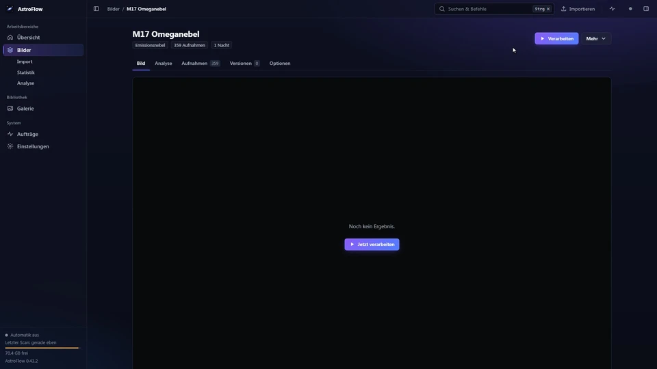

Der **Stacking-Verlauf** zeigt, was 1, 3, 10, 30, 100 … Aufnahmen ausmachen, und **Vorher/Nachher** vergleicht den linearen Stack mit dem entwickelten Bild
(Gradienten, Gaia-Farbkalibrierung, optional GraXpert und StarNet).

| | |
|---|---|
| 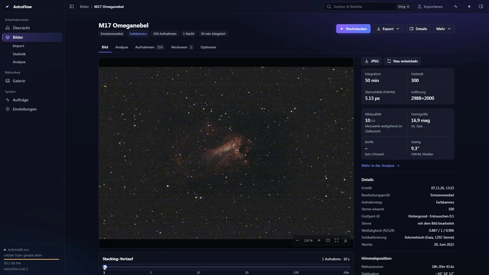 | 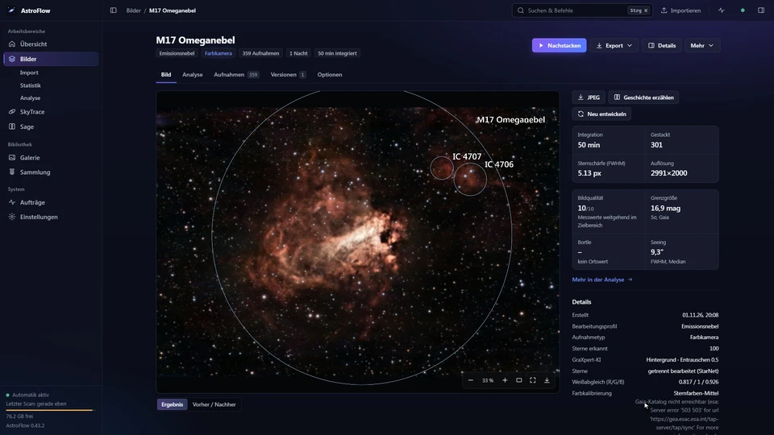 |

*(Stacking-Verlauf: M16, Vorher/Nachher und Live-Ansicht: M17 – echte Aufnahmen eines Smart-Teleskops.)*

## Ergebnisse

Fertige Bilder aus AstroFlow, vollautomatisch aus Rohaufnahmen eines Smart-Teleskops (80 mm Öffnung) entwickelt, verkleinert:

| | | |
|---|---|---|
| 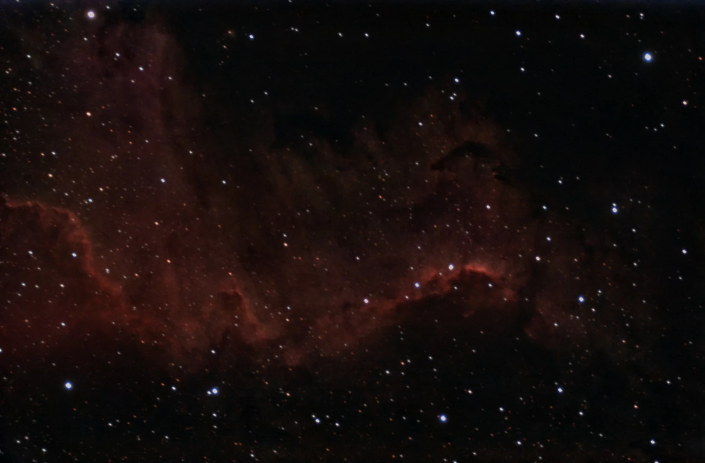 | 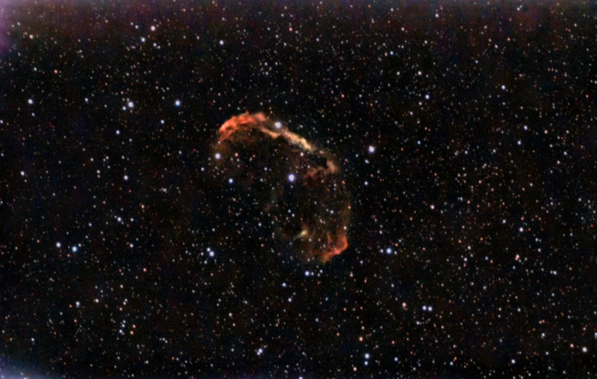 | 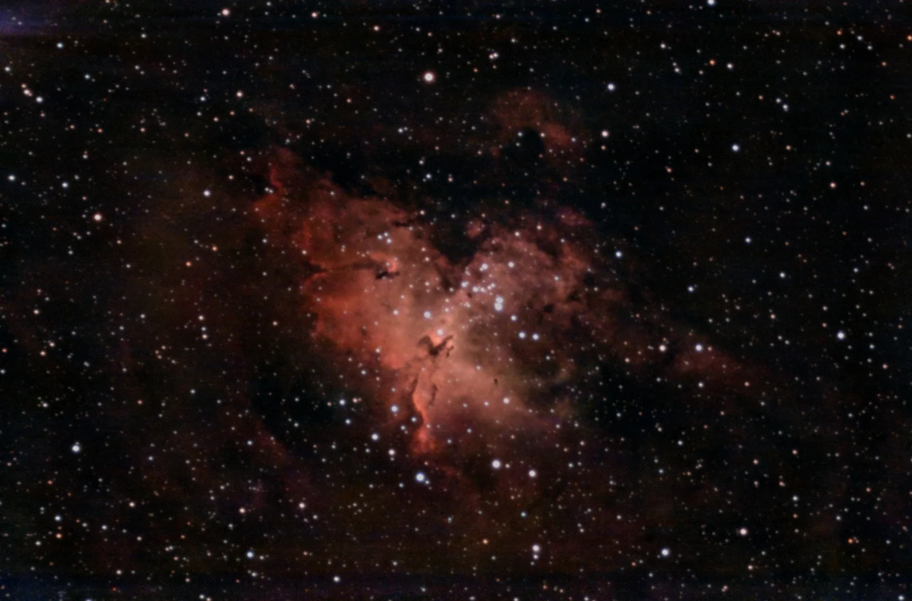 |
| NGC 7000, 58 min | NGC 6888, 45 min | M16 Adlernebel, 1 h 05 min |
| 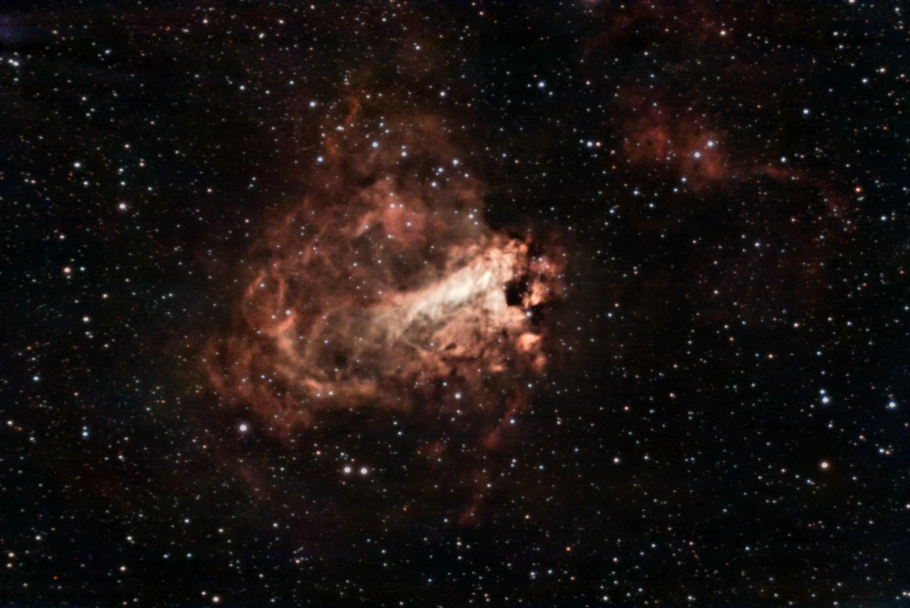 | 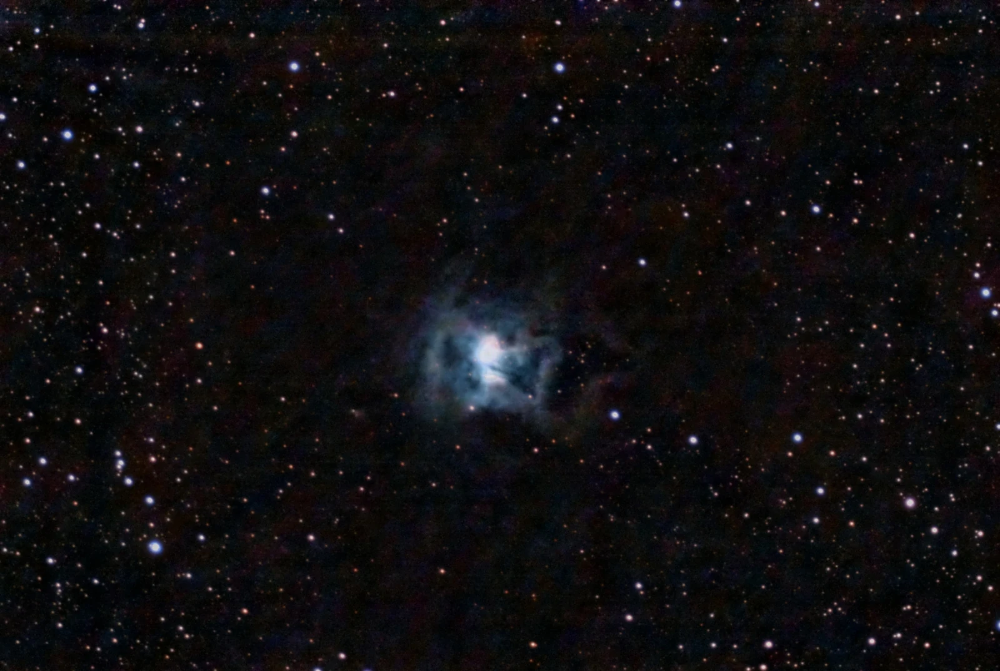 | 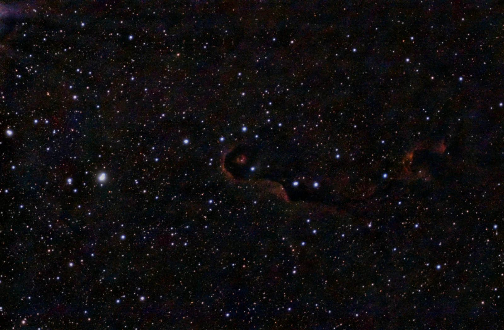 |
| M17 Omeganebel, 50 min | NGC 7023, 3 h 58 min | IC 1396, 60 min |

Die **Galerie** zeigt alle fertigen Bilder, die **Übersicht** das Zuletzt-Bearbeitete – am Handy genauso wie am großen Bildschirm.

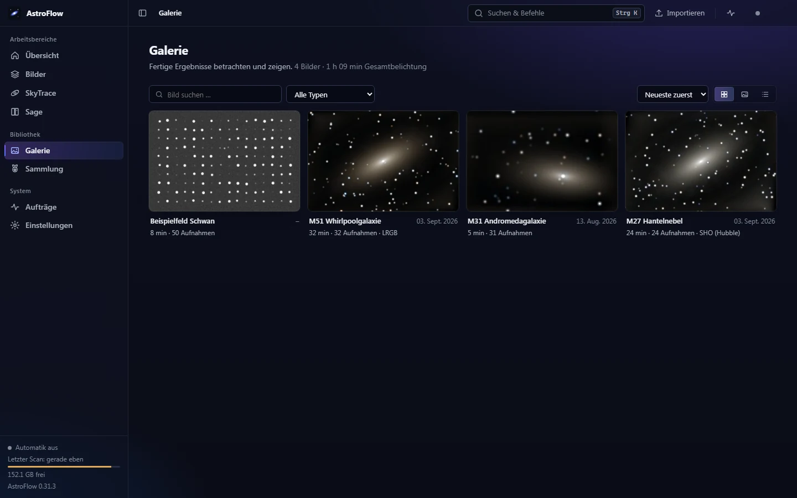

**Teilen-Karte für Foren & Co.:** „Teilen“ im Galerie-Betrachter, in den Bild-Details oder im Export-Menü erzeugt eine
gestaltete Bilddatei: das Foto groß, daneben bzw. darunter Objekt, Aufnahme (Gerät, Belichtung, Aufnahmen, Datum) und bis
zu vier Ergebnisse der Analysen – etwa Grenzgröße, wie lange das Licht der fernsten Galaxie unterwegs war, nachgewiesene
Asteroiden oder entfernte Satellitenspuren –, auf Wunsch mit Objektnamen im Bild und kleiner Himmelskarte. Querformat
(Voreinstellung „Forum“: 1600 px, unter 1 MB) oder Hochformat 4:5 für soziale Netzwerke, dazu „Text kopieren“ als BBCode
oder Markdown. Standort, Uhrzeiten, Dateinamen und Seriennummern stehen nie darauf; hochgeladen wird nichts. Importierte
Bilder lassen sich nur mit Bestätigung „mein eigenes Foto“ oder genanntem Fotografen teilen.

## Das einzelne Objekt: Bild, Qualität, Aufnahmen

Die Objektseite zeigt das Ergebnis im Zoom-Betrachter, den **Stacking-Verlauf** und eine **Bildqualität als Note** (Tiefe, Rauschen, Schärfe und Sternform
einzeln als Balken, dazu Grenzgröße, Bortle und Seeing). Ein kurzer Tutor-Hinweis nennt, was bei dieser Aufnahme störte (Dämmerung, Mond, Wolken).

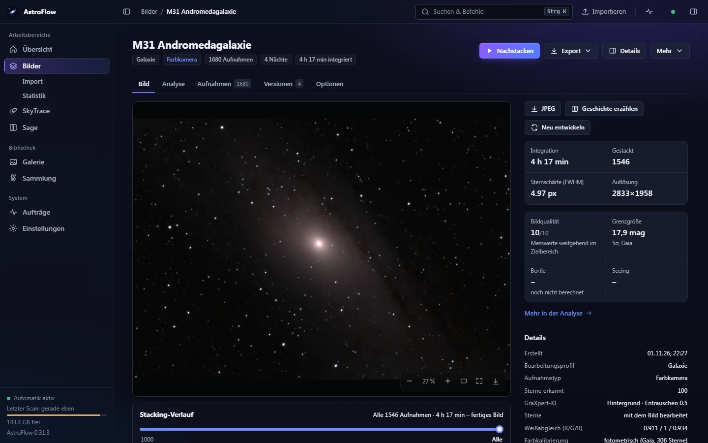

Im Reiter **Aufnahmen** steht jede Einzelaufnahme mit Vorschaubild und der Begründung, warum sie gestackt oder verworfen wurde. Das Diagramm darüber zeigt
Himmelshelligkeit und Schärfe über die Zeit, die Nächte als Bänder mit Dämmerung und Mond sowie die verworfenen Aufnahmen.

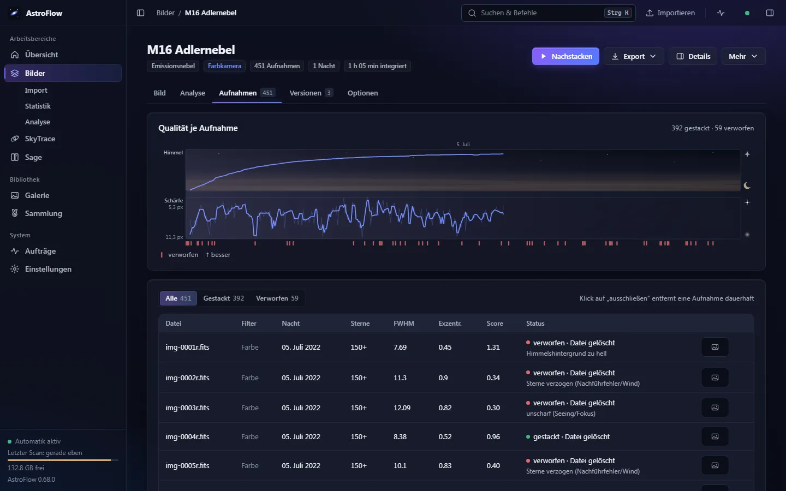

Ein Klick auf das Vorschaubild öffnet die Aufnahme groß – mit dem Grund in Klartext („unscharf – Seeing/Fokus“, „wenige Sterne – Wolken/Dunst“), den Messwerten
im Vergleich zum Median der Nacht und auf Wunsch den erkannten Sternen als Markierung. Mit den Pfeilen blätterst du durch die Serie; „ausschließen“ und „einschließen“
korrigieren die automatische Auswahl.

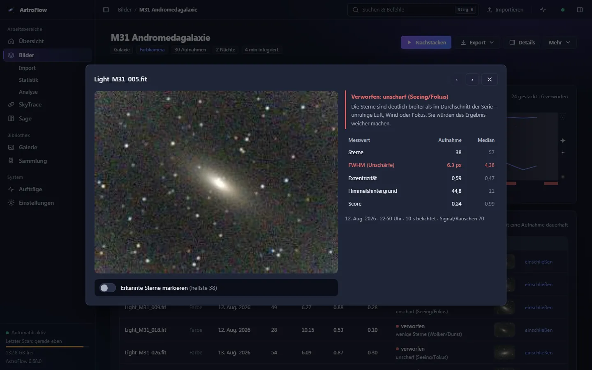

*(Demodaten: synthetische Aufnahmen.)*

**Aussortieren mit Verstand:** Neben Unschärfe, Wolken, Dunst und Satellitenspuren erkennt AstroFlow auch **Sternschweife durch einen Ruck der Montierung**
(runder Sternkern mit schwachem, gleichgerichtetem Schweif) und verwirft solche Aufnahmen mit dem Grund „Sternschweif“. Satelliten- und Flugzeugspuren in den
übrigen Aufnahmen werden maskiert statt die ganze Aufnahme zu opfern.

Verschiebt das Teleskop das Bildfeld deutlich (Mosaikmodus der Stellina, Nachführsprünge), setzt AstroFlow die Felder zu einem größeren Bild zusammen
(Optionen: Mosaik automatisch/ein/aus, Zuschnitt groß oder kompakt).

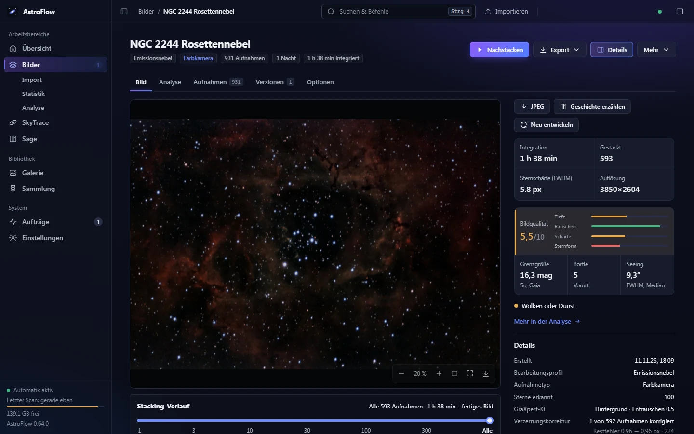

## Fertige Bilder importieren

Neben Rohaufnahmen nimmt AstroFlow auch **fertige Bilder** (JPG, PNG, TIFF) auf – etwa die Ausgabe deines Smart-Teleskops oder ein bearbeitetes Foto –, damit sie
in Galerie, Sage und Observatorium auftauchen. Erkennt AstroFlow das Objekt nicht aus dem Dateinamen, bestimmt es im Hintergrund per **Plate-Solving**
(ASTAP, lokal, ohne Konto): Objekt, Koordinaten, Bildfeld und Ausrichtung werden eingetragen. Das klappt bei normalen Smart-Teleskop-Bildern ab etwa
800 px; stark verkleinerte Webbilder können scheitern – dann hilft „Namen setzen“ (ein Katalogname wie „M42“ setzt zugleich das Objekt) oder „Erneut versuchen“.

Der Reiter **Analyse** zeigt für importierte Bilder die Objekte im Bild (auch als Überlagerung, mit „Objekte im Bild einblenden“), Bildfeld, Maßstab und
Ausrichtung, eine grobe Einordnung der Bildqualität (Sternschärfe, Sternform, Rauschen, Farbstich) und deine eigenen Aufnahmen desselben Objekts.
Messungen, die lineare Rohdaten brauchen (Grenzgröße, HR-Diagramm, Farbkalibrierung), gibt es für fertige Bilder bewusst nicht – ehrlich statt geschätzt.

## Analyse: Was dein Bild zeigt

Im Reiter **Analyse** jedes Objekts misst AstroFlow aus dem plate-gelösten Bild die **Grenzgröße**, die erfassten Sterne, den nächsten und fernsten Stern
(Gaia-Parallaxen) und die fernsten sichtbaren Galaxien und Quasare (Rotverschiebung, Lichtlaufzeit) – als Kennzahlen, Markierungen und **in 3D**.

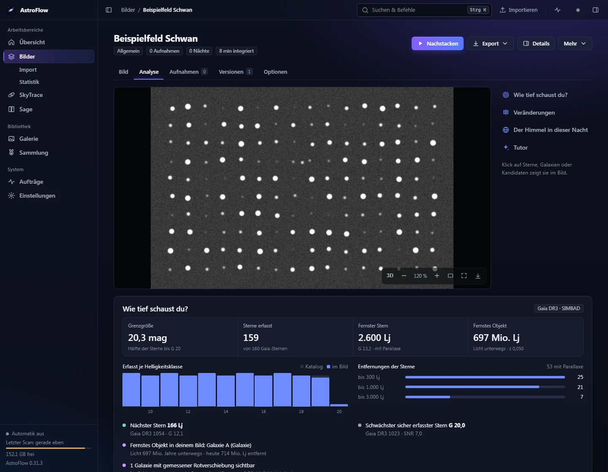

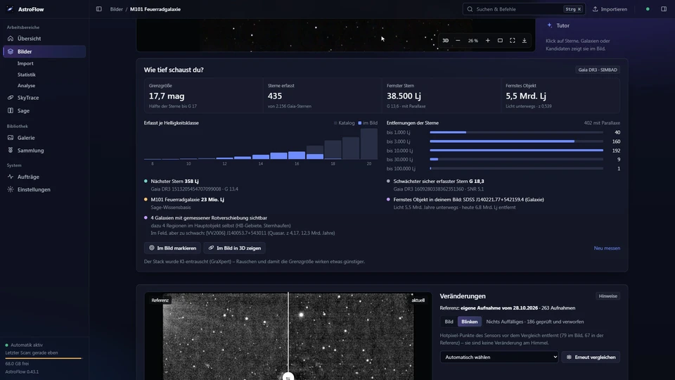

Der **Blinkvergleich** stellt das Bild gegen eine frühere eigene Aufnahme oder die DSS2-Durchmusterung. Neue oder verschwundene Lichtquellen werden nur gemeldet,
wenn sie über der Grenzgröße beider Bilder liegen, und mit SIMBAD und JPL-Kleinkörpern abgeglichen – als Hinweis, nicht als Entdeckung.

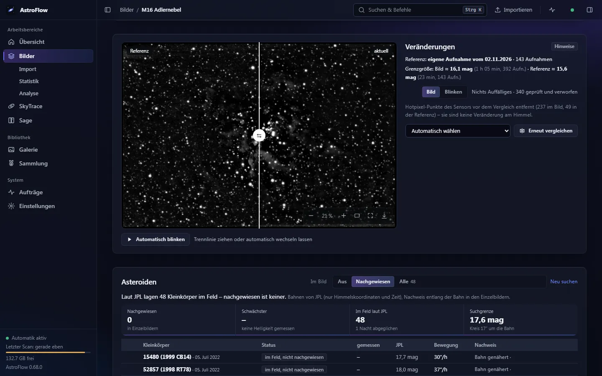

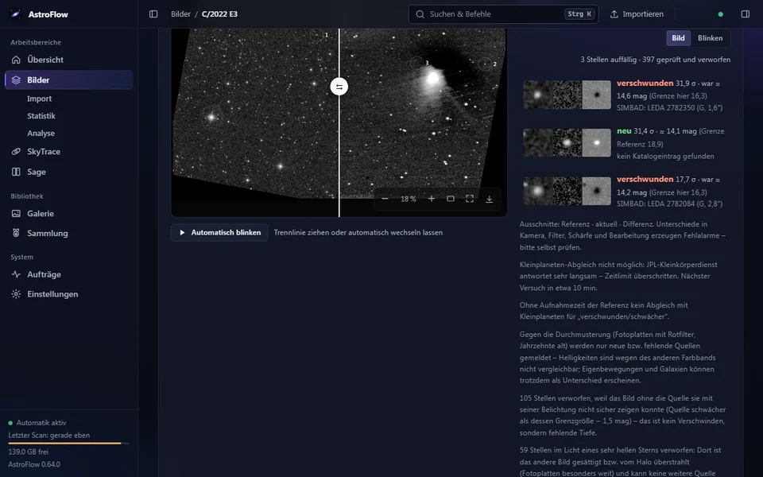

Weitere Auswertungen je Objekt, alle aus gespeicherten Daten:

- **HR-Diagramm** bei Sternhaufen: Farben-Helligkeits-Diagramm aus deinem eigenen Bild mit Abknickpunkt, Entfernung, Rötung und grobem Alter – mit Gegenprobe gegen Gaia.
- **Asteroiden:** welche bekannten Kleinplaneten im Feld lagen und welche du in den Einzelbildern wirklich erwischt hast, mit gemessener Helligkeit.
- **Dein Gerät:** Nachführung (Drift, Verschmieren), Fokus über die Nacht, Schärfekarte des Bildfelds und der Verlauf über alle Nächte des Geräts.
- **Himmel der Aufnahmenacht** (Bortle-Schätzung, Seeing, Lichtrichtung) und **Bild-Tutor** mit Tipps passend zum Gerät.

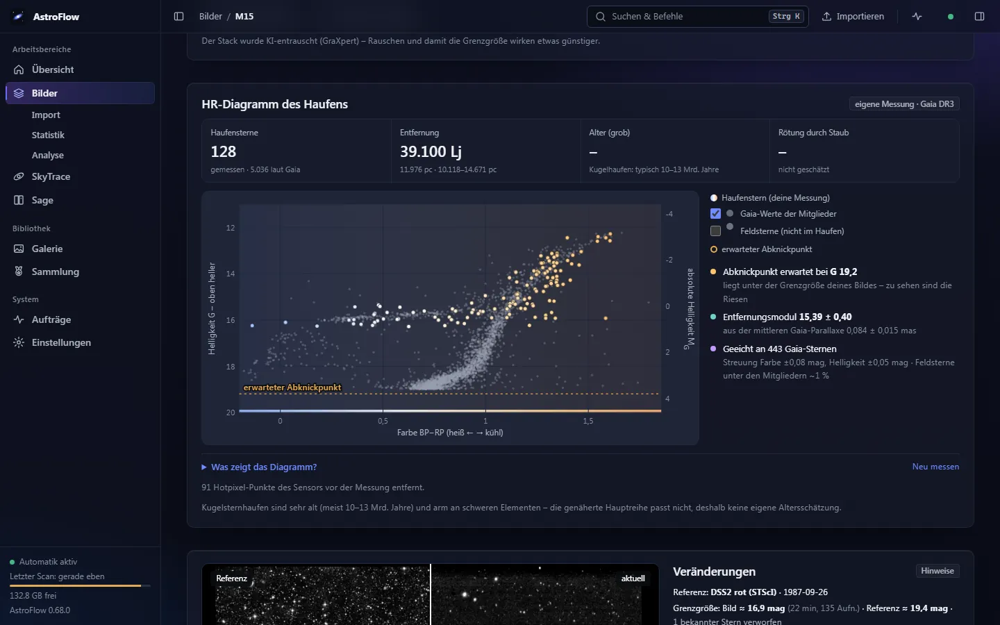

| | |
|---|---|
| 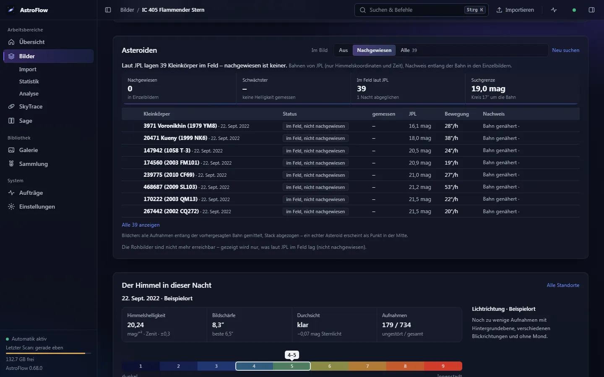 | 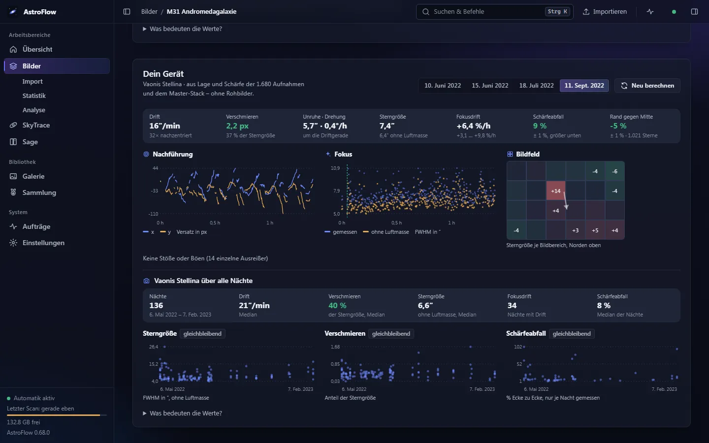 |

*(Beispiele aus echten Aufnahmen eines Smart-Teleskops; Ortsnamen sind durch „Beispielort“ ersetzt. Beim Asteroiden-Bild lagen 48 Kleinkörper laut JPL im Feld, nachgewiesen wurde keiner – AstroFlow meldet nur, was wirklich zu sehen ist.)*

Das **Analyse-Dashboard** (Bilder → Analyse) fasst die ganze Bibliothek zusammen: Kennzahlen, Rekorde, „Dein Universum“ als 3D-Wolke, Verläufe und die Frage,
was am meisten gebracht hat; „Alles analysieren“ rechnet fehlende Auswertungen im Hintergrund nach.

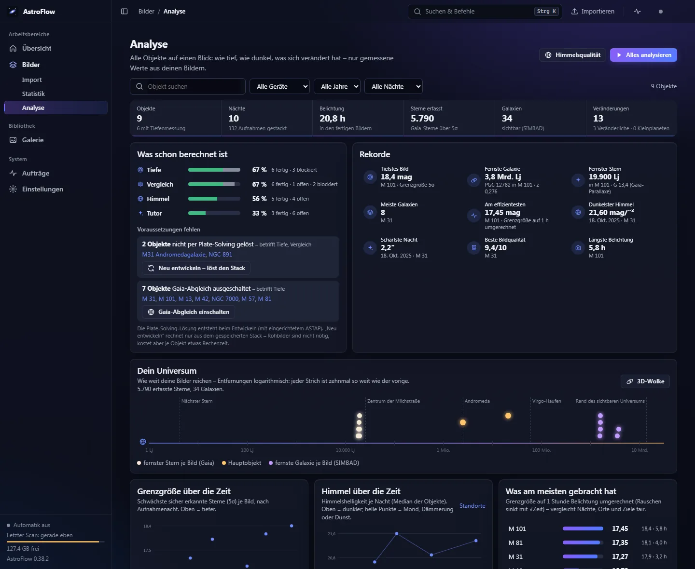

## Himmelsqualität und „Heute Nacht“

| | |
|---|---|
| 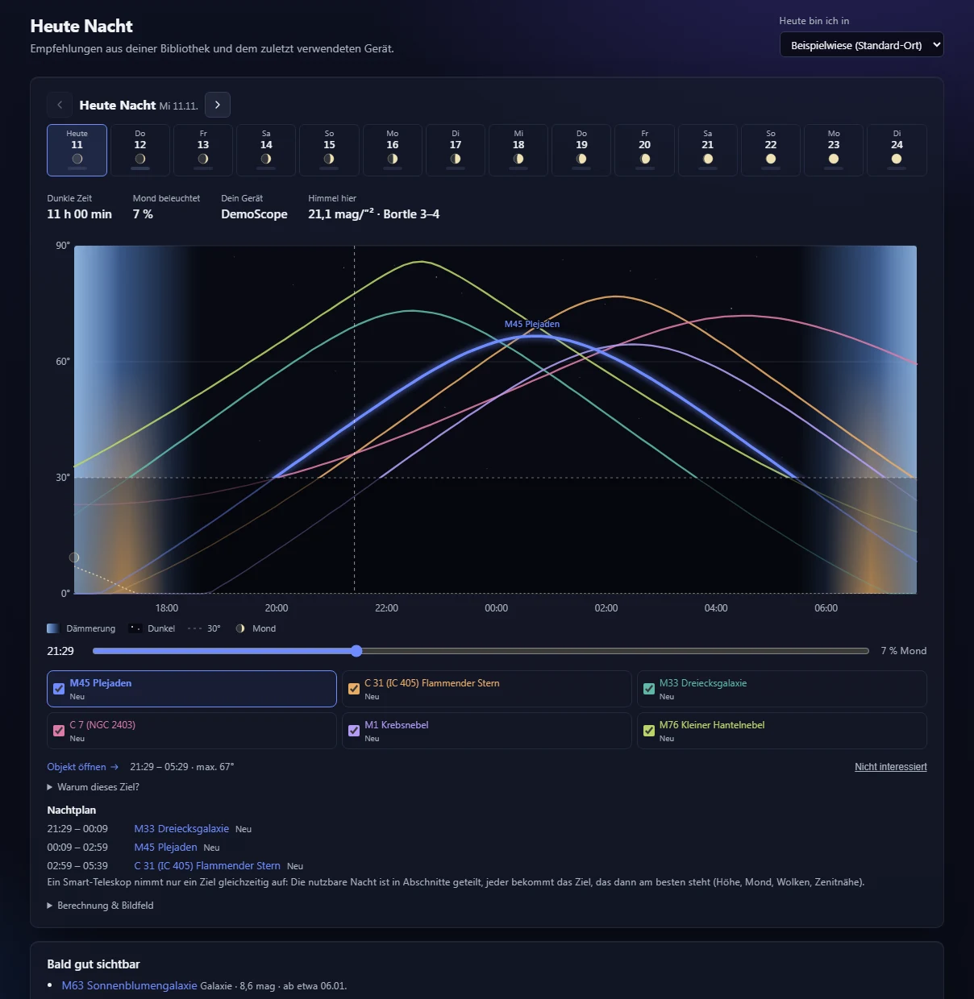 | 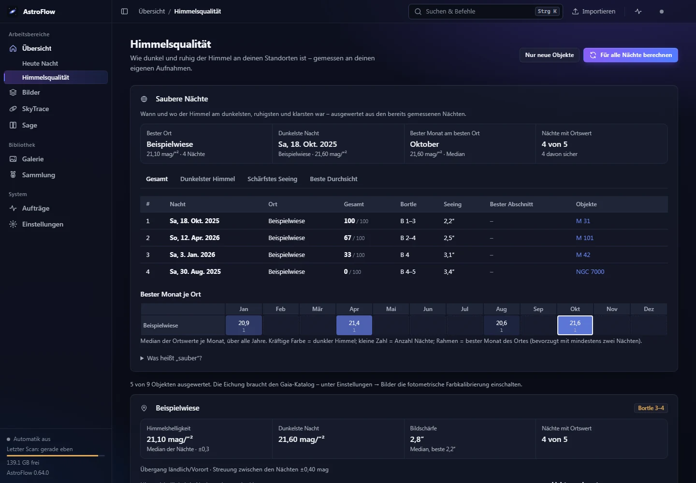 |
| **Heute Nacht:** gut sichtbare Ziele für die gewählte Nacht (mit ‹ › durch die nächsten 14 Nächte blättern), Höhenverläufe mit Dämmerung und Mond, Nachtplan, optional Wetter. | **Himmelsqualität:** aus deinen Aufnahmen gemessen, an Gaia-Sternen geeicht – mag/″², Bortle mit Spanne, Seeing, Lichtrichtung, dazu die **sauberen Nächte** mit Ranglisten. |

*(Demodaten mit erfundenem Ort.)*

## Observatorium: Atlas, „Von hier“ und Beobachtungsplaner

Das Observatorium ist ein zoombarer **Himmelsatlas** des ganzen Himmels – Sterne, Sternbilder mit deutschen Namen, Messier-/Caldwell-Objekte und **deine eigenen Fotos
an ihrer echten Position, in echter Größe und Drehung** (aus dem Plate-Solving). Ein Klick auf ein Foto öffnet das Projekt, auf ein Katalogobjekt die Sage-Seite;
Sage springt umgekehrt von jeder Objektseite hierher. Ebenen (Fotos, Katalog, Sternbilder, Gitter) schaltest du einzeln, die Suche fliegt zu jedem Objekt.

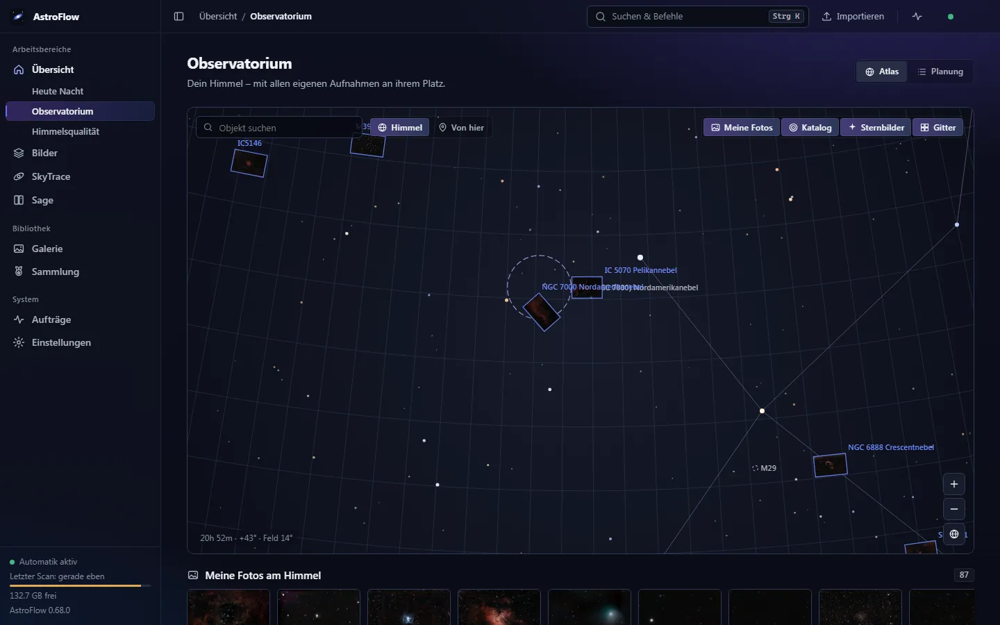

**Von hier:** Der Schalter „Von hier“ zeigt den Himmel, wie er **von deinem Standort aus** aussieht – mit Himmelsrichtungen, Boden unter deiner Horizontmaske, der
Dämmerung und einem **Zeitregler** von jetzt bis 16 Stunden voraus. So siehst du, wann das Ziel über den Baum klettert. Fotos, Katalog und Plan gelten in beiden
Ansichten; alles wird lokal gerechnet.

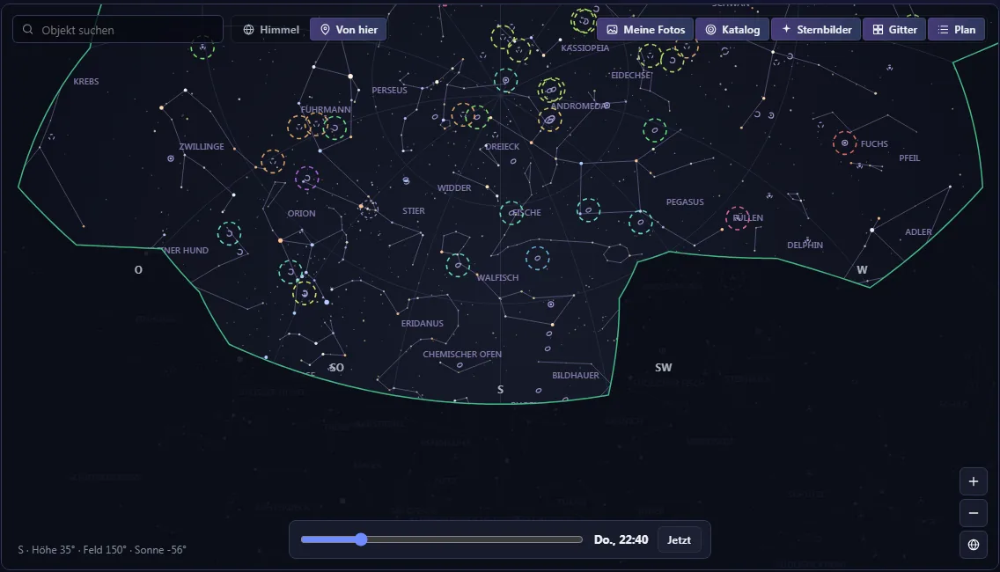

*(Demodaten mit erfundenem Ort und erfundener Horizontmaske; die gestrichelten Ringe sind Ziele aus dem Plan. Eigene Fotos erscheinen hier an ihrer Position.)*

**Planung:** Ein Assistent fragt nach den Nächten (1–14), nach einem oder **zwei Geräten gleichzeitig** (z. B. Stellina und Vespera), dem Wunsch (Neues,
Mischung oder vorhandene Objekte vertiefen), der Mindestbelichtung je Objekt und einer Merkliste – und rechnet daraus einen **Plan über mehrere Nächte**: welches Objekt wann
auf welchem Gerät aufgenommen wird, nach Dunkelheit, Höhe über dem Horizont, Mond und – mit aktivierter Wetter-Einstellung – Wolken. Die Zeitleiste zeigt jede Nacht
je Gerät, die Zielliste den Fortschritt, geplante Ziele erscheinen als Ringe im Atlas, und „Heute Nacht“ zeigt **Dein Plan für diese Nacht**. Mit „Kalender“
exportierst du den Plan als `.ics`-Datei für dein Kalenderprogramm.

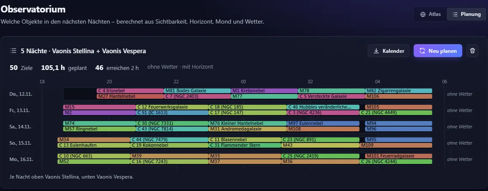

*(Demodaten mit erfundenem Ort, ohne Wetter.)*

## Standorte und Horizont

Orte legst du unter Einstellungen → Standorte **nach Datum** an (Zeiträume, einzelne Nächte, Standard-Ort); „Heute bin ich in …“ wechselt den Ort für die
aktuelle Nacht. Der Ort einer Aufnahme ergibt sich aus FITS-Kopf → Zeitraum → Standard. Dein Standort verlässt dabei den Rechner nie.

Je Ort lässt sich ein **Horizont** einzeichnen – Bäume, Häuser, Balkonbrüstung: Linie auf die richtige Höhe ziehen oder eine Vorlage nehmen. „Heute Nacht“, der
Planer und „Von hier“ rechnen dann nur mit dem freien Himmel. Aus deinen eigenen Aufnahmen entsteht ein **Vorschlag**: Punkte zeigen, wohin du an diesem Ort
schon fotografiert hast (rot = von der Maske verdeckt), und „An Aufnahmen anpassen“ senkt die Maske dort ab.

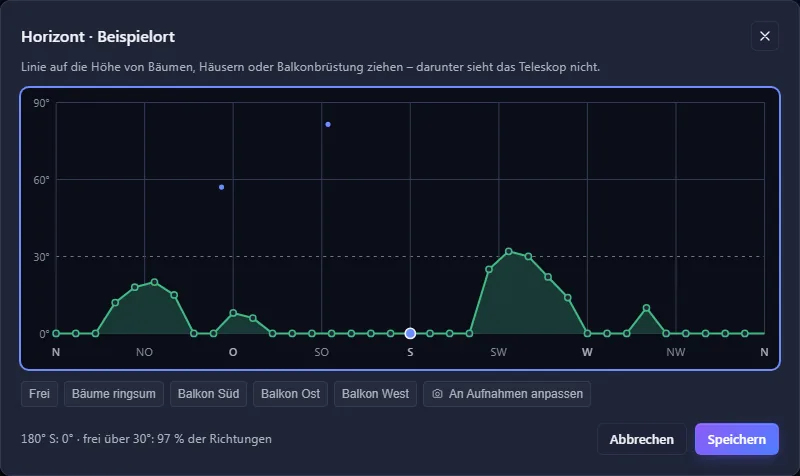

*(Demodaten mit erfundenem Ort.)*

**Bahnen:** In „Von hier“ zeigt die Ebene **Bahnen**, wie deine Ziele durch die Nacht wandern und wann sie im freien Ausschnitt über deinem Horizont stehen – mit Listen „Jetzt frei“, „Später frei“ und „Nie frei“; „Ganzer Himmel“ zeigt alles von oben. Mit einem Plan siehst du dort auch, wann dein Teleskop welches Objekt anpeilt und wohin es danach schwenkt.

## Kometenmodus

Kometen bekommen zwei Stacks – auf die Sterne und auf den Kometenkern – und werden zu einem Bild zusammengesetzt (Bahn aus der JPL-Ephemeride oder im Bild
gemessen). Beide Einzelstacks bleiben ansehbar.
