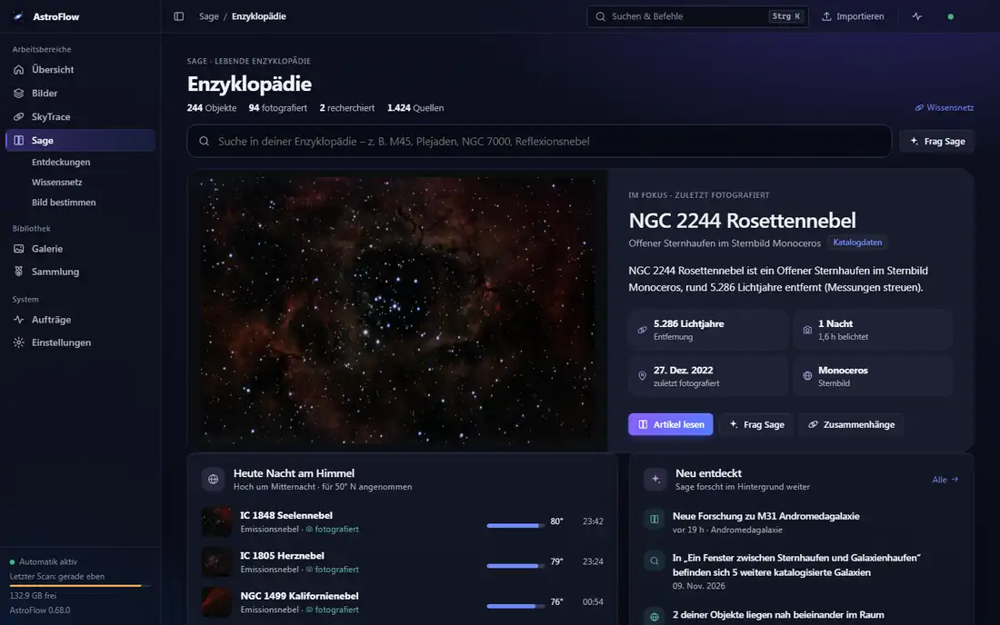
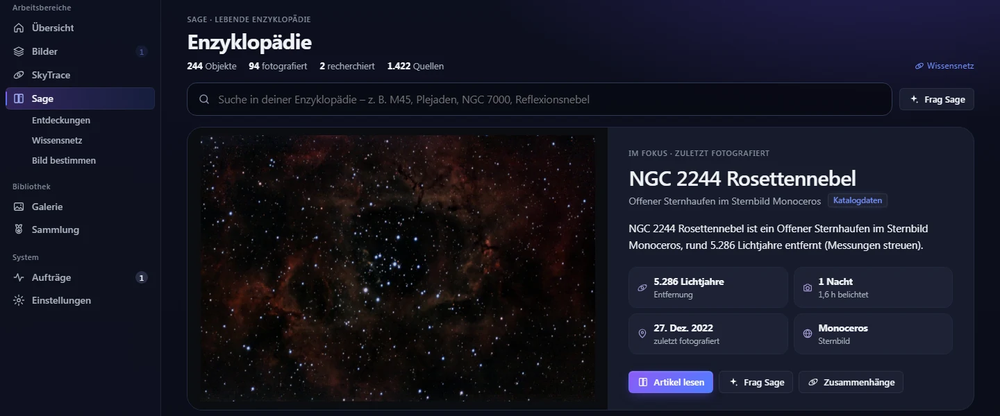
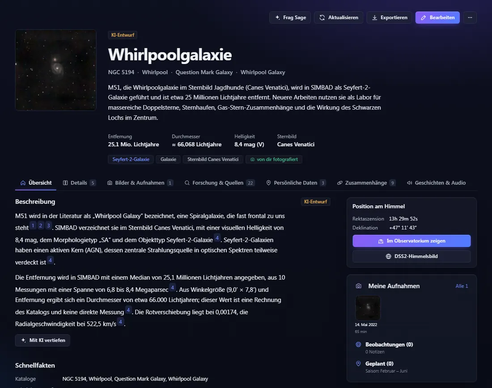
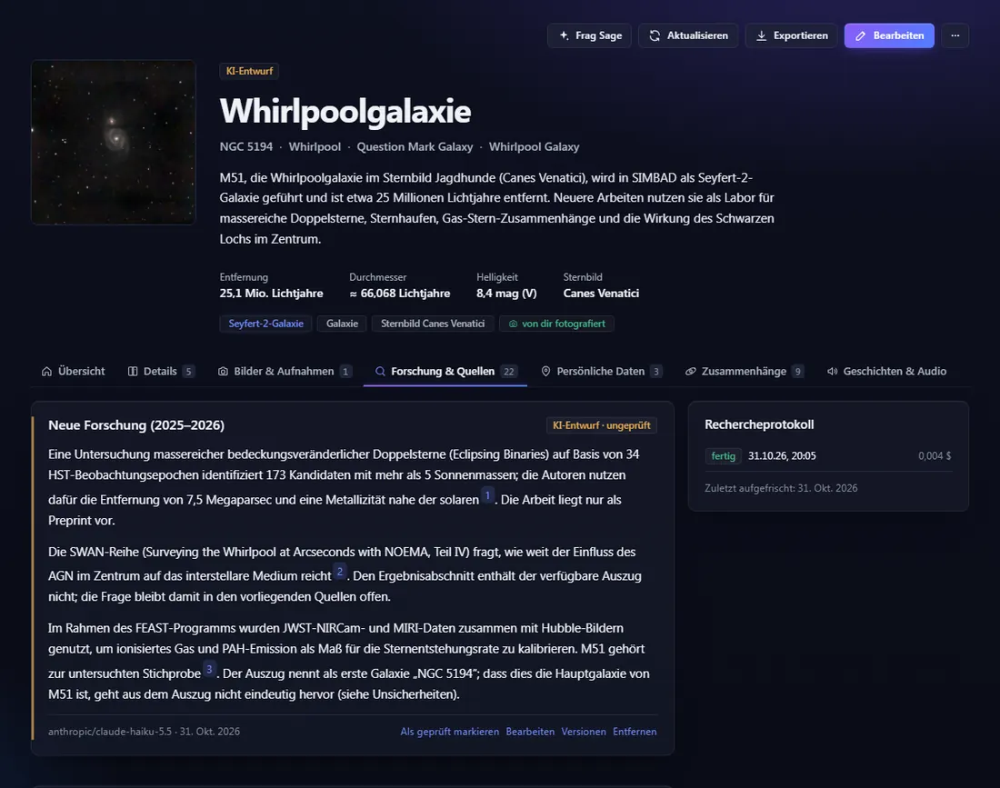
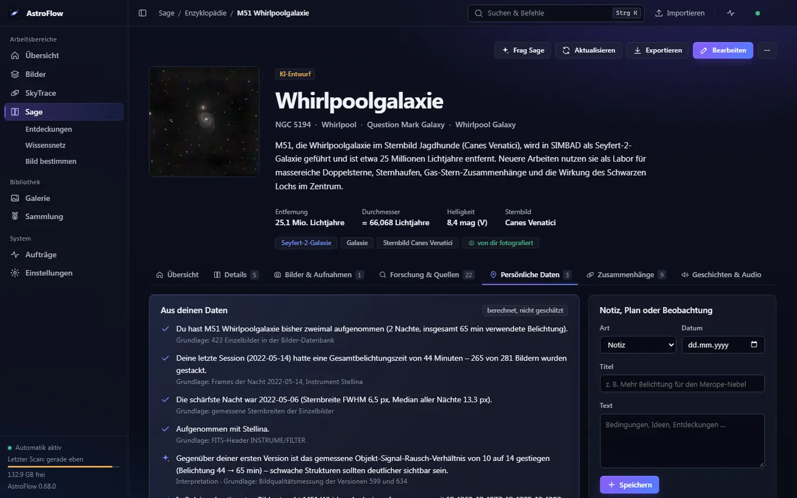
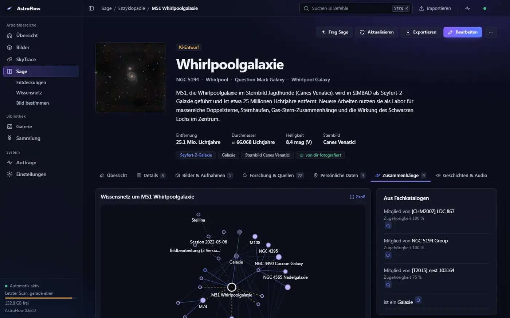
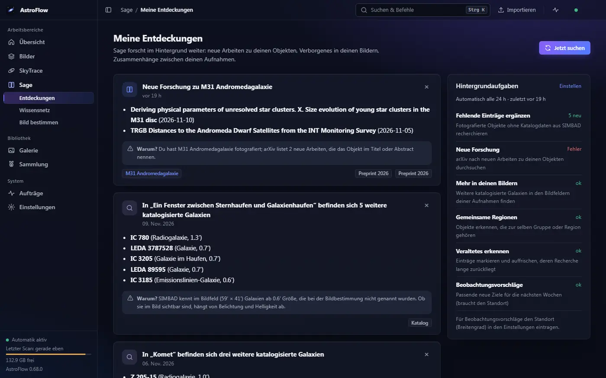
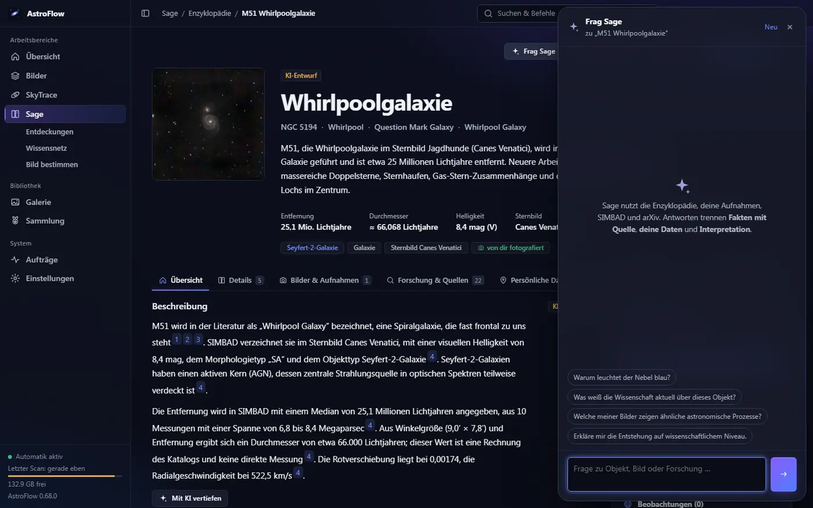
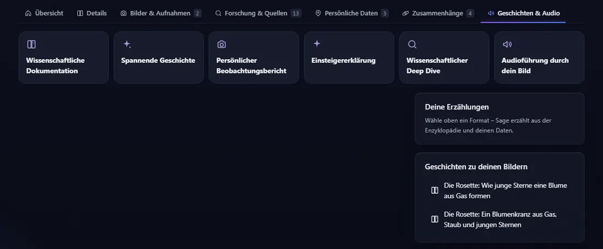
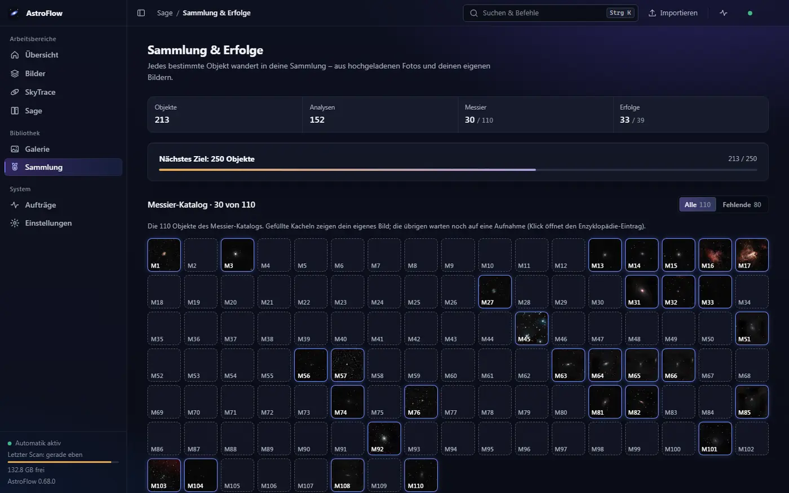

# Sage – die lebende Enzyklopädie

Sage erklärt, was du fotografiert hast: Jedes Objekt bekommt einen Eintrag mit deinem Bild, Messwerten aus Fachkatalogen,
deinen eigenen Beobachtungen und – wenn du eine KI einrichtest – Recherche, Geschichten und einem Gesprächspartner. Alles läuft lokal
auf deinem Rechner, ohne Konto.

[← Zurück zur Übersicht](../../README.md)

**Inhalt**

1. [Die Grundregel: Belegpflicht](#die-grundregel-belegpflicht)
2. [Enzyklopädie und Objektseite](#enzyklopädie-und-objektseite)
3. [Bild bestimmen](#bild-bestimmen)
4. [Recherche: Fachkataloge und KI-Agent](#recherche-fachkataloge-und-ki-agent)
5. [Dein Beobachtungsgedächtnis](#dein-beobachtungsgedächtnis)
6. [Wissensnetz](#wissensnetz)
7. [Meine Entdeckungen](#meine-entdeckungen)
8. [Frag Sage – der Chat](#frag-sage--der-chat)
9. [Geschichten und Audioführung](#geschichten-und-audioführung)
10. [Sammlung und Erfolge](#sammlung-und-erfolge)
11. [Zusammenspiel mit Bilder und dem Observatorium](#zusammenspiel-mit-bilder-und-dem-observatorium)
12. [Was braucht eine KI, was geht ohne?](#was-braucht-eine-ki-was-geht-ohne)

## Die Grundregel: Belegpflicht

Sage trennt strikt, was gemessen ist und was ein Sprachmodell geschrieben hat:

- **Messwerte kommen aus Fachquellen**, nie von der KI: Koordinaten, Objektart, Entfernung, Winkelgröße, Helligkeit und Zugehörigkeit
  stammen aus [SIMBAD](https://simbad.cds.unistra.fr/); jede Entfernungsmessung ist mit ihrer Literaturquelle verknüpft. Streuen die
  Messungen stark, steht das so da („Messungen streuen“), statt einen schönen Mittelwert vorzutäuschen.
- **Jede Aussage hat eine Quelle** (nummerierte Verweise im Text, die zur Quellenliste führen) **oder ist als KI-Vorschlag gekennzeichnet.**
  Texte der KI tragen das Etikett **„KI-Entwurf“**, bis du sie selbst mit „Als geprüft markieren“ bestätigst.
- **Ein Prüfer liest mit:** Absätze ohne Beleg, Verweise auf unbekannte Quellen und Zahlen, die den Katalogwerten widersprechen, werden
  markiert.
- **Persönliche Aussagen nur aus echten Daten** („Du hast M51 zweimal aufgenommen …“) – mit der Grundlage dahinter.
- **Inhalte aus dem Netz sind Daten, keine Anweisungen:** Was ein Katalog oder ein Fachartikel enthält, steuert die KI nicht.

## Enzyklopädie und Objektseite

Die Startseite ist ein Portal im Stil einer Enzyklopädie-Hauptseite: Suche, ein Bild „im Fokus“ (zuletzt fotografiert, umschaltbar), „Heute
Nacht am Himmel“ mit den Objekten, die um Mitternacht hoch stehen, „Neu entdeckt“ und ein Raster aller Einträge, filterbar nach Objektart.
Die Suche kennt Namen, Kennungen und Fachbegriffe – auch ohne Umlaute und Schreibweisen wie „M 45“ oder „Plejaden“.

Jedes Objekt hat eine eigene Seite: dein Bild als Titelbild, Kurztext, Kernwerte (Entfernung, Durchmesser, Helligkeit, Sternbild),
Beschreibung mit Quellenverweisen, Schnellfakten, verwandte Objekte und deine Aufnahmen. Sieben Reiter ordnen den Rest:
**Übersicht · Details · Bilder & Aufnahmen · Forschung & Quellen · Persönliche Daten · Zusammenhänge · Geschichten & Audio.**
Die Seite lässt sich als Markdown **mit Quellen exportieren** und bearbeiten – eigene Korrekturen bleiben erhalten.

## Bild bestimmen

Sage erkennt, was auf einem Bild zu sehen ist, und verknüpft jedes Objekt mit seinem Eintrag. Der Ablauf:

1. **Bild kommt in die Galerie** – ein gestackter Master aus dem Bilder-Modul oder ein fertiges Bild über **Importieren**.
2. **Position bestimmen:** Bei Bildern aus AstroFlow wird die gespeicherte Lösung des Stacks wiederverwendet (in Sekundenbruchteilen).
   Sonst liest Sage die Koordinaten aus dem FITS-Header oder löst lokal mit ASTAP. Ohne Positionshinweis wird nicht blind gelöst.
   Online-Lösen über nova.astrometry.net gibt es nur, wenn du es ausdrücklich erlaubst; das Bild wird dann hochgeladen.
3. **Objekte eintragen:** Alle Katalogobjekte im Bildfeld bekommen sofort einen Eintrag; fehlende Details werden im Hintergrund aus
   SIMBAD ergänzt. Im Bild ist jedes Objekt antippbar und öffnet seine Wissenskarte.

Fertige Webbilder (stark verkleinerte JPG/PNG) lassen sich schlechter lösen als Smart-Teleskop-Bilder ab etwa 800 px; ohne erkennbares
Objekt bleibt das Bild im Verlauf, ohne dass etwas Falsches eingetragen wird.

## Recherche: Fachkataloge und KI-Agent

Ein Eintrag entsteht in Stufen, jede ist einzeln nutzbar:

1. **Grundeintrag** aus dem eingebauten Katalog – sofort, ohne Netz.
2. **Katalogdaten** aus SIMBAD: Typ, Koordinaten, Entfernung (Parallaxe oder Median der Messungen), Hierarchie („Mitglied von …“,
   „enthält …“), Literaturhinweise.
3. **Mit KI recherchieren:** Ein begrenzter Agent liest dazu Fachartikel (arXiv, auf Wunsch NASA ADS), schreibt Abschnitte wie
   Beschreibung, Physik und neue Forschung und gibt jede Aussage mit Beleg an. Jeder Lauf wird protokolliert (Schritte, abgerufene
   Quellen, Kosten) und hat ein **Lauf- und ein Monatsbudget**, damit die Recherche nicht unbemerkt teuer wird.

Das Ergebnis erscheint als KI-Entwurf unter **Forschung & Quellen**; du kannst Abschnitte prüfen, bearbeiten, in früheren Fassungen
nachlesen oder entfernen.

## Dein Beobachtungsgedächtnis

Sage kennt deine Aufnahmen aus dem Bilder-Modul und rechnet daraus persönliche Aussagen – jeweils mit der Grundlage, auf der sie beruhen
(„berechnet, nicht geschätzt“):

- wie oft und in wie vielen Nächten du ein Objekt aufgenommen hast, mit welcher Belichtung und welchem Gerät,
- welche deiner Nächte die schärfste war (gemessene Sternbreite) und wie sich das Signal-Rausch-Verhältnis zwischen deinen
  Bearbeitungsversionen verbessert hat,
- welche anderen Objekte auf denselben Bildern auftauchen.

Dazu gibt es **Notizen, Pläne und Beobachtungen** je Objekt (z. B. „Mehr Belichtung für den Rand“), die Sage bei Antworten und Vorschlägen kennt. Das alles braucht keine KI.

## Wissensnetz

Das Wissensnetz zeigt, wie deine Objekte zusammenhängen. Der Überblick **gruppiert nach Objektart oder Sternbild**; wichtige Objekte
liegen in der Mitte, die Größe folgt den Belichtungsstunden. Antippen öffnet eine Infokarte mit den Verbindungen, ein Fokus auf ein
Objekt zeigt seine Nachbarn in Ringen. Zoomen und Ziehen gehen auch per Touch.

Linien tragen ihre Herkunft: **Fachkatalog**, **Grundwissen**, **deine Daten** oder **KI-Vorschlag** (gestrichelt). Vorschläge der KI
gelten nicht als Wissen – du **bestätigst oder verwirfst** sie auf der Infokarte oder unter *Zusammenhänge* eines Objekts.

## Meine Entdeckungen

Sage forscht im Hintergrund weiter und meldet, was für dich neu ist – jeweils mit „Warum?“:

- **Neue Forschung** zu deinen Objekten (neue arXiv-Arbeiten, die dein Objekt im Titel oder Abstract nennen),
- **Mehr in deinen Bildern:** weitere katalogisierte Galaxien im Bildfeld, die bei der Bestimmung nicht genannt wurden,
- **Gemeinsame Regionen:** Objekte, die zur selben Gruppe gehören,
- **Fehlende Einträge** ergänzen und **veraltete** Recherchen markieren,
- **Beobachtungsvorschläge** für die nächsten Wochen (mit eingetragenem Standort).

Die Aufgaben laufen in einem einstellbaren Intervall (Standard: täglich) oder auf Knopfdruck über **Jetzt suchen**; jede einzelne lässt
sich abschalten. Funde fallen nicht doppelt an, und ein Fehler bei einer Aufgabe hält die anderen nicht auf.

## Frag Sage – der Chat

Neben jedem Eintrag (und auf der Startseite) öffnet **Frag Sage** einen Chat, der die Enzyklopädie, deine Aufnahmen, SIMBAD und arXiv
nutzt und mit einem eingebauten Rechner arbeitet. Antworten trennen **Fakt mit Quelle**, **deine Daten** und **Interpretation**. Als
Beleg zählen nur Quellen, die Sage tatsächlich abgerufen hat – erfundene Verweise werden entfernt. Der Chat braucht eine eingerichtete KI.

## Geschichten und Audioführung

Aus Enzyklopädie und deinen Daten erzählt Sage in sechs Formaten: **wissenschaftliche Dokumentation**, **spannende Geschichte**,
**persönlicher Beobachtungsbericht**, **Einsteigererklärung**, **Deep Dive** und die **Audioführung durch dein Bild** – ein Abschnitt
je Objekt, wobei beim Abspielen das jeweilige Objekt im Bild hervorgehoben wird. Alle Erzählungen sammeln sich unter „Deine Geschichten“.

Vorlesen funktioniert wahlweise über OpenRouter (z. B. ElevenLabs-Stimmen), direkt über ein eigenes ElevenLabs-Konto oder einen lokalen,
OpenAI-kompatiblen Sprachserver. Die Vertonung wird gespeichert und nur bei einer anderen Stimme neu erzeugt.

## Sammlung und Erfolge

Jedes bestimmte Objekt wandert in deine Sammlung. Der **Messier-Fortschritt** zeigt alle 110 Objekte als Kacheln – gefüllt mit deinem
eigenen Bild, sobald du sie hast – dazu Meilensteine (nächstes Ziel mit Fortschrittsbalken) und **Erfolge** für Nächte, Belichtungszeit,
Jahreszeiten, Objektarten und mehr. Neue Erfolge feiert die App wie bei Spielen unten rechts; sie beruhen ausschließlich auf deinen
echten Daten und werden rückwirkend vergeben. Ein Klick auf eine Kachel öffnet den Eintrag.

## Zusammenspiel mit Bilder und dem Observatorium

- **Automatisch nach dem Stacken:** Ein fertiges Ergebnis wird auf Wunsch (Standard) sofort bestimmt, bekommt seine Einträge und – wenn
  eine Erzähl-KI eingerichtet ist – eine Geschichte. Gleiches gilt für importierte fertige Bilder. Abschalten: Einstellungen → Sage.
- **Observatorium:** Auf jeder Objektseite zeigt **Im Observatorium zeigen** das Objekt im Himmelsatlas mit deinen Fotos; ein Klick auf ein
  Foto dort führt zurück zum Eintrag.
- **Heute Nacht und Sammlung:** Die Planung weist bei Messier-Zielen darauf hin, das wievielte Objekt es für deine Sammlung wäre; die
  Beobachtungsvorschläge von Sage nutzen deinen Standort aus den Einstellungen.
- **Bilder-Modul:** Nächte, Belichtung, Gerät und Bildqualität kommen von dort – ohne Bilder-Modul bleibt Sage nutzbar, nur ohne persönliche Daten.

## Was braucht eine KI, was geht ohne?

Sage ist so gebaut, dass der Kern ohne KI und ohne Konto funktioniert. Eine KI ist eine Zusatzoption.

| | Ohne KI-Schlüssel | Mit KI |
|---|---|---|
| Enzyklopädie, Suche, Objektseiten, Katalogwerte | ✔ (Internet nur für SIMBAD, sonst Grundeintrag) | – |
| Bild bestimmen (Plate-Solving), Verlauf | ✔ (ASTAP lokal) | – |
| Persönliche Daten, Notizen, Pläne | ✔ | – |
| Wissensnetz (Katalog, Grundwissen, deine Daten) | ✔ | zusätzlich KI-Vorschläge zum Bestätigen |
| Sammlung und Erfolge | ✔ | – |
| Entdeckungen: neue arXiv-Arbeiten, Bildfeld-Funde, Gruppen, veraltete Einträge | ✔ | Zusammenfassungen nur nach ausdrücklicher Freigabe |
| Audioführung | ✔ als Vorlage aus Katalogdaten | KI-Text |
| Recherche mit Quellenabschnitten („Mit KI recherchieren“) | – | ✔ |
| Geschichten, Chat „Frag Sage“ | – | ✔ |
| Vorlesen | – | ✔ (OpenRouter, ElevenLabs oder lokaler Sprachserver) |

- **Anbieter:** OpenAI, OpenRouter, LM Studio oder ein eigener OpenAI-kompatibler Server – auch rein lokal ohne Cloud. Schlüssel und
  Modell trägst du unter Einstellungen → Sage ein; Schlüssel werden nur an die Adresse geschickt, für die du sie eingegeben hast.
- **Kosten:** Lauf- und Monatsbudget samt Protokoll gelten für die KI-Recherche (Agent). **Geschichten und Vorlesen unterliegen diesem Budget nicht** – auch die automatisch erzeugte Geschichte nach dem Stacken nicht; wer das vermeiden will, schaltet sie in den Einstellungen ab. Entdeckungs-Aufgaben nutzen eine KI nur, wenn du das erlaubst.
- **Datenschutz:** Abgefragt werden SIMBAD und arXiv (Objektnamen, keine Standortdaten); an eine KI gehen Objektdaten und Katalogauszüge,
  nie deine Bilder. Ohne Internet bleibt alles Bisherige sichtbar; neue Recherchen warten, bis es wieder geht.
