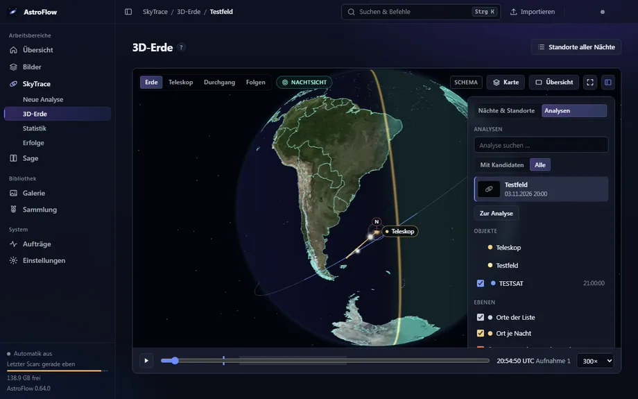

# SkyTrace – was sich zwischen den Sternen bewegt

Bildfolgen auf Lichtspuren und bewegte Objekte untersuchen und mit Satelliten, Meteoren und Flugzeugen zur Aufnahmezeit abgleichen.

[← Zurück zur Übersicht](../../README.md)

Spuren in Bildfolgen werden als **Kandidaten** mit Ausschnitt, Zeitreihe und Messdetails erfasst und zur echten Aufnahmezeit mit Satelliten, Meteoren und Flugzeugen
abgeglichen. Ein Kandidat ist ein Hinweis, kein bestätigtes Objekt.

Die **3D-Erde** zeigt den Standort, das Blickfeld des Teleskops, Satellitenbahnen und – beim Hineinzoomen – eine flache Karte; auch Orte, Heatmaps der
Standortsuche und die Tag/Nacht-Grenze liegen auf demselben Globus. Ein Klick auf eine Satellitenbahn (oder ihren Bodenpunkt in der flachen Karte)
zeigt Name, Kennung, Start, Bahn, gemessene Helligkeit, wie sicher die Zuordnung ist – und den Ausschnitt deiner Aufnahme mit der Spur.

*(Die Spuren-Animation zeigt eine echte Bildfolge ohne Ortsangaben, die 3D-Erde Demodaten mit erfundenem Ort.)*

Weitere Funktionen: **Standort suchen** (aus Satellitenspuren zurückgerechnet, auch ohne Vorwissen), **Uhrversatz suchen**, **Satelliten neu abgleichen**,
**Erneut analysieren**, Statistik mit **Satellitenhelligkeit** und „Satelliten am Himmel“ sowie **Erfolge**. Vorschläge für Orte und Uhrkorrekturen werden nie
automatisch übernommen.
