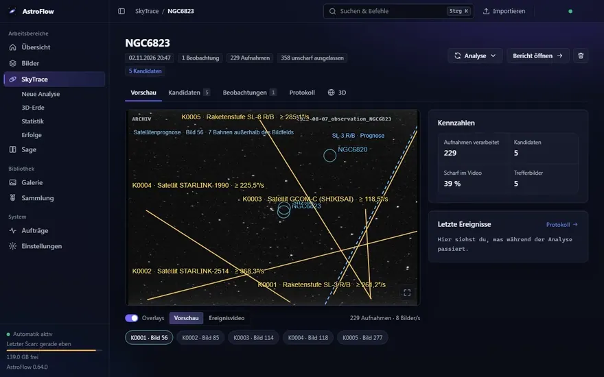
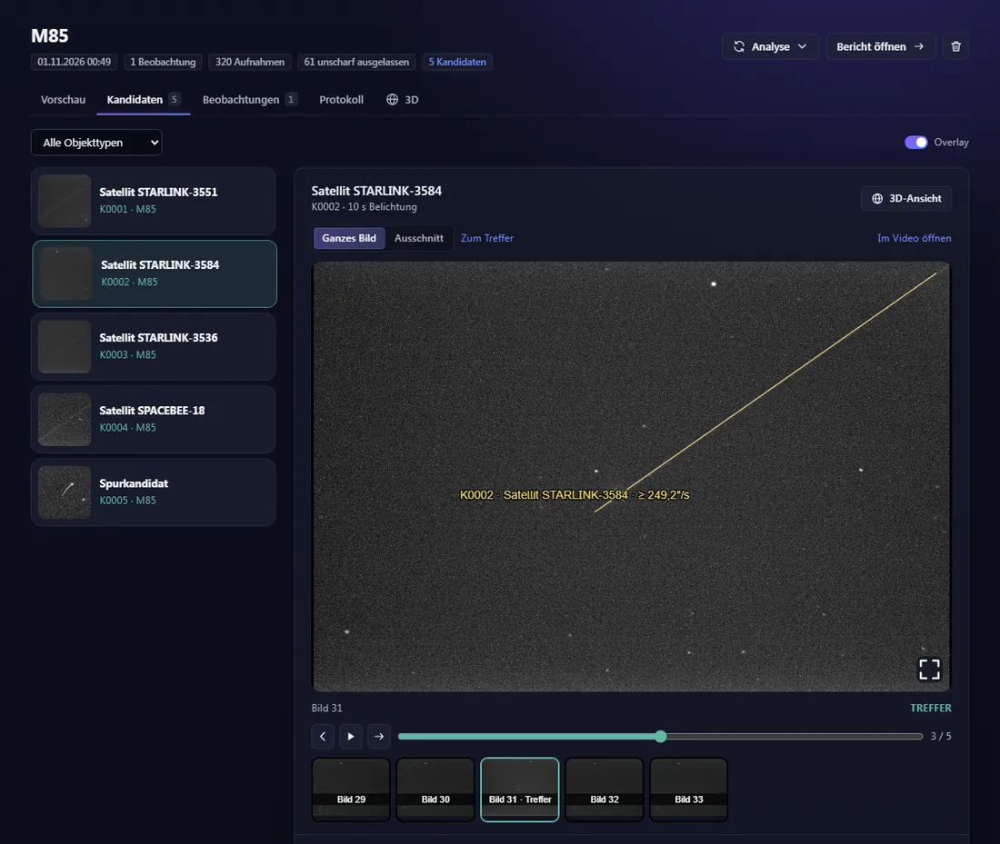
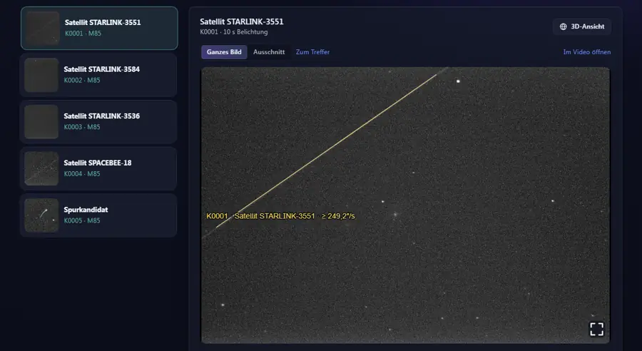
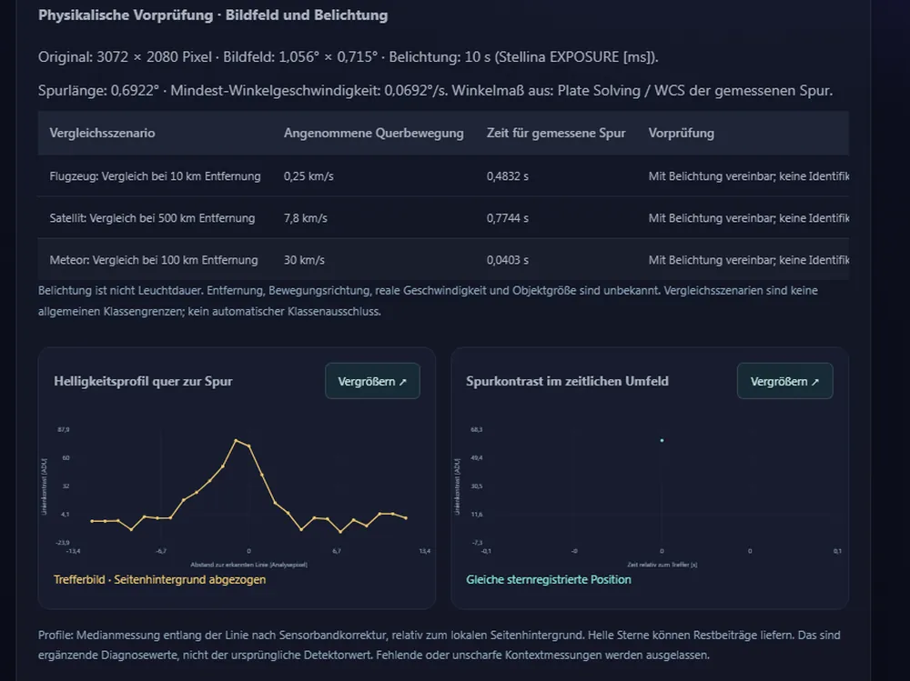
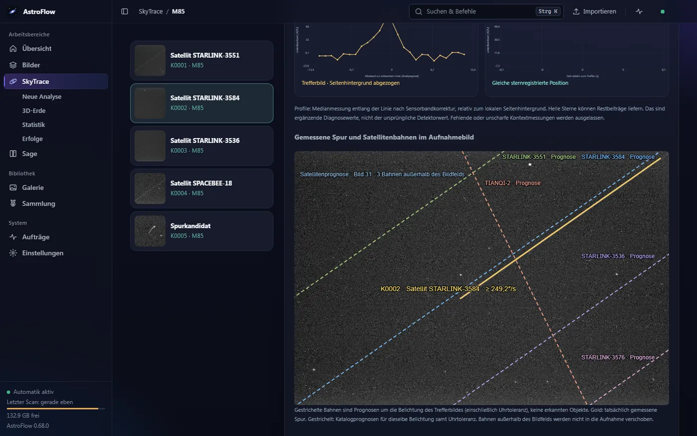
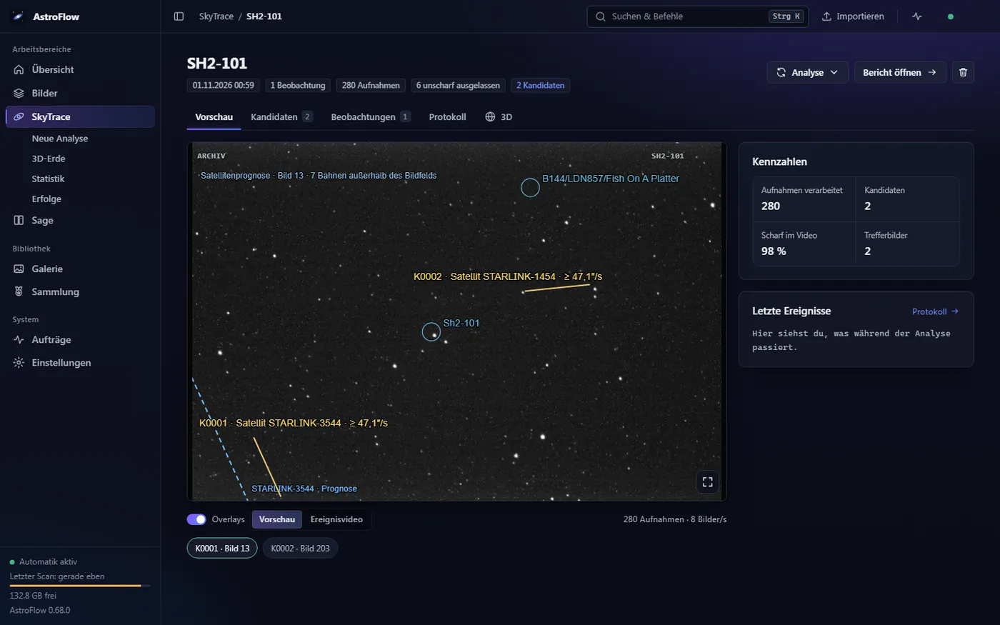
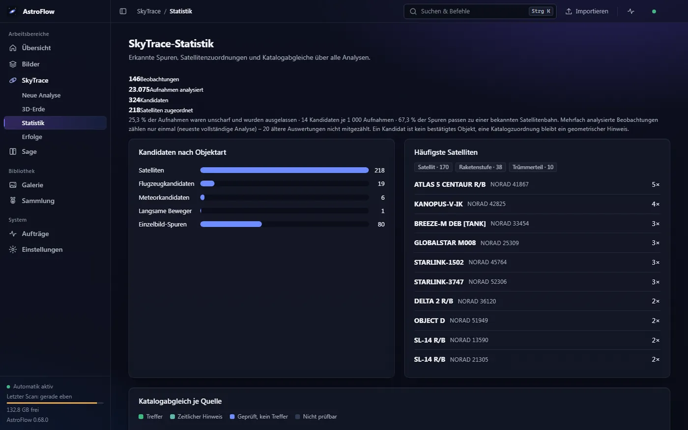
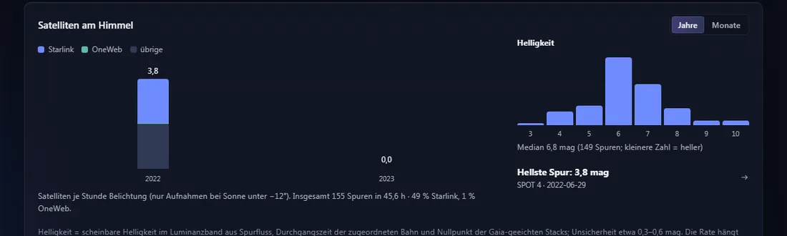

# SkyTrace – was sich zwischen den Sternen bewegt

Bildfolgen auf Lichtspuren und bewegte Objekte untersuchen und mit Satelliten, Meteoren und Flugzeugen zur Aufnahmezeit abgleichen.

[← Zurück zur Übersicht](../../README.md)

SkyTrace sucht in Bildfolgen von Smart-Teleskopen (Stellina, Seestar, Vespera) und klassischen Kameras nach Lichtspuren: Satelliten, Raketenstufen,
Flugzeuge, Meteore. Jede Spur wird als **Kandidat** erfasst – mit Ausschnitt, Zeitreihe und nachvollziehbaren Messwerten – und zur echten Aufnahmezeit mit
Katalogen verglichen. **Ein Kandidat ist ein Hinweis, kein bestätigtes Objekt**; ein Treffer im Katalog bleibt ein geometrischer Hinweis.

**Inhalt**

1. [Erkennung: Kandidaten, Ausschnitt, Zeitreihe](#erkennung-kandidaten-ausschnitt-zeitreihe)
2. [Abgleich mit Satelliten](#abgleich-mit-satelliten)
3. [Meteore, Asteroiden und Flugzeuge](#meteore-asteroiden-und-flugzeuge)
4. [3D-Erde und flache Karte](#3d-erde-und-flache-karte)
5. [Standort und Kamera-Uhr suchen](#standort-und-kamera-uhr-suchen)
6. [Lauf-Ansicht und Video](#lauf-ansicht-und-video)
7. [Automatisch nach dem Stacken](#automatisch-nach-dem-stacken)
8. [Statistik: Satellitenhelligkeit und „Satelliten am Himmel“](#statistik)
9. [Erfolge](#erfolge)
10. [Engine (PyTorch): was ohne sie geht](#engine-pytorch-was-ohne-sie-geht)
11. [Grundsätze: Originale, Datenschutz, Ehrlichkeit](#grundsätze)

## Erkennung: Kandidaten, Ausschnitt, Zeitreihe

Eine Analyse nimmt eine Bildfolge (einen Beobachtungsordner), registriert die Bilder auf die Sterne und sucht Linien, die sich von Bild zu Bild
ändern – auch kurze, schwache Spuren und kurze helle Striche. Unscharfe Aufnahmen (Wind, Wolken, verwackelt) werden ausgelassen, die Zahl steht im Kopf.
Die **Kandidaten** stehen mit Vorschau in einer Liste, gefiltert nach Objekttyp.

Das Detail zeigt die Spur als **ganzes Bild** oder **Ausschnitt**, dazu die **Zeitreihe** der Nachbaraufnahmen (Abspielen, Einzelschritte, Sprung zum
Treffer, „Im Video öffnen“). Bei verketteten Spuren über mehrere Bilder erkennt SkyTrace gleichmäßige Bewegung (z. B. Flugzeug) und ordnet sie nie als
Meteor ein, denn ein Meteor leuchtet nur in einer Aufnahme.

### Warum wurde diese Spur erkannt?

Unter jedem Kandidaten stehen die **Messdetails** in Klartext: Detektorwert samt Schwelle, Spurlänge, Qualität der Sternregistrierung, Zahl der
Trefferbilder, Sternschweif-Prüfung und eine **physikalische Vorprüfung**. Die Belichtungszeit ist nur eine Obergrenze der Leuchtdauer, die gemessene
Winkelgeschwindigkeit daher eine Untergrenze („≥ …″/s“). Entfernung und Geschwindigkeit in km/h werden nicht erfunden. Der Detektorwert ist **keine**
Wahrscheinlichkeit und keine Sigma-Signifikanz – das steht auch so da.

## Abgleich mit Satelliten

Zu jeder Spur rechnet SkyTrace nach, welche Satelliten zur **echten Aufnahmezeit** durchs Bildfeld liefen – mit historischen Bahndaten, nicht mit
aktuellen:

- **Space-Track-Spiegel** (lokales Archiv, CC-BY-4.0) wird bevorzugt,
- sonst ein zeitlich enger Abruf bei **ETH satdb** (nur die Bahnen zur Aufnahmezeit, lokal nach Standort und Bildfeld gefiltert; ETH sammelt seit
  März 2023 – fehlende Abdeckung ist kein Ausschluss),
- Namen, Raketenstufen und Trümmerteile kommen aus dem **CelesTrak-SATCAT** (ein Namenskatalog ohne Ort und Zeit, höchstens einmal je 24 Stunden;
  bei jeder Fehlermeldung des Dienstes hört SkyTrace sofort auf).

Gerechnet wird mit SGP4, der Uhrtoleranz der Kamera und dem Wissen, dass Stellina-`DATE-OBS` das **Belichtungsende** ist. Bis zu acht geprüfte Bahnen
erscheinen mit Abstand zur Spur, Abdeckung, Richtungsabweichung, Durchgangszeit und Bahnalter – auch die **abgelehnten** mit Grund. Die Bahnen liegen als
gestrichelte Prognosen direkt über deiner echten Aufnahme, Bahnen außerhalb des Bildfelds werden gekennzeichnet, nie ins Bild geschoben.

Ein Klick auf eine Satellitenbahn (3D-Erde, Karte, Liste) öffnet eine **Infokarte** mit Name, Kennung, Start, Bahn, gemessener Helligkeit, der Sicherheit
der Zuordnung und dem Ausschnitt deiner Aufnahme.

## Meteore, Asteroiden und Flugzeuge

| Quelle | Was SkyTrace tut | Was dafür nötig ist |
|---|---|---|
| Asteroiden (JPL) | Positionsabgleich nach JPL-Ephemeriden zum Belichtungsmittelpunkt, mit Zeitlimit und Cache | Internet. Übertragen werden Zeit, Himmelsposition **und der Beobachtungsstandort** (Breite, Länge, Höhe) an die JPL-Abfrage, kein Foto; Ergebnisse werden zwischengespeichert |
| Meteore (GMN, CNEOS-Feuerkugeln) | Abgleich mit Meteorbahnen und Feuerkugel-Ereignissen zur Aufnahmezeit | **Vorhandene** lokale Monatsdateien – es wird nichts weltweit heruntergeladen |
| Flugzeuge | Abgleich mit **eigenen** Flugdaten (Datei oder URL) | Eigene Flugdaten; einen automatischen Flugabgleich gibt es nicht |

Fehlen Daten, steht **„nicht prüfbar“** (z. B. „Archivdaten fehlen“) – das bedeutet nie „nichts war da“. Meteore sind im Teleskopbild nur ein Vorschlag:
ein einzelner Strich in einer Aufnahme kann auch ein Satellit sein. Flugzeuge mit Blinklichtern werden als eigene Klasse erkannt.
Alle Kataloge zeigen ihren Status unter „Katalogabgleich zur echten Aufnahmezeit“.

## 3D-Erde und flache Karte

Die **3D-Erde** zeigt Standorte, Nächte, das Blickfeld des Teleskops, Satellitenbahnen, Heatmaps der Standortsuche und die Tag/Nacht-Grenze auf einem
gemeinsamen Globus. Zoomst du nah heran (unter etwa 450 km Höhe), wird der Globus zu einer ebenen **Karte**; der Bodenpunkt eines Satelliten ist dort
ebenfalls anklickbar.

Pro Kandidat gibt es zusätzlich die **3D-Ansicht**: Erde, Teleskop, nachgeführtes Blickfeld, Satellitenbahn ±10 Minuten und der Moment, in dem sie das
Bildfeld durchquert – mit Zeitregler und Kamerafahrten (Erde, Teleskop, Durchgang, Folgen). Auch für Läufe ohne erkanntes Objekt zeigt die Lauf-Ebene,
wohin das Teleskop in der Nacht geblickt hat. (Die 3D-Erde zeigt Demodaten mit erfundenem Ort; die übrigen Bilder stammen aus echten Aufnahmen eines Smart-Teleskops, Ortsangaben sind abgeschnitten.)

## Standort und Kamera-Uhr suchen

Satellitenspuren verraten, wo und wann eine Aufnahme entstand. SkyTrace nutzt das, um falsche Angaben zu finden:

- **Standort suchen:** rechnet aus zugeordneten Spuren den wahrscheinlichsten Ort zurück – erst unter den Orten deiner Liste, mit einstellbarem Spielraum
  (±5/10/20 km), auf Wunsch auch **ohne Vorwissen** (±500 bis ±3000 km um die Listenorte). Die Heatmap zeigt, wo die Spuren zusammenlaufen.
- **Uhrversatz suchen:** ging die Kamera-Uhr falsch (bei Stellina kommt sie vom Handy), verschiebt SkyTrace den Abgleich um bis zu ±20 Minuten und sucht den
  Versatz, bei dem die meisten Spuren zu verschiedenen Satelliten passen – mit Fehlalarm-Schätzung.
- **Satelliten neu abgleichen** und **Erneut analysieren** prüfen die Spuren nach einer Orts- oder Uhrkorrektur noch einmal, auch für alle Nächte
  gemeinsam (Ansicht „Standorte aller Nächte“).

**Vorschläge werden nie automatisch übernommen** – nur auf deinen Klick. Ein Vorschlag nennt, wie viele Spuren ihn stützen und wie wahrscheinlich ein Zufall
wäre. Die Ortsliste teilt SkyTrace mit den Modulen Bilder (Himmelsqualität, Tutor) und Sage; ein hier zugewiesener Ort gilt auch dort für diese Nacht.
Plate-Solving liefert Himmelskoordinaten, keinen Ort auf der Erde.

## Lauf-Ansicht und Video

Jede Analyse hat eine **Lauf-Ansicht** mit Kennzahlen und der Vorschau: das erste scharfe Bild mit allen erkannten Spuren, beschriftet in gelber Schrift
direkt im Bild (Klasse und Mindestgeschwindigkeit), Plate-Solving-Objekte als blaue Kreise und – für den gewählten Kandidaten – die Satellitenprognosen
mit Bildnummer. Die Overlays lassen sich ein- und ausschalten.

Das **Ereignisvideo** spielt die Bildfolge mit denselben Overlays ab und springt auf Wunsch zu einem Treffer; alle Beschriftungen bleiben sternregistriert.
Weitere Reiter: Kandidaten, Beobachtungen (mehrere Bildfolgen je Lauf), Protokoll und 3D. Es gibt außerdem einen eigenständigen **Bericht** (HTML) zum
Weitergeben. Die Originalaufnahmen werden nie verändert; ein Lauf lässt sich löschen, ohne sie anzufassen.

## Automatisch nach dem Stacken

Stackt das Modul Bilder eine Nacht, übergibt es die Aufnahmen auf Wunsch automatisch an SkyTrace (Einstellungen → SkyTrace). Sie werden als Hardlinks
(sonst Kopien) gesichert, bevor hochgeladene Rohbilder gelöscht werden, und als normale Analyse in die Warteschlange gestellt; wartende Ordner erscheinen
unter „Aufträge“. Fehlt die Engine, läuft das Stacken ungestört weiter – die Analyse wird nachgeholt.

## Statistik

Die **Statistik** wertet alle gespeicherten Analysen aus: Kandidaten nach Objektart, häufigste Satelliten, Katalogabgleich je Quelle (Treffer,
„geprüft, kein Treffer“ und „nicht prüfbar“ getrennt), Uhrzeit und Monat der Kandidaten sowie die ergiebigsten Beobachtungen.

Darunter zeigt **„Satelliten am Himmel“**, wie viele Satelliten pro Stunde Belichtung durchs Bild laufen (je Standort, Jahr oder Monat, getrennt nach
Starlink, OneWeb und übrigen), und wie hell die Spuren waren: eine **scheinbare Helligkeit in mag**, gerechnet aus dem Spurfluss, der Durchgangszeit der
zugeordneten Bahn und dem Nullpunkt des Gaia-geeichten Stacks (Unsicherheit etwa 0,3–0,6 mag, keine Normhelligkeit). Das geschieht ohne Neuanalyse.

## Erfolge

60 gestufte **Erfolge** mit Fortschritt, Freischaltdatum und kleiner Animation – von „Erster Treffer“ über „Hundert am Himmel“ und Starlink-Zügen bis zu
Raketenstufen und Raumstationen im Bild. Sie werden rückwirkend aus den vorhandenen Analysen datiert; was einmal freigeschaltet ist, bleibt es. Der Ton
ist freundlich-ironisch; gezählt wird nur, was SkyTrace gespeichert hat.

## Engine (PyTorch): was ohne sie geht

Die **Analyse** selbst (Erkennung, Registrierung, Katalogabgleich) läuft in einer eigenen Engine mit OpenCV und PyTorch. AstroFlow liefert sie nicht mit;
installierst du sie unter Einstellungen per Knopf (nur CPU, rund 1 GB). Ohne Engine startet AstroFlow trotzdem, und alles andere funktioniert:

| | ohne Engine | mit Engine |
|---|---|---|
| Bilder, Sage, Heute Nacht, Observatorium | ja | ja |
| Bereits vorhandene SkyTrace-Ergebnisse ansehen, Statistik, Erfolge | ja | ja |
| 3D-Ansicht, Karte (Bahnrechnung mit `sgp4`) | ja | ja |
| **Neue Analyse**, erneute Analyse, automatische Analyse nach dem Stacken | nein | ja |

Das Erkennungsmodell (Hinweisgeber für Weitwinkel) und die Engine stehen unter AGPL-3.0-or-later; der Rest von AstroFlow unter PolyForm Noncommercial
(siehe [Lizenz](../../README.md)).

## Grundsätze

- **Originale bleiben unberührt.** Nichts wird gelöscht, verschoben oder beschrieben; Ergebnisse liegen in eigenen Ordnern.
- **Keine Fotos verlassen den Rechner.** Katalogabfragen brauchen nur Standort, UTC und Himmelskoordinaten; große Archive werden nie automatisch geladen.
- **„Nicht prüfbar“ ist nicht „nichts da“.** Fehlende Archive, Zeitlimits oder ein unsicherer Standort werden benannt.
- **Hinweis statt Behauptung.** Modellkonfidenz ist keine Identität; Meteor ist nicht Meteorit; Sichtbarkeit rechnet nur den geometrischen Horizont, ohne
  Gelände und Wetter.
